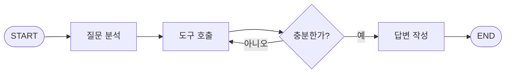
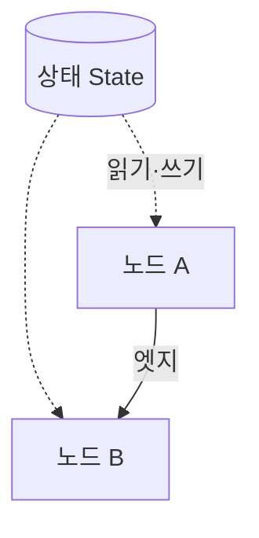

# LangGraph

> LLM 에이전트의 흐름을 **노드(작업)와 엣지(연결)로 이루어진 그래프**로 설계하는 오픈소스 오케스트레이션 프레임워크. 오래 걸리고 상태를 유지하는 에이전트를 위한 저수준 런타임이다.

## 쉽게 말하면
지하철 노선도를 생각하면 된다. 역(노드)마다 하는 일이 있고, 선로(엣지)가 다음 역을 정한다. 갈림길에서는 "지금 상태"를 보고 어느 선으로 갈지 고른다. 승객이 들고 다니는 짐 가방이 **상태**다.

## 자세히
공식 문서(LangChain docs) 기준 핵심 요소:
- **State**: 단계 사이에 전달되는 공유 데이터. 예제는 내장 `MessagesState`(대화 메시지 목록)를 쓴다.
- **Node**: 일을 하는 함수. LLM 호출일 수도, 평범한 코드일 수도 있다. 즉 정해진 단계와 LLM 판단 단계를 한 그래프에 섞는다.
- **Edge**: 흐름 제어. 고정 연결과 조건부 연결(상태를 보고 분기)이 있다.
- **영속성(persistence)**: 실패해도 이어서 실행, 오래 실행되는 에이전트 지원.
- **Human-in-the-loop**: 실행 중 사람이 상태를 보고 수정할 수 있다.
- LangGraph는 프롬프트나 전체 아키텍처를 대신 정해 주지 않는다. 오케스트레이션(흐름 제어)에 집중한다.

## 그림으로 보기



## 예시
공식 최소 예제(요지):
```python
from langgraph.graph import StateGraph, MessagesState, START, END

def mock_llm(state: MessagesState):
    return {"messages": [{"role": "ai", "content": "hello world"}]}

graph = StateGraph(MessagesState)
graph.add_node(mock_llm)
graph.add_edge(START, "mock_llm")
graph.add_edge("mock_llm", END)
graph = graph.compile()
graph.invoke({"messages": [{"role": "user", "content": "hi!"}]})
```
노드 하나를 START와 END 사이에 놓고 컴파일해 실행한다. 여기에 노드와 조건부 엣지를 늘리면 에이전트가 된다.

## 헷갈리는 것과 비교
| 개념 | 차이 |
| --- | --- |
| LangGraph | 흐름을 그래프로 명시. 상태·재개·사람 개입에 강함 |
| LangChain | 모델·도구 연결 부품 모음. LangGraph의 바탕이 되는 생태계 |
| [에이전트 루프](#agent-loop) | LangGraph에서는 루프를 "되돌아가는 엣지"로 그린다 |
| [워크플로 vs 에이전트](#workflow-vs-agent) | LangGraph는 둘 다 그래프로 표현 가능 |

## 더 읽을거리
- [LangGraph overview (공식 문서)](https://docs.langchain.com/oss/python/langgraph/overview) — 개념과 최소 예제
