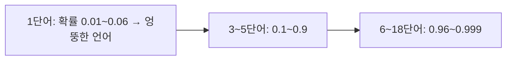
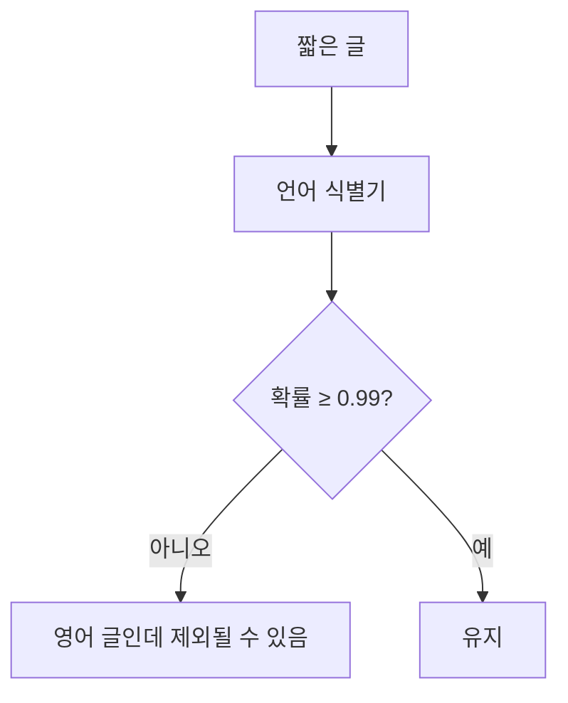

# 짧은 글 언어 식별

> 언어 식별기는 **글자·단어 패턴의 통계**로 언어를 추정하므로, 글이 짧을수록 근거가 적어 틀리거나 확신이 낮다. 짧은 영어 문장이 다른 언어로 오판되거나 "영어 확률 0.99 이상" 기준을 못 넘는 이유다.

## 쉽게 말하면
"Taxi" 한 단어만 보고 어느 나라 말인지 맞히라는 것과 같다. 여러 나라에서 같은 글자로 쓰이니 답할 수 없다. 문장이 길어질수록 단서가 늘어 확신이 높아진다.

## 자세히
- 배경: T5 논문의 C4는 langdetect로 **영어 확률 0.99 이상**인 페이지만 남긴다(2.2절). 이 문서의 실험은 **langdetect가 이 환경에서 빌드되지 않아**(설치 실패) 다른 식별기 `py3langid`(langid 계열, 정규화 확률 사용)로 했다. 도구가 달라 확률 값은 langdetect와 다르며 **현상(짧을수록 불확실)을 보여 주는 용도**다.
- 직접 실행(py3langid, `norm_probs=True`; 영어 문장 13개와 독일어 1개):
  | 문장 | 단어 수 | 예측 | 확률 |
  |---|---|---|---|
  | `Hello` | 1 | br(브르타뉴어) | 0.056 |
  | `OK` | 1 | sr | 0.014 |
  | `Taxi` | 1 | gl | 0.049 |
  | `No problem` | 2 | pl | 0.024 |
  | `Lost Password?` | 2 | en | 0.082 |
  | `Photo credit: Getty Images` | 4 | pcm(나이지리아 피진) | 0.182 |
  | `The lovely Buoy Hostel.` | 4 | en | 0.210 |
  | `Thanks a lot` | 3 | en | 0.719 |
  | `Click here to read more` | 5 | en | 0.879 |
  | `I love this phone so much!` | 6 | en | 0.960 |
  | `See you tomorrow at the airport` | 6 | en | 0.978 |
  | `The battery life is excellent and … would buy it again.` | 18 | en | **0.999** |
  | `Das ist ein kurzer Satz.`(독일어) | 5 | de | 0.998 |
- 읽는 법: **0.99 기준을 넘은 영어 문장은 13개 중 1개(18단어짜리)뿐**이었다. 한두 단어짜리는 엉뚱한 언어가 나왔고(`Hello`→브르타뉴어), 4단어도 확신이 낮았다. 반면 독일어 5단어 문장은 0.998로 확신했다 — 길이만이 아니라 **언어마다 고유한 글자 조합이 있으면 짧아도 잘 맞는다**(해석).
- C4에 대한 함의(추정): 페이지 단위로 식별하면 길이가 충분해 대체로 문제가 없지만, **줄·문장 단위로 언어를 판정**하거나 짧은 게시글·댓글 데이터에 같은 기준을 쓰면 영어 글이 대량으로 걸러진다. 또 확률 값은 식별기마다 보정(calibration) 수준이 달라 "0.99"의 의미가 다르다.
- 대응(제안): ① 최소 길이(예: 문자·단어 수) 미만은 판정하지 않고 문서의 다른 부분(주변 문단·메타 정보)으로 판단 ② 문단 단위 식별 후 가중 합산([문단 단위 언어 판정](#paragraph-level-langid)) ③ 식별기별 임계값을 표본으로 보정 ④ 짧은 글은 용도에 따라 언어 필터를 끈다.
- 한계: 이 실험은 문장 14개의 소규모 시험이며 langdetect로 재현하지 못했다.

## 그림으로 보기



## 예시
```python
l, p = ident.classify("Thanks a lot")   # ('en', 0.719) → 0.99 미만이라 C4식 필터에서는 탈락
```
- 교육: "도구가 확신하지 못하는 구간"을 시험해 보는 실습(짧은 문장·고유명사·혼합 언어).

## 헷갈리는 것과 비교
| 개념 | 차이 |
|---|---|
| 짧은 글 식별 | 근거가 적어 불확실 |
| [문단 단위 판정](#paragraph-level-langid) | 문서를 나눠 각각 판정 |
| 임계값(0.99) | 확신이 이 값 이상인 것만 사용 |

## 더 읽을거리
- [T5 논문 (arXiv 1910.10683)](https://arxiv.org/abs/1910.10683) — langdetect 0.99 영어 필터(읽음).
- [py3langid](https://github.com/adbar/py3langid) — 실험에 쓴 식별기.
- 직접 실행: py3langid로 14개 문장 시험.
