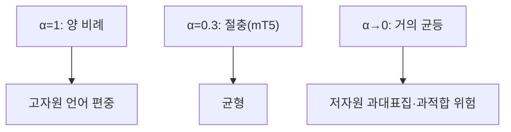

# 언어 표집 지수 α

> 다국어 모델 학습에서 언어별 데이터 양에 지수 α(보통 1 미만)를 씌워 표집 확률을 정하는 값이다. α가 작을수록 데이터가 적은 언어의 비중이 커져 고자원 언어 편중이 줄어든다.

## 쉽게 말하면
반 학생 수가 영어반 1000명, 아이슬란드어반 10명일 때 수업 시간을 인원 비례로 나누면 아이슬란드어는 거의 못 배운다. α는 "소수 언어에 시간을 얼마나 더 줄까"를 정하는 다이얼이다.

## 자세히
(mT5 논문 arXiv 2010.11934 본문을 직접 읽고 확인.)
- **공식**: p(L) ∝ |L|^α. p(L)은 사전학습 중 언어 L에서 뽑을 확률, |L|은 그 언어의 예시 수. α=1이면 양에 비례, α→0이면 거의 균등.
- **이전 연구 값**: mBERT α=0.7, XLM-R α=0.3, MMNMT α=0.2.
- **mT5의 선택**: 세 값을 모두 시험해 **α=0.3**이 고·저자원 언어 성능 사이의 "reasonable compromise"라고 판단.
- **ablation 결과(4.2절)**: α를 0.7로 올리면 고자원 언어는 좋아지고(예: 러시아어 81.5→82.8) 저자원 언어는 나빠져(일부 75.4→70.6) 평균 효과는 음의 방향. α를 0.2로 낮추면 일부 꼬리 언어가 좋아진다. (XNLI 평균 표에서 α=0.7은 80.7, α=0.2도 80.7로 기준선 81.1보다 낮음.)
- **보조 용도**: 학습 후 도메인 이동 실험 등에서는 α를 0.3→0.1로 낮춰 거의 균등 분포로 쓴 사례도 있다.
- 한국어처럼 중간 자원 언어는 α에 따라 비중이 크게 변한다(제안).

## 그림으로 보기

## 예시
- 한국어·영어·일본어 코퍼스 비율이 100:1000:300일 때 α=0.3 적용 후 비중 계산해 보기.
- 교육 활용: "공정한 데이터 배분이란?"을 지수 하나로 토론.

## 헷갈리는 것과 비교
| 개념 | 차이 |
|---|---|
| 언어 표집 지수 α | 언어 간 비율 조절(다국어) |
| [표집 비율 튜닝](#sampling-proportion-tuning) | 출처(웹·책 등) 간 비율 조절 |
| 온도(temperature) 샘플링 | 같은 수식 형태로 부르기도 함(제안) |

## 더 읽을거리
- [mT5 (arXiv 2010.11934)](https://arxiv.org/abs/2010.11934) — 3.2절 공식·α 비교.
