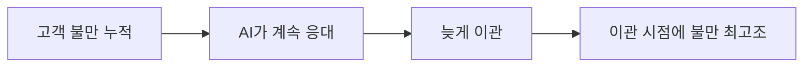
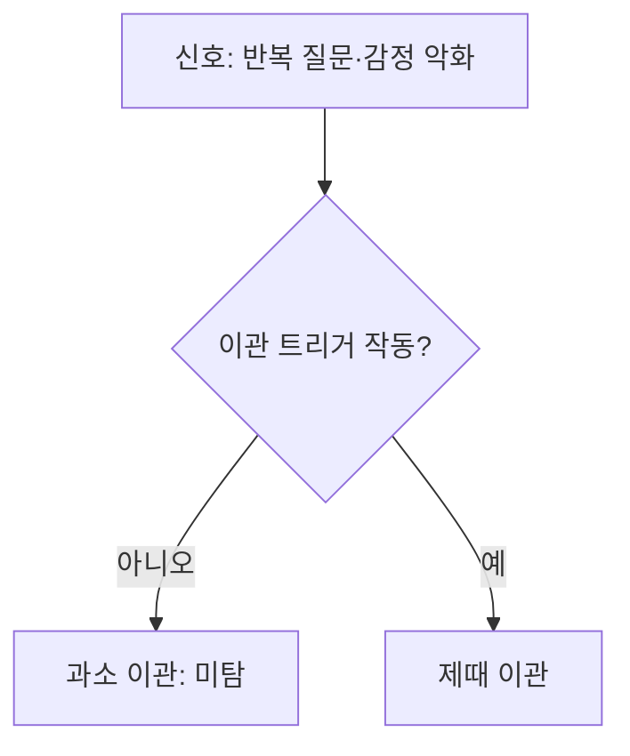

# 과소 이관

> 사람이 필요했는데 AI가 계속 처리했거나 너무 늦게 넘긴 경우다. 이관 필요를 "음성"으로 잘못 예측한 미탐(false negative)이며, 고객 불만이 쌓인 뒤에야 드러난다.

## 쉽게 말하면
환자가 계속 아프다고 하는데 접수 직원이 "약 드세요"만 되풀이하다가 한참 뒤에야 의사를 부르는 상황이다. 늦게 부른 의사 앞에서는 환자가 이미 화가 나 있다.

## 자세히
(Twig 블로그 글 기반, 벤더 글. 용어는 문맥으로 정리.)
- **정의**: 사람이 필요했는데 AI가 계속 대응하여 놓친 대화. 글은 "AI가 처리한 대화 뒤 고객이 자주 불만을 제기한다면"을 신호로 든다.
- **원인(글 기반 추론)**: 지식 공백, 과대평가된 확신도, 과거 정확도 데이터 부족, 반복 루프 같은 행동 신호를 놓침.
- **측정(글에 언급된 것)**: AI 처리 후 불만 접수 빈도, 이관 후 해결 속도·만족도, 카테고리별 이관률. 이관 시점이 최고조 불만 이전이었는지 보는 것이 핵심이다.
- **행동 신호**: 같은 질문 반복(루프), 메시지가 점점 짧아짐 등을 트리거로 쓸 수 있으나 글이 기록 여부를 명시하지는 않았다.
- **Forrester 주장**: 조기 이관이 만족도를 높인다는 정성적 주장이 링크되어 있으나 수치 근거는 제시되지 않았다.
- **연결 지표**: [무언의 이탈](#silent-abandonment)로 사라진 고객은 불만 접수도 하지 않으므로 과소 이관이 로그에 더 안 보인다.

## 그림으로 보기

## 예시
- 같은 질문을 3번 바꿔 물으면 자동 이관 트리거를 건다(제안 규칙).
- AI 단독 종료 건의 사후 설문·재접촉을 보고, 불만 접수가 많은 문의 사유를 우선 이관 대상으로 지정.

## 헷갈리는 것과 비교
| 개념 | 차이 |
|---|---|
| 과소 이관(미탐) | 필요한데 안 하거나 늦은 이관 |
| [과잉 이관](#over-escalation-false-positive) | 불필요한 이관 |
| [무언의 이탈](#silent-abandonment) | 신호 없이 떠남, 과소 이관의 결과일 수 있음 |
| [이관 후 재접촉률](#post-escalation-recontact) | 이관된 건의 사후 결과 |

## 더 읽을거리
- [Twig: AI에서 라이브 상담원으로 이관은 얼마나 매끄러운가](https://www.twig.so/blog/how-smooth-is-handoff-from-ai-to-live-agent) — 미탐 관점과 적응형 임계값(직접 열어 확인, 벤더 글).
