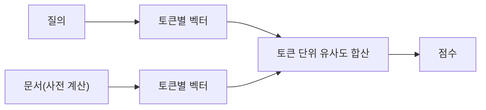
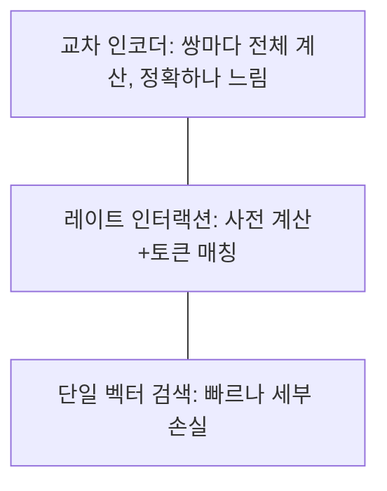

# 레이트 인터랙션

> **레이트 인터랙션(late interaction)** 은 질의와 문서를 **따로 인코딩**해 두고, 마지막에 **토큰 단위 벡터끼리 가볍게 비교**해 점수를 내는 검색 구조다. ColBERT가 대표적이다.

## 쉽게 말하면
문서 전체를 한 줄 요약(벡터 하나)으로 비교하면 세부가 날아가고, 질문-문서 쌍마다 처음부터 같이 읽으면 너무 느리다. 레이트 인터랙션은 문서를 미리 "단어별 지문"으로 만들어 두고 질문이 올 때 지문끼리 빠르게 맞춰 보는 절충이다.

## 자세히
(ColBERT, Khattab & Zaharia, SIGIR 2020 초록 확인)
- **문제**: BERT 기반 교차 인코더 랭커는 질의-문서 쌍마다 큰 네트워크를 돌려야 해 비싸다.
- **구조**: 질의와 문서를 각각 BERT로 인코딩하고, **세밀한 토큰 수준 표현**을 가벼운 단계에서 비교. 문서 표현은 **오프라인 사전 계산** 가능.
- **end-to-end 검색**: 벡터 유사도 인덱스와 함께 쓸 수 있어 후보 재정렬뿐 아니라 큰 컬렉션을 직접 검색.
- **결과**: BERT 랭커와 경쟁적인 효과, 비-BERT 기준선은 앞섰고, **약 100배 빠르고 쿼리당 FLOPs 약 1만 분의 1**.
- **연결**: [멀티모달 RAG](#multimodal-rag)의 ColPali는 페이지 이미지에서 **멀티벡터 임베딩**을 만들고 레이트 인터랙션으로 매칭한다.
- 대가(일반 지식): 문서당 여러 벡터를 저장하므로 인덱스가 커진다.

## 그림으로 보기

## 예시
- 사내 문서 수십만 건을 오프라인으로 인코딩해 두고, 질문마다 토큰 벡터 매칭으로 상위 후보를 찾는 검색 서버.

## 헷갈리는 것과 비교
| 방식 | 특징 |
|---|---|
| 교차 인코더 | 쌍을 함께 인코딩, 정확·느림 |
| 바이 인코더(단일 벡터) | 빠름, 세부 손실 |
| 레이트 인터랙션 | 멀티벡터, 중간 절충 |
| [HNSW](#hnsw) | 벡터 이웃 탐색 인덱스 |

## 더 읽을거리
- [ColBERT](https://arxiv.org/abs/2004.12832)
- [ColPali](https://arxiv.org/abs/2407.01449)
