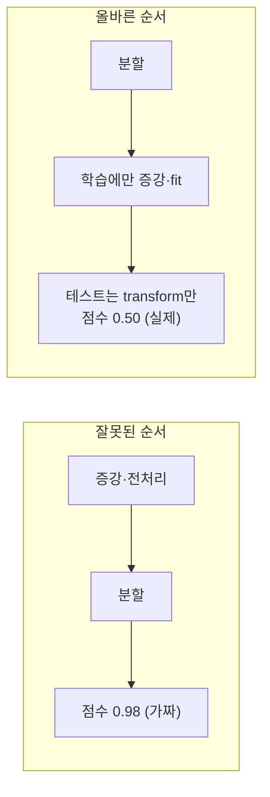
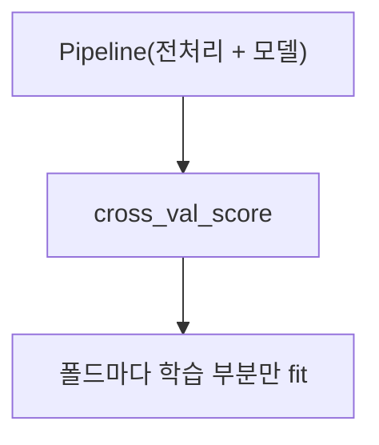

# 늦은 분할 오류

> 전처리·증강·선택 같은 **데이터를 가공하는 단계를 학습/테스트 분할보다 먼저 하는 실수**다. 테스트 정보나 같은 원본의 복제본이 학습에 스며들어 점수가 부풀려진다.

## 쉽게 말하면
시험 문제를 만든 뒤 "문제를 변형 문제 5개로 불려서" 학습지와 시험지로 나누면, 학습지에 시험 문제의 쌍둥이가 들어간다. 학생은 시험을 외운 셈이고, 점수는 실력이 아니다.

## 자세히
- **원칙(scikit-learn Common pitfalls)**: "never call `fit` on the test data". 정규화 평균도 전체가 아니라 학습 세트의 평균이어야 한다. 먼저 분할하고, `fit_transform`은 학습에만, `transform`은 테스트에. `Pipeline`을 쓰면 교차검증·튜닝에서도 이 규칙이 자동으로 지켜진다. 이 위험은 `StandardScaler`·`SimpleImputer`·`PCA` 등 거의 모든 변환에 해당한다.
- **공식 문서 실험**: 샘플 200개·무작위 특성 10,000개·무작위 정답(실제 정확도 약 0.5)에서 분할 전에 `SelectKBest(k=25)`를 적용하면 정확도 **0.76**, 분할 후 학습에만 적용하면 **0.5**, Pipeline에서도 0.5(교차검증 평균 0.43±0.05).
- **직접 실험(증강 후 분할, scikit-learn 1.9.1)**: 무작위 특성·무작위 정답 300샘플, 증강은 노이즈(σ=0.01) 복제본 5개씩. 결정 트리 정확도 — **증강 후 분할 0.980 ± 0.011**(20회), **분할 후 학습에만 증강 0.503 ± 0.058**. 정답이 무작위여서 실제 실력은 0.5인데도 늦은 분할은 0.98이 나왔다.
- **발생 지점**: ① 전체 데이터로 스케일러·인코더·결측 대치 ② 전체 데이터로 특성 선택·PCA ③ 분할 전 증강·오버샘플링(SMOTE 포함) ④ 분할 전 중복·시간 정렬 처리. 모두 "테스트 정보가 학습으로 흐름"이다.
- **점검법**: 점수가 비현실적으로 좋으면 의심. 정답을 섞은 데이터로 같은 파이프라인을 돌려 0.5 부근이 나오는지 확인(위 실험의 방식).
- **올바른 순서**: 그룹·시간 기준 분할 → 학습 세트에서만 전처리 fit·증강 → 테스트는 transform만. 같은 원본에서 나온 증강본은 항상 같은 쪽에 둔다([증강 그룹 누수](#augmentation-group-leak)).

## 그림으로 보기



## 예시
```python
from sklearn.pipeline import make_pipeline
from sklearn.preprocessing import StandardScaler
from sklearn.model_selection import cross_val_score
cross_val_score(make_pipeline(StandardScaler(), model), X, y, cv=5)  # 누수 방지
```
- 이미지 증강을 폴더 단위로 먼저 만들어 두고 나중에 무작위 분할 → 같은 사진의 변형본이 양쪽에 존재.

## 헷갈리는 것과 비교
| 개념 | 차이 |
|---|---|
| 늦은 분할 | 가공을 분할보다 먼저 함 |
| [분할 후 누수 점검](#split-leakage-audit) | 나눈 뒤 겹침을 사후 점검 |
| [층화와 누수](#stratification-vs-leakage) | 분할기 선택 문제 |
| [데이터 누수](#data-leakage) | 상위 개념 |

## 더 읽을거리
- [scikit-learn Common pitfalls — Data leakage](https://scikit-learn.org/stable/common_pitfalls.html) — fit 규칙과 SelectKBest 실험(0.76 vs 0.5).
