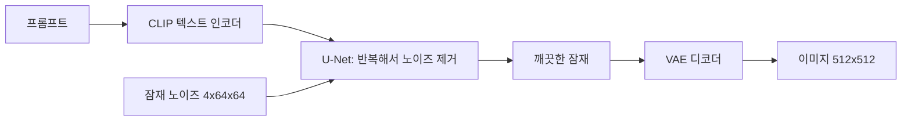
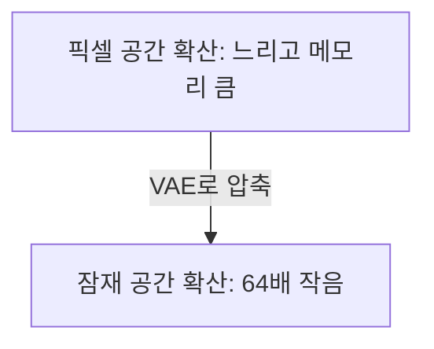

# 잠재 확산·Stable Diffusion

> 잠재 확산(latent diffusion)은 이미지를 작게 압축한 잠재 공간에서 확산(노이즈 제거) 과정을 돌려, 같은 품질을 훨씬 적은 계산으로 얻는 구조다. Stable Diffusion이 대표 사례다.

## 쉽게 말하면
큰 벽화를 그리기 전에 작은 스케치부터 다듬고, 마지막에 벽 크기로 확대해 옮기는 방식이다. 픽셀 하나하나를 지우개로 다듬는 대신 압축된 스케치에서 작업하니 빠르고 가볍다.

## 자세히
Hugging Face 블로그 설명 기준 세 부품으로 이뤄진다.
1. **VAE(오토인코더)**: 인코더가 이미지를 잠재 표현으로 압축하고, 디코더가 되돌린다. 생성할 때는 디코더만 써서 마지막 잠재를 픽셀로 바꾼다([VAE](#vae)).
2. **U-Net**: 각 단계의 노이즈를 예측해 걷어 내는 잡음 제거기. 크로스 어텐션으로 텍스트 조건을 받는다.
3. **텍스트 인코더(CLIP)**: 프롬프트를 임베딩(77×768)으로 바꿔 U-Net에 준다. Stable Diffusion은 사전학습된 CLIP 인코더를 그대로 쓴다.

- 압축 비율: 가로세로 8배 축소, 3×512×512 이미지가 4×64×64 잠재가 된다(공간 64배 압축). 그래서 512×512 생성이 일반 GPU에서 가능하다.
- 기본 원리인 노이즈 추가·제거는 [확산 모델](#diffusion-model)과 같다. 달라진 것은 작업 공간이 픽셀이 아니라 잠재라는 점이다.

## 그림으로 보기

## 예시
- "해질녘 서울 한강, 수채화" 프롬프트 → CLIP 임베딩 → 64×64 잠재 노이즈를 수십 단계 정리 → 디코더로 512×512 출력.
- 파이썬 diffusers 라이브러리의 파이프라인이 위 세 부품을 묶어 제공한다.

## 헷갈리는 것과 비교
| 개념 | 차이 |
|---|---|
| [확산 모델](#diffusion-model) | 노이즈 제거로 생성하는 일반 원리 |
| 잠재 확산 | 그 원리를 압축된 잠재 공간에서 수행 |
| [VAE](#vae) | 잠재 확산의 압축·복원 부품 |

## 더 읽을거리
- [Hugging Face: Stable Diffusion with Diffusers](https://huggingface.co/blog/stable_diffusion) — 세 부품과 텐서 크기를 코드로 설명.
