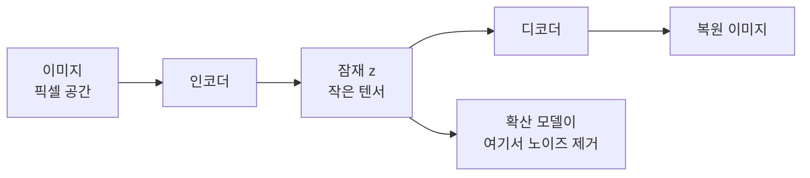
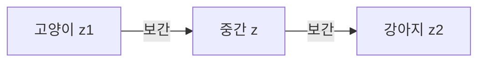

# 잠재 공간

> 잠재 공간(latent space)은 이미지·문장 같은 복잡한 데이터를 의미만 남기고 압축한 숫자 벡터들이 사는 저차원 공간이다. 확산 모델은 픽셀 대신 이 공간에서 작업한다.

## 쉽게 말하면
도시의 모든 건물을 사진으로 저장하는 대신 "위도·경도·높이" 같은 몇 개의 좌표로 적어 두는 것과 비슷하다. 좌표만 있으면 건물을 다시 그릴 수 있고, 좌표가 가까우면 비슷한 건물이다. 잠재 공간은 이런 "의미 좌표"가 모인 지도다.

## 자세히
- 인코더가 데이터를 잠재 벡터 `z`로 압축하고, 디코더가 `z`에서 데이터를 복원한다.
- Stable Diffusion 계열 VAE(HF diffusers `AutoencoderKL`, v0.42.1 문서)는 `latent_channels=4`가 기본이고, 인코더 출력은 평균·로그분산을 가진 가우시안 분포에서 샘플링한다.
- 학습 때 잠재의 표준편차를 맞추려고 `scaling_factor`(기본 0.18215)를 곱한 뒤 확산 모델에 넣고, 디코딩 때 되돌린다.
- 비슷한 입력은 가까운 잠재로 간다. 그래서 두 잠재를 섞거나(보간) 방향을 따라 이동하면 의미가 부드럽게 바뀌는 것이 VAE 계열 잠재 공간의 매력이다(추론에 가까운 설명이며, KL 손실이 이를 돕는다: [KL 손실](#vae-kl-loss)).
- 장점: 연산량이 줄어 고해상도 생성이 가능. 단점: 압축 과정에서 세부(작은 글자 등)가 손실될 수 있다.

## 그림으로 보기



## 예시
```python
z = vae.encode(img).latent_dist.sample() * vae.config.scaling_factor
z_mix = 0.5*z1 + 0.5*z2   # 두 이미지의 잠재를 섞어 중간 이미지 만들기(개념 예시)
```

## 헷갈리는 것과 비교
| 개념 | 차이 |
|---|---|
| 잠재 공간 | 압축된 의미 표현 공간 |
| 임베딩 | 비슷한 개념(의미 벡터). 목적에 따라 텍스트 검색용 등 |
| [VAE](#vae-latent) | 잠재 공간을 만드는 인코더·디코더 |
| 픽셀 공간 | 원본 그대로, 계산량 큼 |

## 더 읽을거리
- [HF AutoencoderKL 문서](https://huggingface.co/docs/diffusers/api/models/autoencoderkl) — latent_channels, scaling_factor.
- [Lilian Weng, From Autoencoder to Beta-VAE](https://lilianweng.github.io/posts/2018-08-12-vae/) — 잠재 분포와 VAE 설명.
