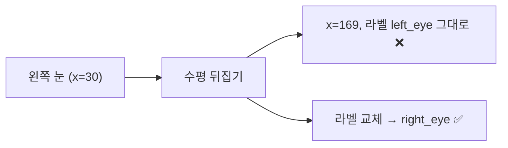
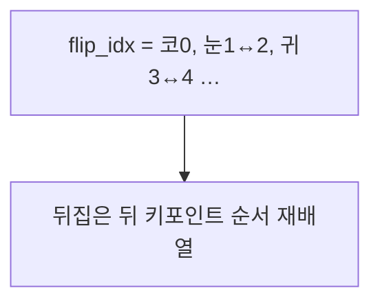

# 좌우 라벨 동반 반전

> 이미지를 좌우로 뒤집을 때 **라벨 이름에 들어 있는 왼쪽/오른쪽(L/R)도 서로 바꿔 주는** 처리다. 위치(좌표)만 뒤집고 이름을 그대로 두면 "왼쪽 눈"이라는 라벨이 오른쪽에 붙는다.

## 쉽게 말하면
사진 속 "왼쪽 신발"과 "오른쪽 신발"에 이름표를 붙였다고 하자. 사진을 거울처럼 뒤집으면 왼쪽 신발이 오른쪽으로 가는데 이름표는 그대로다. 이름표도 맞바꿔야 한다.

## 자세히
- 직접 실행(Albumentations 2.0.8, 200×100 이미지, `HorizontalFlip(p=1)`):
  - 박스 `left_lung [20,30,80,90]`, `right_lung [120,30,180,90]` → 뒤집은 뒤 좌표는 `[120,30,180,90]`, `[20,30,80,90]`로 **위치만 맞바뀌고 라벨 문자열은 `['left_lung','right_lung']` 그대로**였다. 즉 `left_lung` 라벨이 오른쪽 박스에 붙는다. 라벨을 사전으로 맞바꾸면(`{'left_lung':'right_lung', …}`) `['right_lung','left_lung']`로 정상화된다.
  - 키포인트 `left_eye (30,50)`, `right_eye (170,50)`, `nose (100,20)` → 좌표는 `(169,50)`, `(29,50)`, `(99,20)`으로 뒤집히지만(x'=W−1−x) 이름은 그대로. 라이브러리가 이름의 좌우를 알아서 바꾸지 않는다.
- 사례(Ultralytics 문서에서 읽음): 포즈 데이터셋 설정의 `flip_idx`는 "각 키포인트를 거울쌍으로 대응시켜 수평 뒤집기에서도 좌우가 일관되게 한다". COCO8-pose의 값은 `[0, 2, 1, 4, 3, 6, 5, 8, 7, 10, 9, 12, 11, 14, 13, 16, 15]` — 코(0)는 그대로, 눈(1↔2)·귀(3↔4)·어깨(5↔6)·팔꿈치·손목·엉덩이·무릎·발목이 쌍으로 교체된다. 5점 얼굴 예시는 `[1, 0, 2, 4, 3]`.
- 확인할 곳(제안): ① 클래스명에 left/right/L/R이 들어간 데이터(장기·사지·치아 번호 등) ② 포즈·키포인트 ③ 텍스트 캡션의 "왼쪽/오른쪽"([조용한 데이터 버그](#silent-data-bugs): 오류 없이 지나간다).
- 주의: 의료 영상의 좌우는 "환자 기준"과 "화면 기준"이 반대인 관례가 있어(흉부 X선은 환자의 오른쪽이 화면 왼쪽에 표시) 이름이 어느 기준인지 확인한다. 또 영상의 L/R 표식 글자까지 뒤집히면 글자가 거울상이 되므로 표식은 별도 처리가 필요하다(일반적 지적, 이 실험에서 확인하지 않음).
- 가장 안전한 방법은 **좌우가 의미 있는 과제에서는 뒤집기를 쓰지 않는 것**이다([우심증과 증강](#dextrocardia-augmentation)).

## 그림으로 보기



## 예시
```python
swap = {'left_lung': 'right_lung', 'right_lung': 'left_lung'}
labels = [swap[n] for n in r['n']]   # 뒤집기를 적용한 경우에만
```
- 교육: "거울 반전은 좌표만 바꾸는 일이 아니다"를 가르치는 사례.

## 헷갈리는 것과 비교
| 개념 | 차이 |
|---|---|
| 좌표 반전 | 위치(x)를 W−1−x로 변환 |
| 라벨 동반 반전 | 이름 속 좌우 의미까지 교체 |
| flip_idx | 키포인트 순서에서 좌우 쌍을 정의 |
| [우심증과 증강](#dextrocardia-augmentation) | 좌우가 곧 진단일 때의 문제 |

## 더 읽을거리
- [Ultralytics: Pose 데이터셋](https://docs.ultralytics.com/datasets/pose/) — `flip_idx` 설명(읽음).
- 직접 실행: Albumentations 2.0.8 수평 뒤집기 박스·키포인트 실험.
