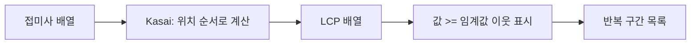
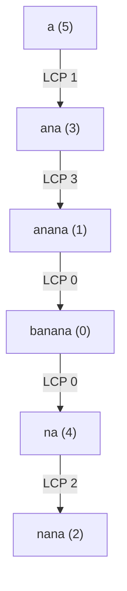

# LCP 배열

> 접미사 배열에서 **바로 이웃한 두 접미사가 앞에서부터 몇 글자까지 같은지**를 적은 배열이다. 접미사 배열이 "반복이 어디 있나"를 모아 주면, LCP 배열은 "얼마나 길게 반복되나"를 알려 준다.

## 쉽게 말하면
가나다순으로 늘어놓은 찾아보기에서 옆 줄과 첫 몇 글자가 같은지를 줄마다 숫자로 적어 둔 것이다. 숫자가 큰 줄 근처에는 똑같은 구절이 있다. 숫자만 쭉 훑으면 반복 구절을 찾는다.

## 자세히
- "banana"의 접미사 배열은 [5,3,1,0,4,2], LCP 배열은 [1,3,0,0,2]다(직접 실행). 최댓값 3은 "ana" 반복.
- **순진한 계산**은 이웃 쌍마다 처음부터 비교해 최악에 n²에 가깝다. **Kasai 알고리즘**(2001)은 텍스트 위치 순서로 계산하며 "다음 위치의 LCP ≥ 이전 위치 LCP − 1"이라는 성질로 이미 같은 만큼은 건너뛴다. 총 문자 비교가 최대 2n번, 즉 선형 시간이다(Gog·Ohlebusch 논문 ar5iv에서 확인).
- **메모리**: Kasai는 문자열·SA·역SA(ISA)·LCP를 들고 있어 4바이트 정수 기준 약 13n바이트, 접근 위치가 흩어져 캐시 미스가 많다. Manzini 변형은 9n바이트(5~10% 느려짐), Kärkkäinen 등의 PLCP 방식은 약 5n바이트이며 더 빠르다(같은 논문).
- **직접 실행**(Python, 이진 문자 8000자, 3000자 구간을 앞뒤에 복사): 순진한 방식과 Kasai 결과가 완전히 같았고, 가장 긴 공통 접두사는 2001. 시간은 순진한 방식 0.20초 vs Kasai 약 0.00초(작은 입력의 1회 측정이라 절대값보다 선형 알고리즘이 훨씬 빠르다는 방향만 본다). 최대 LCP 위치의 두 접미사가 5999번과 499번으로, 복사해 넣은 두 구간이 정확히 잡혔다.
- **쓰임**: 정확 부분문자열 중복 제거에서 LCP ≥ 임계값(예: 50토큰)인 이웃을 표시하면 반복 구간 목록이 나온다. 가장 긴 반복 부분 문자열, 서로 다른 부분 문자열 수 세기에도 쓰인다.

## 그림으로 보기

## 예시
- 학습 말뭉치 접미사 배열 위에서 LCP ≥ 50토큰인 쌍을 훑어 중복 문서·문단 구간을 지운다.
- 교육: 짧은 단어로 손으로 접미사를 정렬하고 LCP를 채워 보게 한다.

## 헷갈리는 것과 비교
| 개념 | 차이 |
|---|---|
| [접미사 배열](#suffix-array) | 정렬된 시작 위치. LCP의 재료 |
| LCP 배열 | 이웃 접미사의 공통 길이 |
| [정확 부분문자열 중복 제거](#exact-substring-dedup) | LCP를 쓰는 응용 |
| [MinHash](#minhash) | 근사 유사도. LCP는 정확 일치 |

## 더 읽을거리
- [Lightweight LCP-Array Construction in Linear Time](https://ar5iv.labs.arxiv.org/html/1012.4263) — Kasai, Manzini, PLCP 비교(열어 확인).
