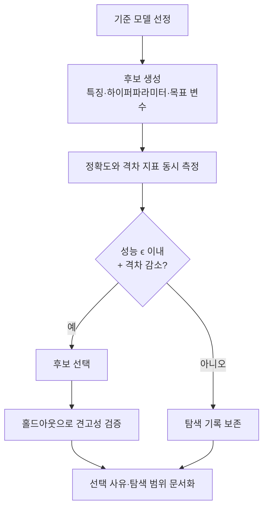

# LDA 탐색 절차

> 기존 모델보다 격차가 작으면서 성능은 비슷한 모델([덜 차별적 대안](#less-discriminatory-alternative))을 **체계적으로 찾고 기록하는 과정**: 후보 생성 → 성능·격차 비교 → 선택 → 문서화.

## 쉽게 말하면
이사할 집을 고를 때 한 곳만 보고 계약하지 않고, 비슷한 값의 매물을 여러 곳 비교한 뒤 비교표를 남기는 것과 같다. 탐색을 했다는 기록이 곧 "합리적으로 찾아봤다"는 증거가 된다.

## 자세히
출처: Black 외 arXiv 2406.06817 v1(FAccT 2024 요약판, HTML 본문 확인, 2026-11-18). 탐색의 효과 수치는 논문에 거의 없고 사례 서술 위주다.
- **후보 만들기**: 특징 집합, 결측치 대체, 하이퍼파라미터 등 파이프라인 전 단계의 선택지를 넓혀 모델 묶음을 만든다.
- **비교**: 정확도가 비슷한 모델 중 선택률 격차가 가장 작은 모델을 고른다. 논문은 하이퍼파라미터 튜닝에 격차 지표를 추가하는 것을 "사실상 사소한 변경"으로 소개하며 탐색 자동화 방법으로 든다.
- **목표 변수 재구성**: 데이터를 새로 모으지 않고 기존 데이터로 목표 변수를 바꾼다. IRS 세무 감사 사례에서 이진 대신 연속형 목표를 쓰자 차별 영향이 줄었다는 서술(Black 외 2022 인용).
- **범위 좁히기**: 비용을 줄이려고 현재 쓰는 모델 유형, 기준 모델과 학습 요구가 비슷한 유형, 모범 사례 유형으로 한정할 수 있다.
- **견고성 검증**: 격차 감소가 새 데이터에도 유지되는지 교차검증이나 별도 홀드아웃으로 확인한다.
- **Upstart 모니터십 사례(논문 서술)**: 독립 모니터가 입력 특징의 부분집합을 모두 탐색하고 튜닝을 병행해 여러 실행 가능한 LDA를 찾았다. 성능 비교에는 예측 불확실성 구간을 ϵ 범위로 썼다. 회사는 정확도 훼손을 이유로 권고안 채택을 거부해 합의에 이르지 못했다.
- **한계**: 오류 재배분의 기술적 한계, 어떤 개입이 효과적일지 미리 알기 어려움, 탐색 자원 부담이 논문이 꼽은 어려움이다.

## 그림으로 보기


## 예시
```python
# 격차 지표를 튜닝 목적에 넣는 간단한 스케치(개념 예시)
best = None
for params in grid:
    m = fit(params, X_tr, y_tr)
    auc = roc_auc(y_va, m.predict_proba(X_va))
    gap = rate_gap(m.predict(X_va), group_va)      # 집단 선발률 격차
    if auc >= base_auc - eps and (best is None or gap < best.gap):
        best = Result(m, auc, gap)
```
교육 활용: 금융·HR 직무 교육에서 "모델을 하나 고르기 전에 비교표를 남긴다"를 팀 규칙으로 연습한다.

## 헷갈리는 것과 비교
| 개념 | 차이 |
|---|---|
| LDA 탐색 절차 | 대안을 찾는 작업 흐름 |
| [모델 다중성](#model-multiplicity) | 대안이 존재할 수 있다는 현상 |
| [공정성 제약 학습](#fairness-constrained-training) | 학습 단계에서 격차를 직접 제한하는 방법 |
| 하이퍼파라미터 튜닝 | 성능만 최적화, LDA 탐색은 격차도 함께 |

## 더 읽을거리
- [arXiv 2406.06817](https://arxiv.org/html/2406.06817v1) — 탐색 방법과 Upstart 사례(요약판)
