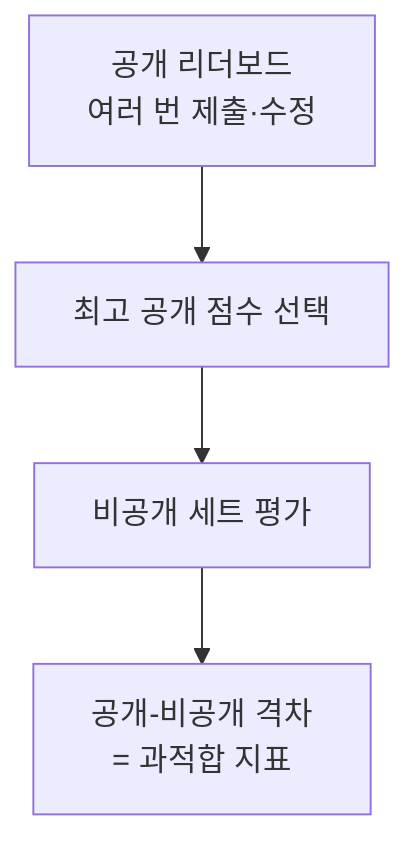
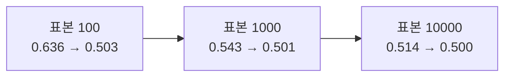

# 리더보드 과적합

> 같은 평가 세트(공개 리더보드)에 점수를 여러 번 확인하며 모델을 고치면, 그 평가 세트에 맞춰 순위가 오른 것일 수 있다. 평가 세트가 작고 제출 횟수가 많을수록 위험하다.

## 쉽게 말하면
시험 답안을 200번 제출해 보고 가장 높은 점수가 나온 답안을 고르면, 실력이 아니라 운이 좋았던 답안을 고른 것이다. 진짜 시험(비공개)에서 같은 점수가 나온다는 보장이 없다. 시험 문제가 적을수록 이 운의 폭이 크다.

## 자세히
- **구조**: Kaggle은 제출물을 공개 분할과 비공개 분할 모두에서 채점하고, 대회 중에는 공개 분할 점수만 보여 준다. 마지막에 비공개 점수로 순위가 정해진다(Roelofs 외, NeurIPS 2019 메타분석 검색 요약, 열람 한계 있음). 두 점수의 차이가 적응적 과적합의 지표다.
- **직접 해 본 시뮬레이션(순수 무작위 이진 예측 200개를 제출, 공개 표본 n과 비공개 표본 같은 크기, 200번 반복)**: 공개 표본 n=100에서 최고 공개 점수의 평균은 0.636, 같은 예측의 비공개 점수는 0.503이었다. n=1,000에서는 0.543 대 0.501, n=10,000에서는 0.514 대 0.500이었다. 실력이 전혀 없어도 표본이 작으면 최고 점수가 0.64까지 올라가고, 표본이 100배 커지면 0.514로 줄었다. 이 설정은 가장 나쁜 경우(제출이 모두 독립적인 무작위)를 보여 준다.
- **현실의 증거**: 위 메타분석은 Kaggle 100여 개 대회에서 시험 세트를 반복 확인해도 "상당한 과적합의 증거가 적다"고 보고했고, 홀드아웃 방식이 여러 분야에서 견고하다는 결론을 냈다(NeurIPS 논문 페이지, 열람). 그러나 이는 분류 대회 중심이고, 평가 세트가 큰 경우였다는 한계가 제기됐다(검색 결과의 리뷰 요약, 직접 확인 못 함).
- **적용(해석)**: ① 평가 세트가 작거나 제출·튜닝 횟수가 많으면 공개 점수의 소수점 차이를 믿지 않는다 ② 공개 점수와 별도의 비공개 세트를 모두 유지한다 ③ 점수 차가 표준오차 안이면 동률로 본다([동률일 때 고르는 기준](#tie-break-criteria)) ④ 시험 세트는 한 번만 본다([최종 테스트 세트 확인](#final-test-set-confirmation)).

## 그림으로 보기

## 예시
- 공개 100건짜리 사내 평가 세트로 프롬프트를 50번 고쳐 정답률 82%가 나왔다면, 새 문제 100건으로 다시 재서 확인한다.
- 교육 활용: 무작위 예측을 200개 만들어 "아무 실력이 없어도 최고 점수가 60%를 넘는다"를 보여 준다.

## 헷갈리는 것과 비교
| 개념 | 차이 |
| --- | --- |
| 리더보드 과적합 | 공개 세트에 맞춘 순위 상승 |
| 일반 과적합 | 학습 데이터에 맞춰 일반화 실패 |
| [테스트 세트 재사용 위험](#test-set-reuse-risk) | 같은 현상, 자기 프로젝트 관점 |
| [최종 테스트 세트 확인](#final-test-set-confirmation) | 방지 절차 |

## 더 읽을거리
- [A Meta-Analysis of Overfitting in Machine Learning (NeurIPS 2019)](https://papers.nips.cc/paper/9117-a-meta-analysis-of-overfitting-in-machine-learning) — Kaggle 100여 개 대회 분석, 큰 과적합은 드물다는 결론
