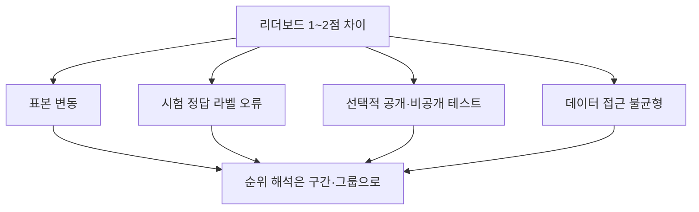
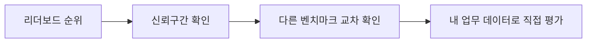

# 리더보드 작은 점수 차

> AI 모델 리더보드에서 1~2점 차이로 순위가 갈릴 때, 그 차이는 표본 변동·시험 정답 오류·선택적 공개 같은 요인에 가려질 수 있어 우열의 근거로 삼기 어렵다는 주의점이다.

## 쉽게 말하면
올림픽 100m에서 0.001초 차이로 금메달이 갈려도 측정기 오차가 그만큼이라면 "누가 더 빠른가"는 불확실하다. 리더보드도 순위 숫자만 보지 말고 오차 범위와 측정 조건을 같이 봐야 한다.

## 자세히
(arXiv 초록 3건을 직접 열어 확인하고, 표본 변동은 직접 시뮬레이션한 결과를 참조.)
- **표본 변동**: 정확도 85% 모델의 시험 문항 100개 기준 표준오차는 약 3.6%p, 진짜 2%p 차이 두 모델이 독립 시험셋에서 순위가 뒤집힐 확률은 n=100에서 0.388, n=1,000에서 0.124(직접 시뮬레이션, [작은 시험셋의 변동](#small-test-set-variance)).
- **시험 정답 오류**: 대표 벤치마크 10개 시험 세트에 평균 최소 3.3%의 라벨 오류가 있고, 오류 비율이 약 5~6%p 늘면 ResNet-18이 ResNet-50을, VGG-11이 VGG-19를 앞지르기도 했다(arXiv 2103.14749 초록 확인; [벤치마크 라벨 노이즈](#label-noise-benchmarks)).
- **사람 선호 리더보드의 통계(Chatbot Arena, arXiv 2403.04132)**: 몇 달간 **24만 표 이상**을 모아 쌍대 비교로 순위를 매기며, 크라우드 투표가 전문가 평가자와 "잘 일치한다"고 주장(초록). 순위는 투표 수가 늘수록 안정되지만 접전인 모델 간에는 구간이 겹친다(제안).
- **구조적 문제(The Leaderboard Illusion, arXiv 2504.20879 초록)**: ① 일부 제공자가 출시 전 **여러 변형을 비공개로 테스트**하고 마음에 안 드는 점수는 철회해, 공개된 점수가 편향됨(메타의 비공개 변형 27개 사례) ② **데이터 접근 불균형**: 폐쇄형 모델이 더 자주 샘플링되고 덜 퇴출되며, 구글과 오픈AI가 약 19.2%·20.4%의 데이터를, 오픈 가중치 모델 83개가 합쳐 약 29.7%를 받았다고 추정 ③ 소량의 추가 데이터가 분포 내에서 큰 상대 이득(보수적 추정 최대 112%) ④ 결과적으로 일반 품질이 아닌 Arena 특유의 역학에 맞춰 튜닝. 저자들은 평가 체계 개선 권고. (이 논문의 주장이며 해당 주제는 논쟁 중일 수 있다.)
- **읽는 법(제안)**: ① 점수 옆 신뢰구간·표본 수 확인 ② 순위가 아닌 "통계적으로 구분되는 그룹"으로 해석 ③ 여러 벤치마크·자체 평가셋으로 교차 확인 ④ 내 업무 데이터로 직접 평가(작은 평가셋이라도 [윌슨 구간](#wilson-interval) 포함) ⑤ 비용·지연·보안 요건 병행.

## 그림으로 보기

## 예시
- 모델 A 71.3점, 모델 B 70.5점: 시험 세트 크기와 신뢰구간을 확인하고, 겹치면 가격·속도·보안 요건으로 고른 뒤 자사 질문 100~300개로 직접 비교한다.
- 교육 활용: "벤치마크 점수를 비판적으로 읽는 법" — AI 도입 의사결정 교육의 핵심 항목.

## 헷갈리는 것과 비교
| 개념 | 차이 |
|---|---|
| 점수 차이 | 숫자로 보이는 차이 |
| 통계적 유의성 | 우연을 넘어서는 차이인지 |
| [벤치마크 오염](#benchmark-contamination) | 시험 문제가 학습에 들어감 |
| [벤치마크 라벨 노이즈](#label-noise-benchmarks) | 시험 정답 오류 |

## 더 읽을거리
- [Chatbot Arena (arXiv 2403.04132)](https://arxiv.org/abs/2403.04132) — 24만 표·쌍대 비교(초록 확인).
- [The Leaderboard Illusion (arXiv 2504.20879)](https://arxiv.org/abs/2504.20879) — 선택적 공개·데이터 불균형(초록 확인).
- [Pervasive Label Errors in Test Sets (arXiv 2103.14749)](https://arxiv.org/abs/2103.14749) — 시험 라벨 오류(초록 확인).
