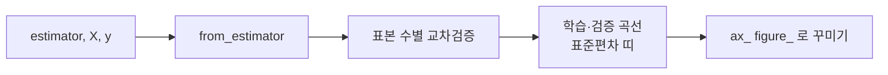
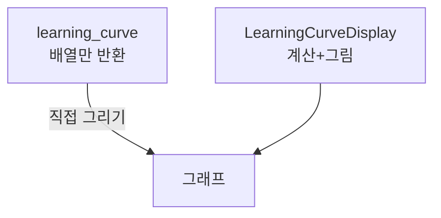

# LearningCurveDisplay

> LearningCurveDisplay는 scikit-learn의 시각화 클래스로, 교차검증을 돌려 학습 표본 수에 따른 학습·검증 점수 곡선을 한 줄로 그려 준다. scikit-learn 1.2에서 추가됐다.

## 쉽게 말하면
예전에는 점수를 계산해 배열로 받은 뒤 그래프를 손으로 그렸다. 이 도구는 "이 모델과 데이터로 곡선 그려 줘" 한 줄이면 계산과 그림을 한꺼번에 해 주는 자동 그래프 기계다.

## 자세히
- **사용법(공식 API 문서, 열람)**: `LearningCurveDisplay.from_estimator(estimator, X, y)`가 교차검증과 그리기를 함께 한다. 이미 계산한 `train_sizes`, `train_scores`, `test_scores`가 있으면 생성자에 넣어 그림만 만들 수 있다.
- **주요 인자**: `train_sizes`(기본 `np.linspace(0.1, 1.0, 5)`, 실수면 비율·정수면 절대 표본 수), `cv`(None이면 5겹, 분류기는 `StratifiedKFold`·섞기 없음), `score_type`("train"·"test"·"both", 기본 both), `std_display_style`("fill_between"·"errorbar"·None), `line_kw`(선 모양).
- **직접 확인한 것**: scikit-learn 1.9.1에서 `inspect.signature`로 확인한 `from_estimator`에는 `shuffle=False`, `random_state=None`, `score_type='both'`, `std_display_style='fill_between'`, `negate_score=False`, `n_jobs=None` 등이 있었다. 이 환경에는 matplotlib가 없어 실제 그림은 그리지 않았다.
- **속성**: 그린 뒤 `ax_`, `figure_`, `lines_`(평균선), `fill_between_`(표준편차 띠)로 그림을 더 꾸민다.
- **함정(해석)**: 데이터가 클래스별로 정렬돼 있으면 섞기 없는 분할은 왜곡될 수 있어 `shuffle=True, random_state=0`을 준다. 곡선 해석은 [데이터를 더 모을 가치 판단](#data-more-worth)을 따른다.
- **오류 점수**: 손실 지표(예: `neg_mean_squared_error`)는 `negate_score=True`로 부호를 뒤집어 보기 좋게 그린다.

## 그림으로 보기



## 예시
```python
from sklearn.datasets import load_digits
from sklearn.linear_model import LogisticRegression
from sklearn.model_selection import LearningCurveDisplay
X, y = load_digits(return_X_y=True)
LearningCurveDisplay.from_estimator(
    LogisticRegression(max_iter=2000), X, y,
    train_sizes=[0.1, 0.3, 0.6, 1.0], cv=5, shuffle=True, random_state=0)
```
교육 활용: 학습자가 모델만 바꿔 같은 코드를 돌려 곡선 모양을 비교한다.

## 헷갈리는 것과 비교
| 개념 | 차이 |
| --- | --- |
| LearningCurveDisplay | 표본 수 곡선을 그림까지 |
| [ValidationCurveDisplay](#validation-curve-display) | 하이퍼파라미터 곡선을 그림까지 |
| [학습 곡선](#learning-curve) | 개념과 함수 `learning_curve` |
| [검증 곡선](#validation-curve) | 개념 |

## 더 읽을거리
- [scikit-learn: LearningCurveDisplay](https://scikit-learn.org/stable/modules/generated/sklearn.model_selection.LearningCurveDisplay.html) — 인자와 속성
- [scikit-learn: Learning curve](https://scikit-learn.org/stable/modules/learning_curve.html) — 곡선 해석
