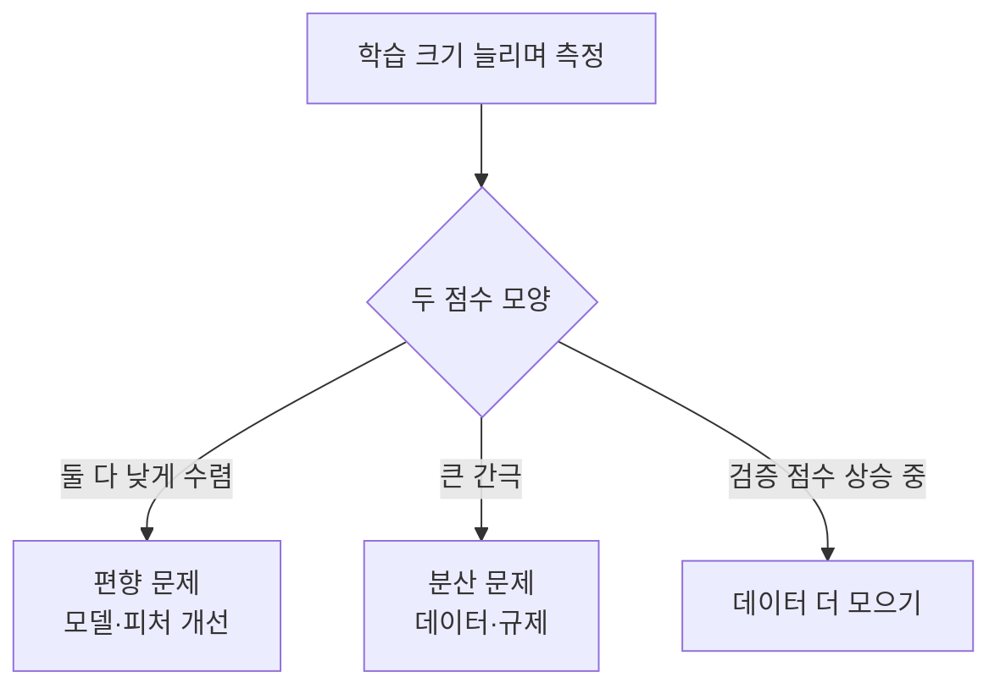
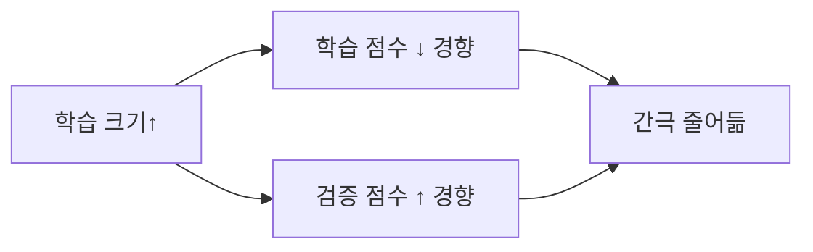

# 학습 곡선

> **학습 데이터 양을 늘려 가며 학습 점수와 검증 점수를 그린 그래프**다. 데이터를 더 모으면 이득이 있는지, 문제가 편향(bias)인지 분산(variance)인지 가늠하는 진단 도구다.

## 쉽게 말하면
공부 시간을 1시간, 3시간, 6시간으로 늘려 가며 모의고사 점수를 재는 것이다. 점수가 계속 오르면 더 공부할 가치가 있고, 어느 시점부터 평평하면 공부량 말고 공부법(모델)을 바꿔야 한다.

## 자세히
- **정의(scikit-learn 가이드)**: 학습 크기별 학습·검증 점수를 그려 "추가 데이터가 도움이 되는지, 편향 오류가 큰지 분산 오류가 큰지" 알아내는 도구.
- **읽는 법**
  - 두 점수가 *낮은 값에 수렴* → 과소적합(편향). 가이드의 나이브 베이즈 예: 더 모아도 이득이 적다.
  - 학습 점수는 높고 검증 점수가 낮은 큰 *간극* → 과적합(분산). 가이드의 SVM 예: 샘플을 더 넣으면 일반화가 좋아질 가능성이 크다.
  - 검증 점수가 최대 학습 크기에서도 계속 오르는 중 → 데이터가 더 있으면 유리.
- **직접 실험(scikit-learn 1.9.1, digits 데이터 5-폴드, 학습 크기 143/431/862/1437)**: 로지스틱 회귀 검증 점수 0.888→0.904→0.916→0.915(거의 수렴, 학습 1.0). 결정 트리 검증 0.610→0.729→0.768→0.786(아직 오르는 중, 학습 1.0). 같은 데이터라도 모델에 따라 "더 모으면 이득"의 정도가 다르다.
- **함수**: `learning_curve(estimator, X, y, train_sizes=[...], cv=5)`는 크기 배열, 학습 점수, 검증 점수를 돌려준다. 그림만 필요하면 `LearningCurveDisplay.from_estimator`.
- **검증 곡선과 차이**: `validation_curve`는 하이퍼파라미터를 바꾸고 데이터는 고정, `learning_curve`는 데이터 양을 바꾸고 모델은 고정.
- 가이드 조건부 조언: 진짜 함수가 낮은 분산의 추정기로 근사하기엔 너무 복잡할 때만 데이터를 더 모은다.

## 그림으로 보기



## 예시
```python
from sklearn.model_selection import learning_curve
sizes, tr, va = learning_curve(model, X, y, cv=5, train_sizes=[0.1,0.3,0.6,1.0])
print(tr.mean(1), va.mean(1))
```
- 라벨링 예산을 쓰기 전에: 검증 점수가 평평하면 라벨을 더 사지 않고 모델·피처를 바꾼다.

## 헷갈리는 것과 비교
| 개념 | 가로축 | 목적 |
|---|---|---|
| 학습 곡선 | 학습 데이터 양 | 데이터 추가 효과, 편향/분산 |
| 검증 곡선 | 하이퍼파라미터 값 | 최적 설정·과적합 구간 |
| 에포크별 손실 그래프 | 학습 반복 횟수 | 수렴·조기 종료 |
| [교차검증 편향-분산](#cv-variance-bias-tradeoff) | 폴드 수 k | 추정치 신뢰도 |

## 더 읽을거리
- [scikit-learn: 검증 곡선과 학습 곡선](https://scikit-learn.org/stable/modules/learning_curve.html) — 정의, 해석 예, API.
