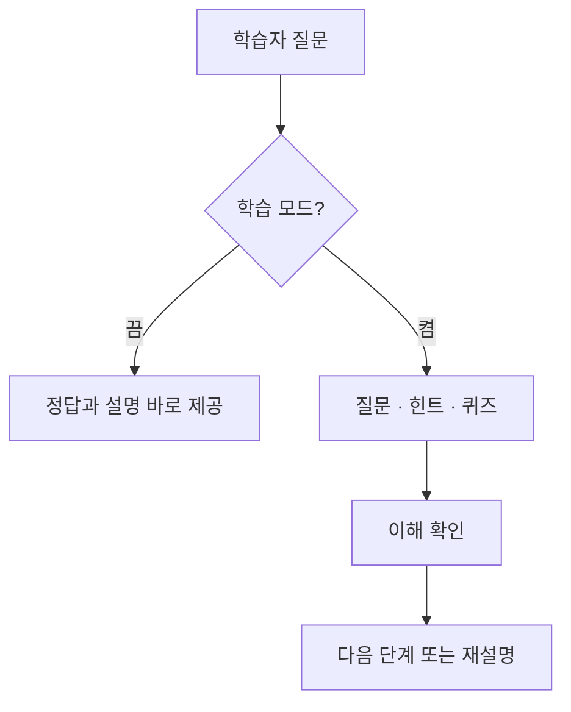
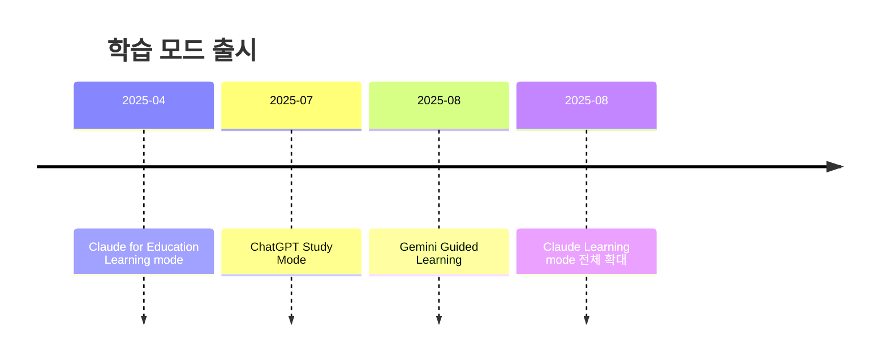

# 학습 모드 제품 비교

> 학습 모드는 챗봇이 정답을 바로 주는 대신 질문·힌트·퀴즈로 학습자를 끌고 가도록 만든 제품 설정으로, ChatGPT Study Mode, Gemini Guided Learning, Claude Learning mode가 대표적이다.

## 쉽게 말하면
같은 선생님이 "정답 알려 주는 모드"와 "옆에서 질문만 던지는 코치 모드"를 오가는 스위치를 단 것이다. 세 회사가 2025년 여름 거의 동시에 이 스위치를 내놨다.

## 자세히
(2차 비교 글 기준, 기능은 자주 바뀌므로 확인 필요)
- **Claude Learning mode**: Claude for Education으로 2025-04 먼저 공개, 2025-08-14 전체 사용자로 확대. Projects와 함께 써서 내 문서를 바탕으로 학습 가능.
- **ChatGPT Study Mode**: 2025-07-29 출시. 소크라테스식 질문, 연습 문제, 예시 풀이 중심이고 대화 중 켜고 끌 수 있다.
- **Gemini Guided Learning**: 2025-08-06 출시. 플래시카드·퀴즈 등 구조화된 점검이 강점. 무료 이용량 제한 보고.
- 공통점은 "바로 정답 금지 + 이해 확인 질문". 차이는 엄격도, 인터페이스, 부가 기능이다. 리뷰어들은 경쟁보다 보완 관계로 본다.
- 학습 효과가 실제로 더 좋은지는 제품 비교 글만으로는 알 수 없다 → [AI 튜터 성과 측정](#tutor-outcome-measurement).

## 그림으로 보기

## 예시
- 교육 현장: 같은 미적분 문제를 세 모드에 넣어 "힌트 몇 단계 후 정답을 주는가"를 비교표로 만들기([튜터 우회 시험](#tutor-jailbreak-testing)과 연결).
- 개인 공부: 개념 탐색은 한 도구, 퀴즈로 굳히기는 다른 도구.

## 헷갈리는 것과 비교
| 개념 | 차이 |
|---|---|
| 학습 모드 | 제품에 내장된 스위치 |
| [AI 튜터 가드레일](#ai-tutor-guardrails) | 직접 설계할 때의 원칙·규칙 |
| 일반 챗 모드 | 정답 중심, 학습 설계 없음 |

## 더 읽을거리
- [Study Modes: The New AI Battleground (EdTech Insiders)](https://edtechinsiders.substack.com/p/study-modes-the-new-ai-battleground) — 세 제품 비교 논평.
- [Tom's Guide: ChatGPT Study vs Claude Learning](https://www.tomsguide.com/ai/i-tested-chatgpt-5-study-mode-vs-claude-learning-mode-with-7-prompts-heres-the-winner) — 7개 프롬프트 실제 비교.
- [Why Try AI: I Tested Three AI Study Modes](https://www.whytryai.com/p/ai-study-modes) — 세 모드 직접 시험기.
