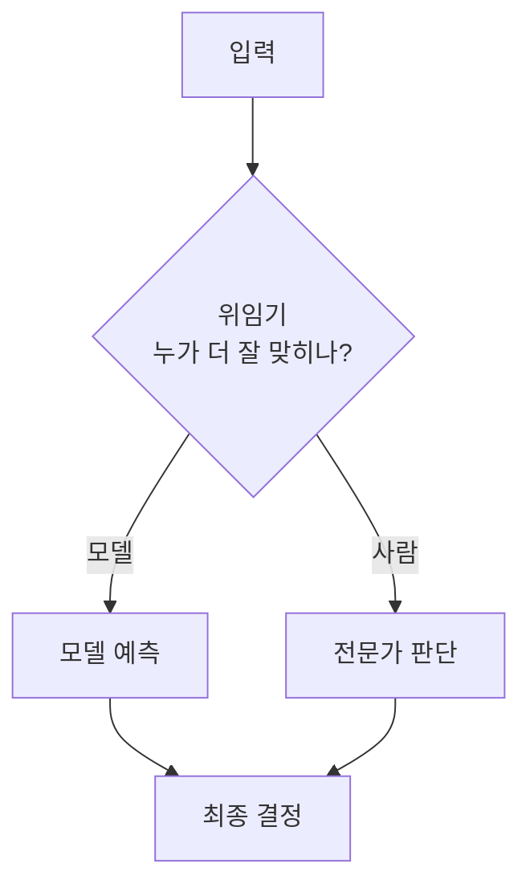
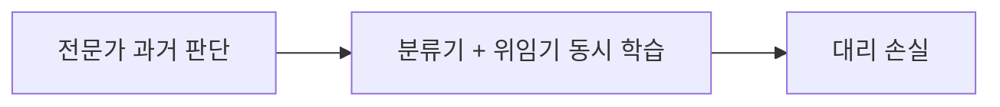

# 위임 학습(learning to defer)

> 모델이 "내가 맞힐 수 있는 건 내가, 사람이 더 잘하는 건 사람에게"를 스스로 판단하도록, 예측기와 위임 규칙(rejector)을 함께 학습하는 접근. 사람 전문가의 실제 판단 이력을 학습에 활용한다.

## 쉽게 말하면
신입 의사가 "이 건은 제가 봐도 되고, 이 건은 선배에게 물어야겠다"를 구분하는 법을 배우는 것과 같다. 선배가 어떤 유형에 강하고 약한지도 같이 고려해서 판단한다.

## 자세히
- **reject option과의 차이**: 단순 reject option은 확신이 낮으면 넘긴다. 위임 학습은 "넘겼을 때 사람이 얼마나 잘하는가"까지 고려한다. Madras·Pitassi·Zemel(NeurIPS 2018, arXiv 1711.06664, 초록 열람)은 자동 모델과 외부 의사결정자가 결정을 나누는 2단계 시스템에서, 하류 에이전트의 영향과 그 편향 가능성까지 반영해 학습하는 방법을 제안했고, 외부 사용자가 일관되지 않거나 편향돼 있어도 정확도나 공정성(또는 둘 다)이 개선될 수 있다고 보고했다.
- **일치된 손실(Mozannar·Sontag, arXiv 2006.01862, 초록 열람)**: 알고리즘은 사람 전문가와 협업하는데 설계에서는 이를 보통 무시한다. 이 논문은 과거 전문가 판단 표본만으로, 예측하거나 전문가에게 넘기는 예측기를 만든다. 문제를 비용 민감 학습으로 줄이고 분류기와 위임기(rejector)를 함께 학습하며, 교차 엔트로피를 일반화한 일치성 있는 대리 손실을 제안했다. 이론 분석과 여러 실험에서 효과가 있다고 보고한다.
- **필요한 것**: 사람 전문가의 과거 판단 기록(정답 라벨과 전문가 판단의 쌍).
- **한계(해석)**: 전문가의 판단 이력이 편향·불일치를 포함할 수 있고, 위임 비율이 검토 용량을 넘을 수 있다. 실제 운영에서는 [검토 큐 설계](#review-queue-design)와 [이중 임계값 정책](#double-threshold-policy)과 함께 본다.
- 두 논문은 초록만 열람했고 실험 규모·구체 수치는 확인하지 못했다.

## 그림으로 보기

## 예시
- 영상 속 병변 분류: 모델이 잘하는 유형은 자동, 전문의가 더 정확한 희귀 유형은 위임.
- 교육 실습: 문제 20개에서 "사람이 잘하는 유형"과 "AI가 잘하는 유형"을 직접 표시해 위임 규칙 초안을 쓴다.

## 헷갈리는 것과 비교
| 개념 | 차이 |
|---|---|
| reject option | 확신이 낮으면 넘김 |
| 위임 학습 | 사람의 성능까지 고려해 넘김 |
| [이중 임계값 정책](#double-threshold-policy) | 임계값으로 구간을 나눔 |
| [검토 큐 설계](#review-queue-design) | 넘어온 건을 처리하는 운영 |

## 더 읽을거리
- [Predict Responsibly (arXiv 1711.06664)](https://arxiv.org/abs/1711.06664) — 위임 학습 도입(초록 열람)
- [Consistent Estimators for Learning to Defer (arXiv 2006.01862)](https://arxiv.org/abs/2006.01862) — 일치성 있는 대리 손실(초록 열람)
