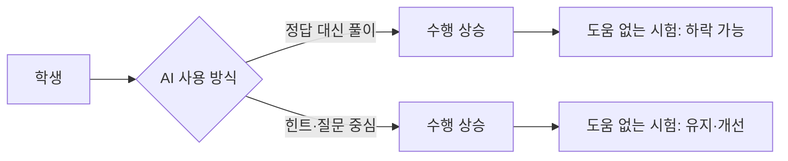

# 학습 vs 수행

> AI 도움으로 과제 결과(수행)가 좋아져도, 도움을 뺐을 때의 실력(학습)은 늘지 않거나 오히려 떨어질 수 있다는 구분.

## 쉽게 말하면
내비게이션을 켜고 가면 목적지엔 잘 도착한다(수행). 하지만 내비를 끄면 길을 모른다(학습 없음). AI가 풀이를 대신 해 주면 숙제는 만점이지만 시험장에서 혼자 풀 힘은 남지 않는다.

## 자세히
- **수행(performance)**: 지금 도움을 받으며 낸 결과. **학습(learning)**: 도움 없이 나중에도 쓸 수 있는 지식·기술. 교육학은 오래전부터 둘을 구별했고, 즉시 수행이 좋아도 학습이 안 되는 경우가 많다고 본다.
- **Bastani 외 PNAS 2025-07**: 터키 고등학교 약 1,000명(9~11학년), 90분 세션 4회. 일반 ChatGPT형(GPT Base)은 연습 점수를 48%, 가드레일 튜터(GPT Tutor)는 127% 높였다. 그러나 AI를 뺀 시험에서 GPT Base 집단은 AI를 안 쓴 집단보다 17% 낮았고, GPT Tutor 집단은 그 피해가 대부분 사라졌다. 저자들은 "목발(crutch)" 효과로 해석한다. 초록·2차 자료만 확인, 정확한 수치는 원문 확인 필요.
- **MIT Media Lab "Your Brain on ChatGPT"(arXiv 2506.08872, 2025-06)**: 대학생 54명이 에세이를 ChatGPT·구글 검색·무도구로 쓰며 EEG 측정. 도구 의존이 클수록 뇌 연결성이 약했다. 단 프리프린트(동료 심사 전), 표본 작음(마지막 세션 18명), 단일·단기 설계라 "인지 부채" 결론은 잠정적이다.
- **실천**: 학습이 목적일 때는 먼저 스스로 시도→AI는 힌트·검증, 도움 없는 점검 시간 확보([AI 튜터 가드레일](#ai-tutor-guardrails)).

## 그림으로 보기

## 예시
- 코딩 과제: AI가 짠 코드를 제출하면 점수는 높지만, 같은 문제를 노트북 없이 풀게 하면 막힌다. 평가에 "AI 없이 설명하기" 구술을 넣는다.
- 신입 교육: 첫 주는 AI 없이 직접 해 보고, 이후 AI로 속도를 높인다.

## 헷갈리는 것과 비교
| 개념 | 차이 |
|---|---|
| 수행 | 지금 결과의 질 |
| 학습 | 도움 없이 남는 능력 |
| 인지적 오프로딩 | 일을 외부 도구에 맡기는 것. 해롭다고 단정 못 함, 무엇을 맡기는지가 핵심 |
| [AI 리터러시](#literacy) | AI를 비판적으로 쓰는 역량 |

## 더 읽을거리
- [Generative AI Can Harm Learning (Stanford SCALE 저장소)](https://scale.stanford.edu/ai/repository/generative-ai-can-harm-learning) — 연구 개요
- [PNAS 2025 서지(IDEAS)](https://ideas.repec.org/a/nas/journl/v122y2025pe2422633122.html) — 최종 논문 서지
- [MIT Media Lab: Your Brain on ChatGPT](https://www.media.mit.edu/publications/your-brain-on-chatgpt/) — 프리프린트 소개
- [The Decoder: MIT study and cognitive debt](https://the-decoder.com/mit-study-shows-cognitive-debt-through-chatgpt-heres-what-it-means-in-real-world-practice/) — 한계 포함 해설
