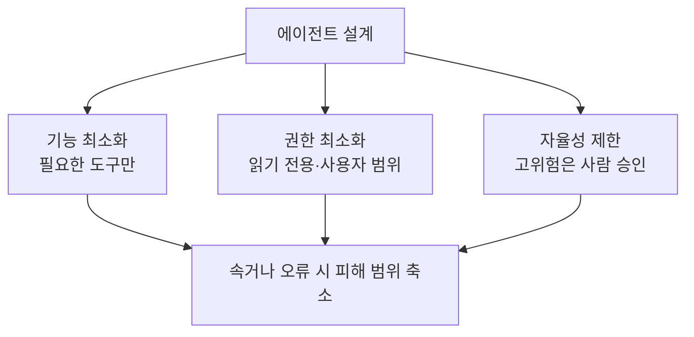
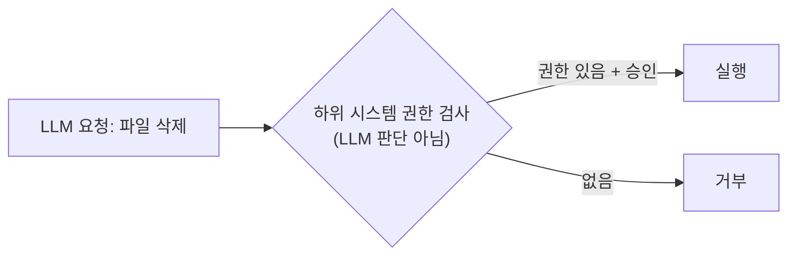

# 에이전트 최소 권한

> AI 에이전트에게 **일을 하는 데 꼭 필요한 기능·권한·자율성만** 주는 원칙. 에이전트가 환각을 하거나 프롬프트 주입에 속아도 **할 수 있는 피해의 크기를 처음부터 제한**한다. OWASP LLM 위험 목록의 "과도한 대리권(Excessive Agency)"에 대한 핵심 대응이다.

## 쉽게 말하면
신입 직원에게 건물 마스터키·회사 카드·송금 권한을 한꺼번에 주지 않는 것과 같다. 실수하거나 속아도 피해가 그 직원 업무 범위 안에서 끝나게, 맡은 일에 필요한 열쇠만 쥐여 준다.

## 자세히
(OWASP GenAI Security Project, LLM06:2025 Excessive Agency 기준)
- **문제 정의**: LLM 기반 시스템이 **예상 밖·모호한·조작된 모델 출력**에 반응해 해로운 행동을 하게 되는 취약점. 원인이 환각이든 프롬프트 주입이든 같다.
- **세 가지 근본 원인**: ① **과도한 기능**(필요 없는 확장·함수 보유), ② **과도한 권한**(작업에 필요한 것보다 하위 시스템 접근 권한이 큼), ③ **과도한 자율성**(검증이나 사람 승인 없이 영향이 큰 행동 수행).
- **예방책(문서 목록 요약)**:
  1. 에이전트가 쓸 **확장(도구) 수 최소화**.
  2. 각 도구 **내부 기능 최소화**(읽기만 필요하면 쓰기 기능을 빼기).
  3. **개방형 도구 지양**(임의 셸·임의 URL 접근 대신 세분화된 도구).
  4. 도구가 하위 시스템에서 갖는 **권한 최소화**.
  5. **특정 사용자의 맥락**에서 최소 범위 인증으로 실행.
  6. **영향이 큰 행동은 사람 승인** 필수.
  7. 권한 검사는 LLM의 판단이 아니라 **하위 시스템에서 강제**(완전한 중개).
  8. 입력·출력을 정제하고 개발 파이프라인에서 보안 테스트.
  - 로깅·모니터링·속도 제한은 **예방이 아니라 피해 제한** 수단이라고 문서가 명시한다.
- **[치명적 3요소](#lethal-trifecta)와의 관계**: 최소 권한은 세 요소 중 하나(비공개 데이터 접근 범위, 외부 통신 능력)를 **좁히거나 끊는** 구체적 방법이다.
- **적용 예**: 일정 정리 에이전트 → 캘린더 읽기/쓰기만(메일·파일 접근 없음), 메일 전송은 사람 승인. 코딩 에이전트 → 작업 폴더 안에서만 쓰기, 네트워크는 허용 목록, 배포·삭제 명령은 승인.
- 한계: 권한을 줄이면 에이전트 능력이 떨어진다. 위험도에 비례해 균형을 잡고, 단계적으로 권한을 넓히며 검증한다.

## 그림으로 보기



## 예시
```yaml
# 에이전트 권한 정책 (예시)
tools:
  - calendar.read
  - calendar.create_event      # 삭제 기능은 제외
network: allowlist [api.company.com]
require_human_approval:
  - send_email
  - delete_*
```
- 교육 포인트: 에이전트 도입 시 "이 도구가 정말 필요한가? 읽기만 되는 버전은 없나?"를 체크리스트에.

## 헷갈리는 것과 비교
| 개념 | 차이 |
|---|---|
| 최소 권한 | 처음부터 줄여서 피해 범위를 제한 |
| 모니터링·로깅 | 사후 탐지·피해 제한(예방 아님) |
| [치명적 3요소](#lethal-trifecta) | 위험한 조합을 진단하는 틀 |
| 사람 승인 | 영향 큰 행동에 대한 관문([사람 관문 설계](#human-gates)) |

## 더 읽을거리
- [OWASP: LLM06:2025 Excessive Agency](https://genai.owasp.org/llmrisk/llm062025-excessive-agency/) — 원인과 예방책 목록.
