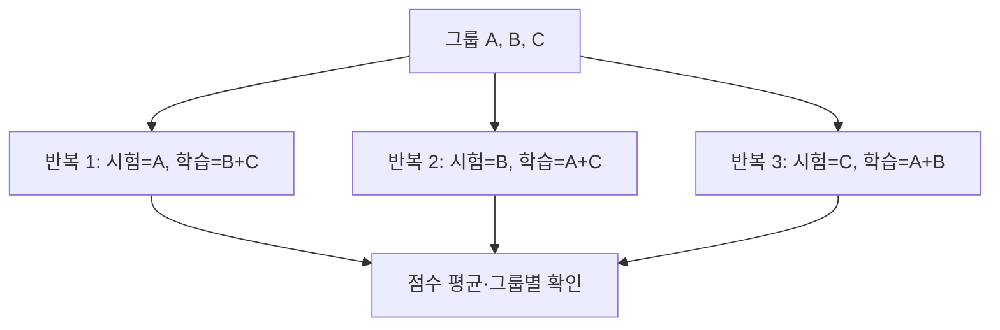
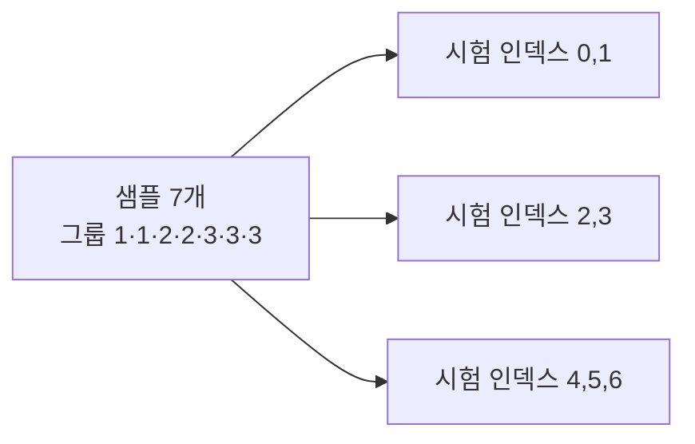

# Leave-One-Group-Out

> 교차 검증에서 그룹(환자·실험·연도 등) 하나를 통째로 시험용으로 빼고 나머지로 학습하는 일을 그룹 수만큼 반복하는 방식이다. 같은 그룹의 샘플이 학습과 시험에 갈리지 않는다.

## 쉽게 말하면
반 학생 5명이 각자 시험 문제집을 만들었다고 하자. 모델이 한 학생의 문제 스타일을 외워서 그 학생의 다른 문제를 맞히면 실력이 아니다. 그래서 한 번에 학생 한 명의 문제집 전체를 시험으로 빼고, 나머지 학생들 문제로 공부한 뒤 푼다. 이걸 학생 수만큼 돌린다.

## 자세히
(scikit-learn 교차 검증 문서를 직접 열어 확인.)
- 근거: 한 환자·한 실험처럼 서로 의존적인 샘플이 있으면 무작위 분할은 i.i.d. 가정을 깨 점수를 부풀린다. 문서의 목표: 검증 폴드의 모든 샘플이 짝이 되는 학습 폴드에 전혀 없는 그룹에서 와야 한다.
- `LeaveOneGroupOut`은 split마다 그룹 1개 전체를 시험으로 뺀다. `LeavePGroupsOut(n_groups=1)`과 같고, `n_splits`가 고유 그룹 수인 `GroupKFold`와도 같다.
- **분할 수 = 고유 그룹 수**. 그룹이 많으면 학습 횟수가 많아 비싸고, 그룹이 2~3개뿐이면 추정이 불안정하다(제안).
- 문서가 드는 용도: 여러 실험에서 모은 데이터, 수집 연도를 그룹으로 삼아 시간 기준 분할.
- 시험 폴드 크기가 그룹마다 달라 폴드 간 점수 편차가 크다. 점수는 평균뿐 아니라 그룹별로 본다(제안).
- 관련: 그룹을 K개로 묶는 [GroupKFold](#group-kfold), 클래스 비율까지 맞추는 [StratifiedGroupKFold](#stratified-group-kfold), 일반 개념 [그룹 단위 분할](#group-wise-split).

## 그림으로 보기



## 예시
```python
from sklearn.model_selection import LeaveOneGroupOut
X=[1,5,10,50,60,70,80]; y=[0,1,1,2,2,2,2]; groups=[1,1,2,2,3,3,3]
for train, test in LeaveOneGroupOut().split(X, y, groups=groups):
    print(train, test)   # [2 3 4 5 6] [0 1] / [0 1 4 5 6] [2 3] / [0 1 2 3] [4 5 6]
```
- 병원 3곳의 영상으로 만든 진단 모델: 병원을 그룹으로 하면 "처음 보는 병원에서도 되는가"를 잴 수 있다.

## 헷갈리는 것과 비교
| 개념 | 차이 |
|---|---|
| Leave-One-Group-Out | 그룹 1개씩 시험. 분할 수=그룹 수 |
| LeavePGroupsOut | 그룹 P개를 조합별로 빼므로 시험 집합이 겹치고 조합이 급증 |
| [GroupKFold](#group-kfold) | 그룹을 K개 폴드로 묶어 한 번씩 시험 |
| GroupShuffleSplit | 무작위로 그룹 일부를 시험으로 반복 |
| [k-겹 교차 검증](#k-fold-cross-validation) | 그룹 고려 없이 샘플 단위로 분할 |

## 더 읽을거리
- [scikit-learn: Cross-validation](https://scikit-learn.org/stable/modules/cross_validation.html) — 그룹 분할기 정의·예제·선택 표(열어 확인).
