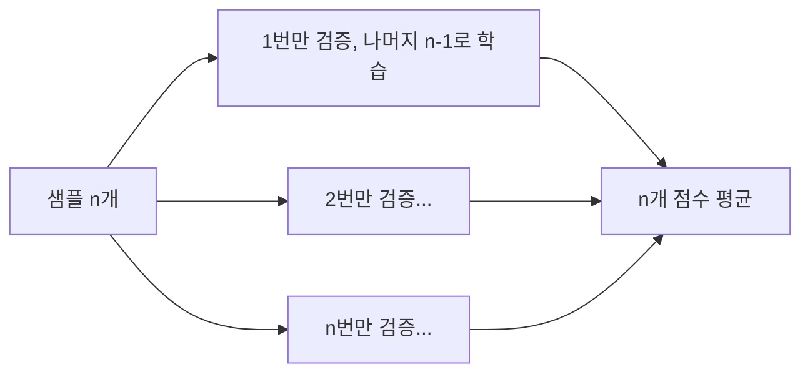
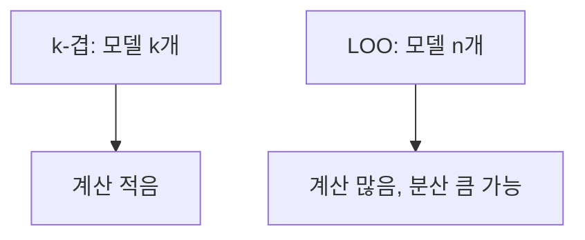

# Leave-One-Out 검증

> 샘플을 하나씩만 검증용으로 빼고 나머지 전부로 학습하는 일을 샘플 수(n)만큼 반복하는 극단적인 교차 검증이다. 학습 데이터를 거의 다 쓰지만 계산이 많이 들고 추정치의 분산이 클 수 있어, 보통 5~10겹을 먼저 권한다.

## 쉽게 말하면
반 학생 30명의 실력을 알려고 "한 명만 빼고 29명으로 공부한 뒤 뺀 한 명에게 시험"을 30번 반복하는 것이다. 공부 자료는 넉넉하게 쓰지만 시험을 30번 치러야 하고, 매번 공부한 모임이 거의 똑같아서 결과들이 서로 닮아 버린다.

## 자세히
(scikit-learn 공식 문서를 직접 확인하고, 이 세션에서 직접 실행했다: scikit-learn 1.9.1.)
- **정의(공식 문서)**: n개 샘플이면 학습 세트 n개, 시험 세트 n개를 만들어 **모델 n개**를 학습한다. 각 모델은 n−1개 샘플로 학습한다(k-겹은 (k−1)n/k개). k가 너무 크지 않고 k<n이면 LOO가 k-겹보다 계산 비용이 크다.
- **분산 문제(문서)**: "LOO는 시험 오차의 추정치로서 분산이 큰 경우가 많다." 각 모델이 n개 중 n−1개 샘플로 만들어져 서로 그리고 전체 학습 세트 모델과 사실상 거의 같기 때문이라고 직관을 설명한다. 반대로 학습 곡선이 가파른 경우 5·10겹은 일반화 오차를 과대 추정할 수 있다고도 적는다.
- **권고(문서)**: "대부분의 저자와 경험적 증거는 LOO보다 5나 10겹 교차 검증을 선호하라고 한다."
- **Leave-P-Out**: `LeavePOut(p)`는 n개에서 p개를 빼는 모든 조합 C(n,p)개의 분할을 만든다. p>1이면 시험 세트가 겹친다. 문서 예: 샘플 4개, p=2이면 6개 분할.
- **직접 실행(iris 150개 샘플, 선형 SVC `SVC(kernel="linear", C=1)`)**:
  - 5겹(shuffle): 적합 5회, 평균 정확도 0.9800, 시간 약 0.016초.
  - 10겹(shuffle): 적합 10회, 평균 0.9667, 약 0.023초.
  - LeaveOneOut: 적합 **150회**, 평균 0.9800, 약 0.296초(5겹의 약 18배).
  - 해석 주의: LOO의 개별 조각 점수는 한 샘플의 맞음·틀림(0 또는 1)이라 조각 점수의 표준편차(0.14)를 "추정치 분산"으로 읽으면 안 된다. 이 실행은 단일 데이터·단일 모델이라 문서가 말하는 분산 문제를 직접 증명하지는 못한다.
- **언제 쓰나(제안)**: 샘플이 아주 적고(수십~수백) 모델 학습이 매우 빠를 때. 그 외에는 [k-겹 교차 검증](#k-fold-cross-validation).
- **누수 주의**: 전처리는 매 반복마다 학습 쪽에서만 맞춘다. 샘플이 사용자·환자 단위로 묶여 있으면 한 샘플만 빼는 방식이 같은 사람의 다른 샘플을 학습에 남겨 점수를 부풀린다(일반적 주의, [그룹 단위 분할](#group-wise-split)의 `LeaveOneGroupOut` 참고).

## 그림으로 보기



## 예시
```python
from sklearn import datasets, svm
from sklearn.model_selection import LeaveOneOut, cross_val_score
X, y = datasets.load_iris(return_X_y=True)
clf = svm.SVC(kernel="linear", C=1, random_state=42)
s = cross_val_score(clf, X, y, cv=LeaveOneOut())
print(len(s), s.mean())   # 150 0.98
```
(직접 실행 결과: 적합 150회, 평균 0.98.)

## 헷갈리는 것과 비교
| 개념 | 차이 |
|---|---|
| Leave-One-Out | 1개씩 빼기, 모델 n개 |
| Leave-P-Out | p개씩 모든 조합 |
| [k-겹 교차 검증](#k-fold-cross-validation) | k조각, 모델 k개 |
| [Leave-One-Group-Out](#leave-one-group-out) | 그룹 하나씩 통째로 |

## 더 읽을거리
- [scikit-learn: Cross-validation](https://scikit-learn.org/stable/modules/cross_validation.html) — LeaveOneOut·LeavePOut 설명과 권고(직접 열어 확인).
