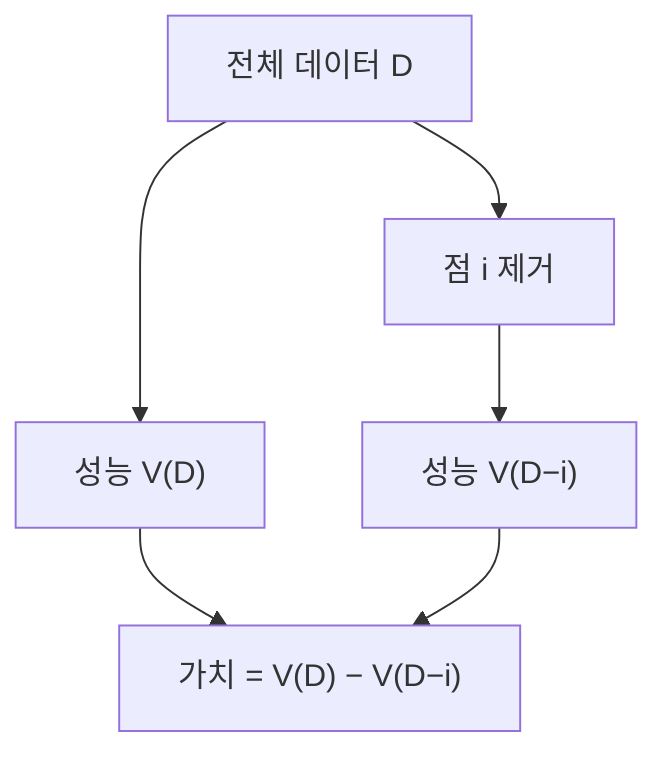
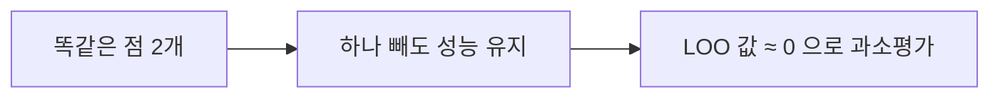

# Leave-one-out 가치

> Leave-one-out(LOO) 평가는 데이터 한 점(또는 출처 하나)을 빼고 다시 학습했을 때 **성능이 얼마나 떨어지는지**를 그 데이터의 가치로 삼는 가장 직관적인 방법이다. 단순하지만 중복·상호작용 앞에서 약하다.

## 쉽게 말하면
축구팀에서 선수 한 명을 빼고 경기해 보고 점수 차이로 그 선수의 가치를 매기는 것이다. 그런데 똑같은 실력의 후보 선수가 벤치에 있으면, 한 명을 빼도 점수가 안 변하니 둘 다 가치가 0으로 나온다. 실제로는 둘 다 중요한데도.

## 자세히
(Ghorbani & Zou, Data Shapley, arXiv 1904.02868 ar5iv 본문 직접 확인)
- **정의**: φᵢ = V(D) − V(D−{i}). 논문 표현으로 "i번째 데이터 출처를 빼면 성능을 얼마나 잃는가".
- **문제**: 논문은 LOO가 "공정한 평가(equitable valuation) 조건을 만족하지 않는다"고 한다. 중복 데이터는 이 글의 추론이다(논문은 중복을 직접 논하지 않는다): 같은 점이 두 개 있으면 하나를 빼도 다른 하나가 남아 각각의 LOO 값이 거의 0일 수 있다. 같은 기여에 같은 값을 주라는 대칭 속성이 흔들린다.
- **실험 비교(논문 보고, 그림 위주)**: ① 오라벨 탐지에서 가치가 낮은 것부터 검사할 때 Shapley가 가장 적은 검사로 찾았고, LOO는 로지스틱 회귀에서는 작동했지만 다른 두 모델에서는 "무작위 검사와 비슷"했다. ② 가치 높은 점을 먼저 제거하면 정확도가 가장 크게 떨어지고, 낮은 가치의 점을 제거하면 성능이 오히려 좋아질 수 있다. ③ 합성 데이터에서 도움이 되는 점을 식별하는 데도 Shapley 방법이 LOO보다 낫다. 비교 수치는 표가 아닌 그림으로만 제시된다.
- **장점**: 개념이 쉽고 구현이 쉽다(데이터 N개면 학습 N+1회). 영향 함수([영향 함수](#influence-functions))는 이를 다시 학습하지 않고 근사하는 방법으로 볼 수 있다.
- **한계**: 학습 횟수가 N+1회라 대규모 모델에서는 비싸고, 확률적 학습 노이즈가 한 점의 작은 효과를 가릴 수 있다(해석).

## 그림으로 보기

## 예시
- 라벨 1,000건을 하나씩 빼고 정확도를 비교해 가장 해로운 라벨 후보를 찾는다(중복이 적을 때).
- 교육 소재: 같은 사진이 2장 있는 작은 데이터셋으로 LOO의 한계를 직접 보여 주는 실습.

## 헷갈리는 것과 비교
| 개념 | 차이 |
|---|---|
| LOO | 한 점 제거 후 차이, 중복에 약함 |
| [Shapley 값](#shapley-value) | 모든 부분집합 평균, 공리 만족, 비쌈 |
| [영향 함수](#influence-functions) | LOO를 재학습 없이 근사 |

## 더 읽을거리
- [Data Shapley (ar5iv HTML)](https://ar5iv.labs.arxiv.org/html/1904.02868) — LOO 정의와 실험 비교(직접 확인).
