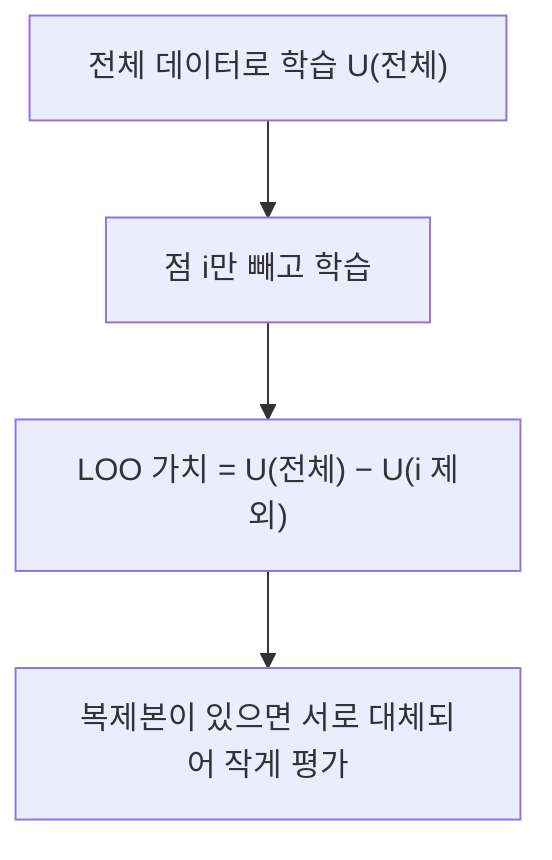

# Leave-one-out 데이터 가치

> 데이터 한 개의 가치를 **"그 점만 빼고 다시 학습했을 때 성능이 얼마나 떨어지는가"**로 재는 가장 단순한 방법이다. 직관적이지만 **중복·상호작용을 가진 데이터의 가치를 작게 평가하는 한계**가 있다.

## 쉽게 말하면
팀원 한 명이 빠졌을 때 성과가 얼마나 줄었는지로 기여도를 잰다. 같은 일을 하는 동료가 한 명 더 있으면 한 명이 빠져도 성과가 거의 안 변해서, 둘 다 별 기여가 없는 것처럼 보인다.

## 자세히
- **정의**: 점 i의 LOO 가치 = U(전체) − U(i를 뺀 전체). 모델은 전체 데이터로 한 번, 각 점을 빼고 n번 학습해 n+1번 학습으로 끝난다.
- **직접 실험(scikit-learn 로지스틱 회귀, 학습 10개, 검증 300개 정확도가 효용 U, 점 3과 4는 **완전히 같은 복제본**, 정확한 샤플리와 비교)**
  | 점 | LOO | 샤플리 |
  |---|---|---|
  | 0 | 0.004 | 0.023 |
  | 1 | 0.008 | 0.062 |
  | 2 | 0.016 | 0.063 |
  | 3 (복제) | **0.002** | **0.016** |
  | 4 (복제) | **0.002** | **0.016** |
  | 5 | 0.004 | 0.020 |
  | 6 | −0.004 | 0.074 |
  | 7 | 0.000 | 0.036 |
  | 8 | 0.034 | 0.080 |
  | 9 | 0.010 | 0.054 |
  - **합**: LOO 가치의 합 0.076, 샤플리 합 **0.442 = U(전체) − U(빈 집합)**. LOO는 기여의 총합이 전체 효용과 맞지 않는다(효율성 공리 없음).
  - **0에 가까운 값**: LOO에서 점 7은 정확히 0, 점 3·4는 0.002로 거의 0이다. 샤플리는 점 7이 0.036, 점 6이 0.074로 **다른 점 때문에 가려진 기여를 드러낸다**. 점 6은 LOO가 −0.004(음수)지만 샤플리는 0.074로 높다.
  - 복제본 3·4는 서로를 대체하므로 LOO가 둘 다 작게(0.002) 본다. 샤플리는 0.016으로 약간 더 높게 본다. 합이 크게 달라 순위 해석이 달라진다.
- **한계 정리**: ① 중복·상호작용 데이터의 가치를 과소평가(서로 대체) ② 큰 데이터에서는 한 점을 빼도 변화가 학습 잡음보다 작아 신호가 약함 ③ 점수가 학습 난수에 민감해 불안정 ④ 음수가 나와도 의미 해석이 어렵다. 샤플리는 부분집합 전체의 평균 기여를 봐 이 문제를 줄이지만 비용이 크다([TMC-Shapley](#tmc-shapley)).
- **쓰임**: 매우 작은 데이터, 빠른 1차 진단. 대규모에서는 영향 함수(influence function) 근사나 샤플리 근사를 쓴다. 낮은 값은 [라벨 오류 후보](#cleanlab-label-quality-score) 검토 재료이지 [자동 삭제](#auto-delete-risk) 근거가 아니다.
- 한 합성 설정의 결과이며 값은 효용 정의(검증 세트)에 의존한다.

## 그림으로 보기



## 예시
```python
full = score(model_fit(X, y))
loo = [full - score(model_fit(np.delete(X, i, 0), np.delete(y, i))) for i in range(n)]
```
- 학습 데이터에 같은 문서가 두 번 들어 있으면 둘 다 LOO 가치가 0에 가까워 "필요 없는 데이터"로 오해하기 쉽다.
- 교육: 동료가 대체 가능하면 한 명의 기여가 작아 보이는 직무 평가의 함정.

## 헷갈리는 것과 비교
| 개념 | 차이 |
|---|---|
| Leave-one-out 데이터 가치 | 한 점 제거의 성능 변화 |
| [교차검증 LOO](#leave-one-out) | 모델 평가 방식(점수 추정) |
| 샤플리 가치 | 모든 부분집합에서의 평균 기여 |
| 영향 함수 | 학습 손실의 기울기로 점의 영향 근사 |

## 더 읽을거리
- [Data Shapley (arXiv 1904.02868)](https://arxiv.org/abs/1904.02868) — 샤플리가 LOO·leverage보다 효과적이라는 보고(초록 확인).
- [Beta Shapley (arXiv 2110.14049)](https://arxiv.org/abs/2110.14049) — 샤플리의 변형(초록 확인).
