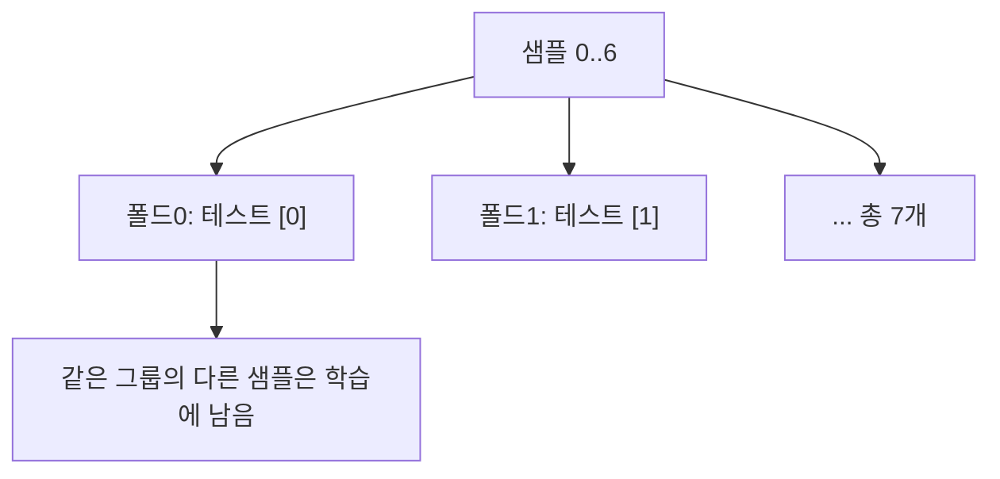
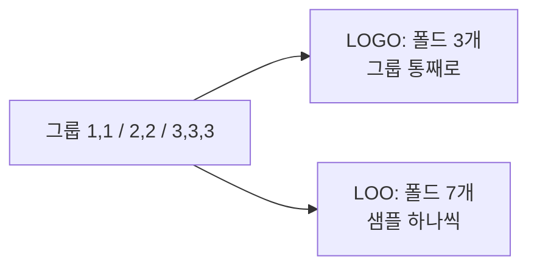

# Leave-One-Out 교차 검증

> **샘플 하나만 시험에 빼고 나머지 전부로 학습**하는 과정을 모든 샘플에 대해 반복하는 교차검증이다. 샘플이 n개면 n번 학습한다. 같은 환자·사용자의 다른 샘플이 학습에 남을 수 있어서 그룹 데이터에는 LOGO를 쓴다.

## 쉽게 말하면
반 학생 한 명씩 돌아가며 "이 학생만 시험 보고 나머지 모두의 풀이로 공부"하는 방식이다. 데이터를 거의 안 낭비하지만, 학생 수만큼 공부를 새로 해야 한다.

## 자세히
- **정의(scikit-learn 가이드)**: 각 학습 세트는 한 샘플만 뺀 전부, 테스트는 그 한 샘플. n개 샘플이면 n개의 서로 다른 학습/테스트 세트가 생긴다. 학습 세트에서 거의 낭비하지 않는다.
- **직접 확인(scikit-learn 1.9.1)**: 샘플 7개에서 `LeaveOneOut().get_n_splits(X)=7`, 그룹 `[1,1,2,2,3,3,3]`에 대한 `LeaveOneGroupOut().get_n_splits(groups=g)=3`. LOO에서 샘플 0을 빼도 같은 그룹 1의 샘플 1은 **학습에 남는다**(True). LOGO는 학습/테스트가 공유하는 그룹이 0이다. 테스트 인덱스도 `[0 1] [2 3] [4 5 6]`처럼 그룹 통째다.
- **LOGO와 차이**: LOO는 샘플 단위(분할 수 n), LOGO는 그룹 단위(분할 수 = 그룹 수). 가이드는 LOGO가 GroupKFold(n_splits=그룹 수)와 같다고 설명한다.
- **비용(가이드)**: n개 모델, 각 n-1개로 학습 → k-폴드(k<n)보다 비싸다. 편향은 작지만 추정치의 **분산이 크다**는 서술이 있고, 대부분의 저자와 경험적 증거는 5·10-폴드를 선호한다.
- **언제 쓰나**: 샘플이 아주 적고(수십 개) 샘플이 서로 독립이며 모델이 가벼울 때. 닫힌 형태 공식으로 LOO 오차를 빠르게 구하는 모델(예: 선형 회귀 계열)도 있다(일반 지식).
- **쓰면 안 되는 때**: 한 개체에서 샘플이 여러 개(이미지 여러 장, 문장 여러 개)일 때. 이때 LOO는 [누수](#stratification-vs-leakage)로 점수를 부풀린다.

## 그림으로 보기



## 예시
```python
from sklearn.model_selection import LeaveOneOut, cross_val_score
scores = cross_val_score(model, X, y, cv=LeaveOneOut())  # 점수 n개, 각각 0 또는 1(정확도)
print(scores.mean())
```
- 환자 15명, 환자당 샘플 1개인 임상 데이터에서 LOO로 정확도 추정.

## 헷갈리는 것과 비교
| 개념 | 폴드 수 | 단위 |
|---|---|---|
| Leave-One-Out | n | 샘플 |
| Leave-One-Group-Out | 그룹 수 | 그룹 |
| [Leave-P-Out](#leave-p-out) | C(n,p) | 샘플 p개 |
| K-폴드 | k | 샘플 묶음 |

## 더 읽을거리
- [scikit-learn 교차검증 가이드 — LOO, LOGO](https://scikit-learn.org/stable/modules/cross_validation.html) — 정의·비용·분산 설명과 예제.
