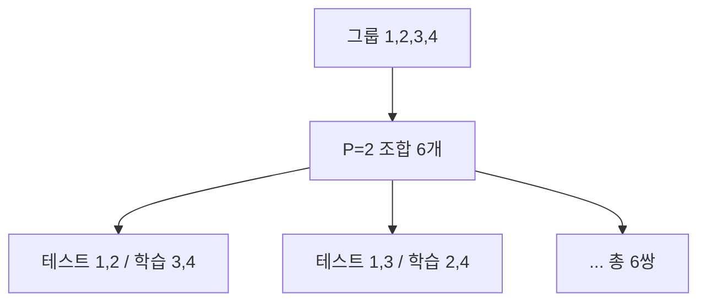
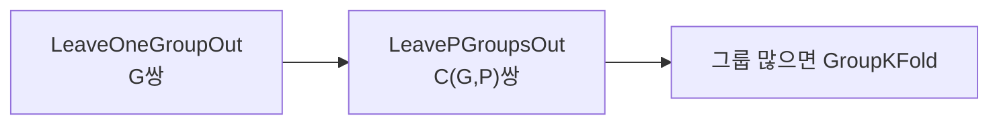

# Leave-P-Groups-Out

> **그룹 P개를 통째로 테스트로 빼는 모든 조합**을 시험하는 교차검증이다(`LeavePGroupsOut`). 같은 그룹의 샘플은 학습과 검증에 갈라지지 않지만, 그룹이 많으면 조합 수 C(그룹 수, P)가 폭발한다.

## 쉽게 말하면
환자 4명의 데이터가 있을 때, "환자 2명을 통째로 시험 대상으로 빼고 나머지 2명으로 학습"하는 모든 경우(6가지)를 다 해 보는 것이다. 한 환자의 일부 데이터만 시험에 쓰지 않는다.

## 자세히
- **정의(scikit-learn 가이드)**: LeaveOneGroupOut과 비슷하되 폴드마다 P개 그룹을 뺀다. P개 그룹의 **모든 조합**을 빼므로 P>1이면 테스트 세트가 서로 겹친다. `n_groups=1`이면 LeaveOneGroupOut과 같다.
- **분할 수**: C(그룹 수, P). (가이드는 공식을 적지 않았고, 조합 계산을 직접 확인했다.) 그룹 4개, P=2 → 6쌍. 직접 실행해 `get_n_splits(groups=g)=6`을 확인했고, 테스트 그룹 쌍이 (1,2)(1,3)(1,4)(2,3)(2,4)(3,4)로 나왔다. LeaveOneGroupOut은 4쌍.
- **폭증**: 그룹 10/50/100개에서 P=2는 45 / 1,225 / 4,950쌍. 그룹 50개 P=3은 19,600쌍.
- **왜 그룹인가(가이드)**: 환자별로 샘플이 여러 개면 i.i.d. 가정이 깨진다. 목표는 "검증 폴드의 모든 샘플이 짝지어진 학습 폴드에 전혀 나타나지 않은 그룹에서 와야 한다"는 것.
- **그룹의 예(가이드)**: 환자 ID, 여러 실험 중 하나, 수집 연도(시간 기반 분할).
- **쓰임**: 그룹이 적고(수~수십) 각 그룹이 서로 다를 때 "여러 그룹이 동시에 빠진 상황"까지 점검하고 싶을 때. 그룹이 많으면 `GroupKFold`·`GroupShuffleSplit`·`StratifiedGroupKFold`가 현실적이다.
- 한계: 그룹 크기가 불균형하면 일부 조합의 테스트 크기가 크게 달라져 점수 비교가 어렵다.

## 그림으로 보기



## 예시
```python
from sklearn.model_selection import LeavePGroupsOut
lpgo = LeavePGroupsOut(n_groups=2)
for tr, te in lpgo.split(X, y, groups=patient_id):
    ...
```
- 실험실 6곳 데이터 → 2곳을 통째로 빼 새 실험실에서의 성능을 모의.

## 헷갈리는 것과 비교
| 개념 | 차이 |
|---|---|
| [Leave-P-Out](#leave-p-out) | 샘플 p개씩 빼는 조합(그룹 무시) |
| Leave-One-Group-Out | 그룹 1개씩, 그룹 수만큼 |
| Leave-P-Groups-Out | 그룹 P개씩, C(G,P)쌍 |
| [StratifiedGroupKFold](#stratified-group-kfold) | 폴드 수를 고정하고 그룹+클래스 비율 |

## 더 읽을거리
- [scikit-learn 교차검증 가이드 — 그룹 데이터](https://scikit-learn.org/stable/modules/cross_validation.html) — LOGO·LPGO 정의와 예제, 환자 ID 비유.
