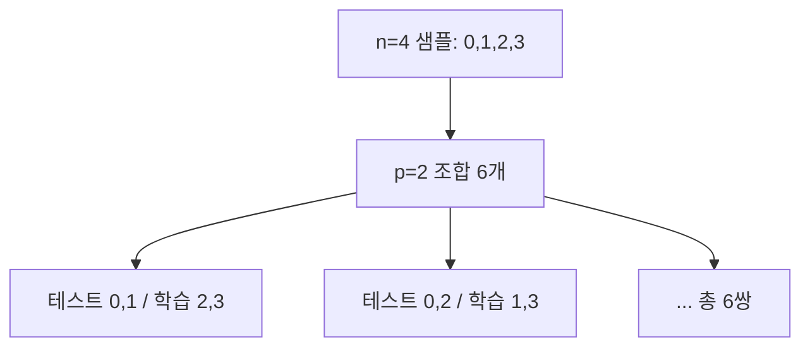
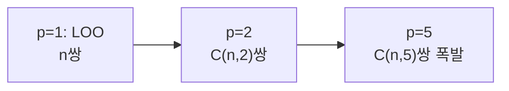

# Leave-P-Out

> 전체 n개 중 **p개를 뽑아 테스트로 빼고 나머지로 학습하는 모든 조합**을 시험하는 교차검증이다. 조합이 C(n, p)개라서 p가 조금만 커도 계산량이 폭발한다.

## 쉽게 말하면
반 학생 4명 중 2명을 "시험 보는 사람"으로 뽑는 모든 경우를 다 해 보는 것이다. 4명이면 6가지지만, 100명 중 5명을 뽑는 경우는 7천5백만 가지가 넘는다.

## 자세히
- **정의(scikit-learn 가이드)**: `LeavePOut`은 `LeaveOneOut`과 비슷하게 p개를 제거해 가능한 모든 학습/테스트 쌍을 만든다. n개 샘플이면 C(n, p)쌍.
- **p=1이면 [LOO](#leave-one-out-cv)**: 쌍이 n개. **p>1이면 테스트 세트가 서로 겹친다**(K-폴드·LOO와 다른 점).
- **조합 수(직접 계산)**: C(4,2)=6, C(100,2)=4,950, C(100,3)=161,700, C(1000,2)=499,500, C(100,5)=75,287,520. 모델을 그만큼 학습해야 한다.
- **비용**: 모델 한 번 학습이 빠른 소규모 데이터(수십 개)에서만 현실적이다. 큰 데이터엔 [K-폴드](#stratified-k-fold)나 반복 분할을 쓴다. (가이드는 LPO의 편향·분산을 따로 설명하지 않으며, 아래는 일반 추론이다.)
- 테스트 세트가 겹치므로 각 점수가 독립이 아니다. 단순 K-폴드의 분산 논리를 그대로 가져오면 안 된다(일반 추론).
- 용도: 표본이 아주 적은 연구·검정에서 가능한 모든 분할을 철저히 보고 싶을 때, 또는 이론 분석에서.
- 코드: `from sklearn.model_selection import LeavePOut; LeavePOut(p=2).split(X)`.

## 그림으로 보기

## 예시
- 환자 12명뿐인 임상 데이터에서 LeavePOut(2)로 C(12,2)=66번 학습해 전체 분할을 시험.
- 교육: 조합론(경우의 수)과 비용의 관계를 보여 주는 소재.

## 헷갈리는 것과 비교
| 개념 | 쌍 수 | 테스트 겹침 |
|---|---|---|
| [Leave-One-Out](#leave-one-out-cv) | n | 없음 |
| Leave-P-Out(p>1) | C(n,p) | 있음 |
| K-폴드 | k | 없음 |
| ShuffleSplit | 지정한 횟수 | 있음(무작위) |

## 더 읽을거리
- [scikit-learn 교차검증 가이드 — Leave P Out](https://scikit-learn.org/stable/modules/cross_validation.html) — 정의와 예제(n=4, p=2 → 6쌍).
