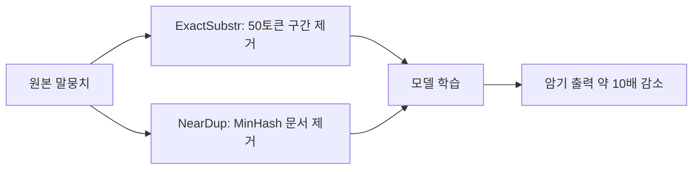
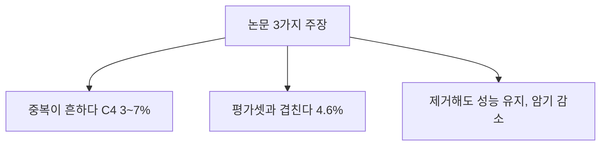

# Lee 외 2021 중복 제거 논문

> "Deduplicating Training Data Makes Language Models Better"(Lee 외, arXiv 2107.06499, 2021)는 언어 모델 학습 데이터에 중복이 흔하며, 지우면 외운 문장 출력이 약 10배 줄고 성능은 안 떨어진다는 것을 보인 기준 논문이다.

## 쉽게 말하면
교과서에 같은 문제가 수만 번 실려 있으면 학생은 이해가 아니라 암기를 한다. 이 논문은 "중복 문제를 지워도 시험 점수는 그대로고, 암기 답안만 크게 줄어든다"를 측정했다.

## 자세히
(ar5iv 본문 확인. 수치는 저자 보고)
- **방법 둘**: ExactSubstr(접미사 배열로 50토큰 이상 같은 구간을 지움, [접미사 배열](#suffix-array)·[LCP](#lcp-array)), NearDup(MinHash 근사 중복 문서 제거, [MinHash LSH](#minhash-lsh)).
- **중복의 규모**:

| 데이터 | NearDup 대상 예제 | ExactSubstr 대상 토큰 |
|---|---|---|
| C4 | 3.04% | 7.18% |
| RealNews | 13.63% | 19.4% |
| LM1B | 4.86% | 0.76% |
| Wiki-40B | 0.39% | 2.76% |

- **학습-검증 겹침**: 검증 예제 중 학습에 중복이 있는 비율은 C4 4.60%, RealNews 14.35%, LM1B 4.92%, Wiki-40B 0.72%(NearDup). 61단어 문장 하나가 C4 학습셋에 61,036번 나왔다.
- **암기**: 1.5B "XL" 모델(GPT-2 유사)의 무프롬프트 출력 중 암기 토큰 비율이 원본 학습 1.93%(1에폭)·1.57%(2에폭)였고, 중복 제거 후 NearDup 0.19%·0.26%, ExactSubstr 0.14%·0.17%로 약 10배 감소.
- **성능**: 중복 제거가 퍼플렉서티를 해치지 않았고 때로 최대 10% 낮췄다. 겹침이 있던 C4 검증 예제에서는 오히려 퍼플렉서티가 높아졌다(외워서 맞히던 이득이 사라짐).
- **모델**: 1.5B XL을 C4 원본·NearDup·ExactSubstr로 약 2에폭 학습, 110M base는 시드 3개.
- **한계(해석)**: 영어 데이터와 2021년 시점의 GPT-2급 모델 기준이다. 오늘의 규모·다국어 데이터에 같은 수치가 나온다고 보장되지 않는다.

## 그림으로 보기

## 예시
- 사내 모델을 학습하기 전 양식 문서를 ExactSubstr로 먼저 정리해 암기 위험과 평가 오염을 줄임.
- 교육: 논문의 표 하나로 "데이터 품질이 모델 행동을 바꾼다"를 설명.

## 헷갈리는 것과 비교
| 개념 | 차이 |
|---|---|
| [50토큰 임계](#dedup-threshold-50-tokens) | 이 논문이 고른 최소 일치 길이 |
| [ExactSubstr vs NearDup](#exactsubstr-vs-neardup) | 구간 삭제와 문서 삭제 |
| [SemDeDup](#semdedup) | 이후 나온 의미 중복 제거 |

## 더 읽을거리
- [Deduplicating Training Data Makes Language Models Better — ar5iv](https://ar5iv.labs.arxiv.org/html/2107.06499) — 표와 부록 B(열어 확인).
