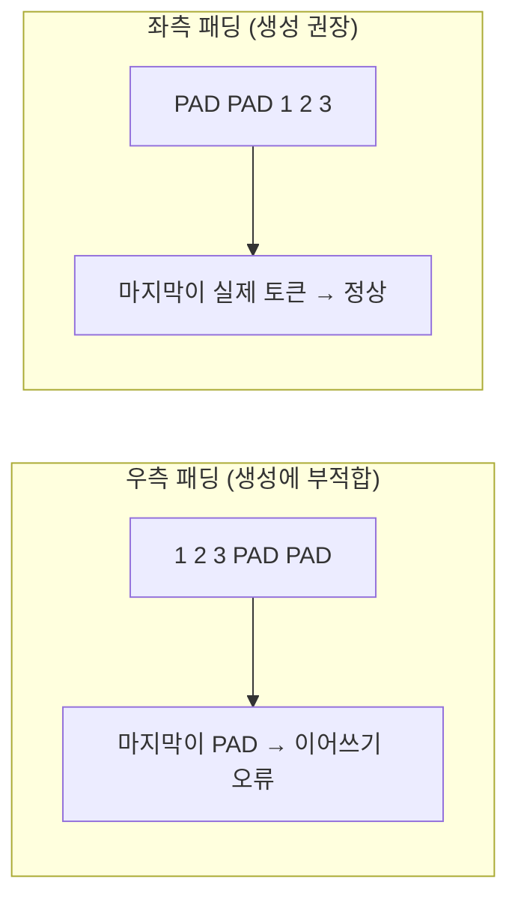

# 좌측·우측 패딩 (Left vs Right Padding)

> 길이가 다른 문장을 한 배치로 묶을 때 빈칸(PAD)을 앞에 둘지 뒤에 둘지의 문제로, 텍스트를 생성하는 디코더 모델은 좌측 패딩을 써야 한다.

## 쉽게 말하면
줄 세울 때 키가 다른 사람들을 맞추려고 받침대를 놓는 일이다. 이어 말하기 게임에서 출발선이 뒤쪽에 있어야 하는데 받침대(빈칸)가 말하는 자리 바로 앞에 있으면 헷갈린다.

## 자세히
Hugging Face 텍스트 생성 문서(2026-11 확인):
- 입력 길이가 다르면 패딩이 필요하지만, **LLM은 패딩 토큰에서 이어 생성하도록 학습되지 않았다.** 그래서 `padding_side="left"`로 설정한다. 우측 패딩이면 마지막 위치가 PAD라 이어 쓰기가 엉킨다.
- 증상 예: 우측 패딩 시 `'1, 2, 33333333333'`처럼 이상한 출력, 좌측 패딩 시 `'1, 2, 3, 4, 5, 6,'`.
- 상태공간·하이브리드 모델은 순환 상태가 뒤쪽 PAD까지 갱신되어 캐시가 프롬프트 끝과 어긋나므로 우측 패딩이 더 나쁘다.
- 코드: `AutoTokenizer.from_pretrained(..., padding_side="left")`, `tokenizer.pad_token = tokenizer.eos_token`(pad 토큰이 없을 때).
- PAD 위치는 [attention mask](#attention-mask)의 0으로 표시해 모델이 무시하게 한다 → [패딩 마스크](#padding-mask).
- 인코더(BERT류) 분류 같은 작업에서는 우측 패딩이 관례다(일반 관행).

## 그림으로 보기

## 예시
배치 추론에서 프롬프트 2개를 같이 넣었는데 한쪽 답이 이상하다 → `padding_side="left"` 확인.

## 헷갈리는 것과 비교
| 개념 | 차이 |
|---|---|
| 좌측 패딩 | 생성(디코더)용 — 끝이 실제 토큰 |
| 우측 패딩 | 분류·인코더 관례 |
| [attention mask](#attention-mask) | 어디가 PAD인지 모델에 알림 |

## 더 읽을거리
- [Text generation (Hugging Face)](https://huggingface.co/docs/transformers/llm_tutorial) — Padding side 절의 예제.
- [Glossary: attention mask](https://huggingface.co/docs/transformers/glossary) — 패딩과 마스크의 관계.
