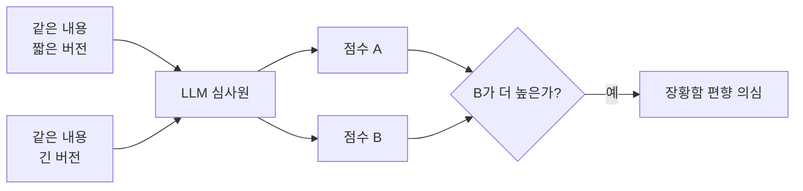
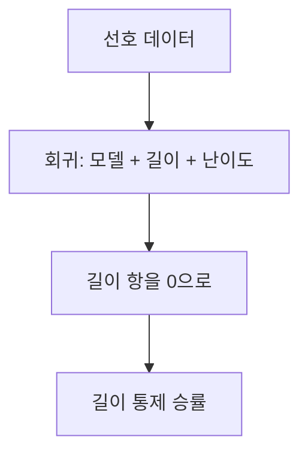

# 길이와 점수 상관

> LLM 심사원이 **글이 길수록 점수를 후하게 주는 경향(장황함 편향)**이 있는지, 점수와 글 길이의 관계를 직접 재 보는 점검이다.

## 쉽게 말하면
논술 채점에서 분량이 많으면 괜히 잘 쓴 것처럼 보이는 일이 있다. 채점자가 이 버릇을 가졌다면 학생은 내용 대신 분량을 늘리면 점수를 얻는다. 그래서 점수를 길이와 나란히 놓고 "길이를 같게 했어도 이 점수가 나왔을까?"를 확인한다.

## 자세히
- 가장 잘 정리된 사례: Dubois 외, Length-Controlled AlpacaEval(arXiv 2404.04475, COLM 2024). AlpacaEval의 승률이 응답 길이에 크게 흔들리자, 자동 평가자의 선호에 **로지스틱 회귀(GLM)**를 맞췄다. 항은 모델 정체성, 길이 차이(표준화 후 tanh), 지시문 난이도다. 길이 항을 0으로 놓고 "두 답의 길이가 같았다면" 승률을 계산한다.
- 편향의 크기(같은 논문): GPT-4-1106-preview에 "더 길게/더 짧게" 쓰라고 프롬프트하면 기존 승률이 22.9%~64.3%로 요동쳤다. 길이 통제 후에는 41.9%~51.6%로 좁아졌고 프롬프트 간 정규화 표준편차는 25%에서 10%로 줄었다. Chatbot Arena와의 스피어만 상관은 0.94에서 0.98로 올랐다.
- 조작 방지: 길이 계수에 약한 정규화를 걸지 않으면 응답을 잘라 이기는 꼼수가 통한다(잘라 낸 GPT-4 변형의 승률이 3.7%에서 25.9%로 뛰었고, 정규화하면 12.2%).
- 한계: 비교적 단순한 영어 지시문과 하나의 평가 프롬프트에서 검증됐고, 닫힌 LLM을 평가자로 쓴 설정이다.
- 우리 쪽 점검법(일반): ① 점수와 글자 수·토큰 수의 상관(스피어만)을 계산 ② 길이 구간별로 점수 평균을 비교 ③ 같은 내용을 길게/짧게 바꿔 점수가 변하는지 시험 ④ 길이를 변수로 넣은 회귀로 길이 효과를 분리.
- 주의: 길이와 점수가 상관이 있다고 곧 편향은 아니다. 좋은 글이 실제로 더 길 수도 있어서, 내용은 같고 길이만 다른 쌍으로 시험해야 편향을 가려낼 수 있다.

## 그림으로 보기

## 예시
| 평가 방식 | GPT-4-1106 승률 범위(논문) |
|---|---|
| 기존 AlpacaEval | 22.9%~64.3% |
| 길이 통제 | 41.9%~51.6% |
- 업무 장면: 챗봇 답변 품질을 LLM이 채점한다면, 답변을 일부러 두 배로 늘린 버전을 만들어 점수가 오르는지 먼저 본다.

## 헷갈리는 것과 비교
| 개념 | 차이 |
|---|---|
| 길이와 점수 상관 | 상관을 재는 점검 절차 |
| [LLM 주석 편향](#llm-annotation-bias) | 길이를 포함한 여러 편향의 상위 개념 |
| 길이 통제 | 편향을 통계로 제거하는 한 방법 |
| [신뢰성과 타당성](#reliability-vs-validity) | 일관된 점수가 옳은 점수는 아님 |

## 더 읽을거리
- [Length-Controlled AlpacaEval (arXiv 2404.04475)](https://arxiv.org/abs/2404.04475) — GLM 길이 통제와 수치(직접 읽음).
