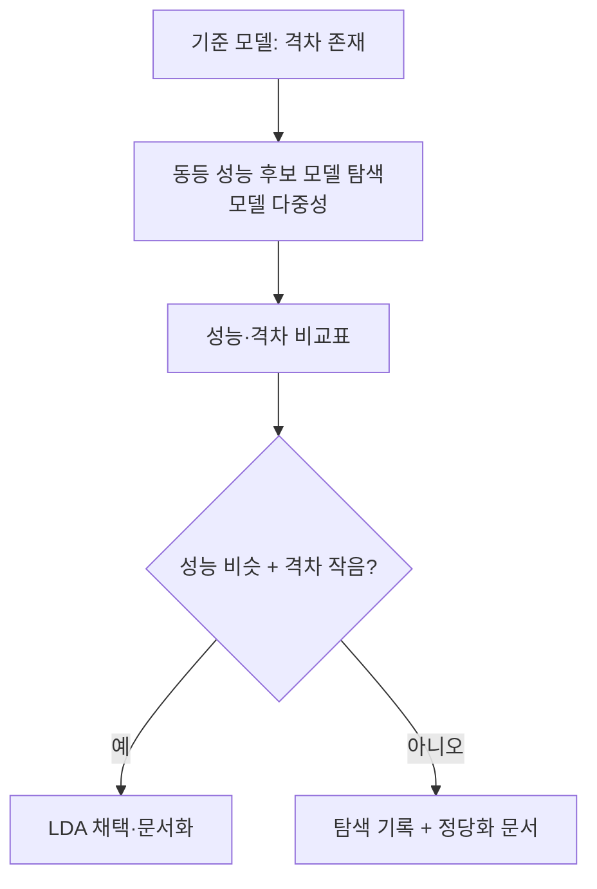

# 덜 차별적 대안 LDA

> 같은 사업 목적을 비슷한 성능으로 달성하면서 집단 간 격차가 더 작은 대안 모델·정책. 차별 영향 분석에서 "더 공정한 대안이 있었는가"를 묻는 핵심 질문이다.

## 쉽게 말하면
같은 맛이면서 재료만 바꿔서 알레르기 환자도 먹을 수 있는 요리가 있다면, 굳이 위험한 요리를 고집할 이유가 없다. 모델도 성능이 같은 여러 모델 중 격차가 작은 것을 고를 수 있다.

## 자세히
출처: Black·Koepke·Kim·Barocas·Hsu, "The Legal Duty to Search for Less Discriminatory Algorithms"(FAccT 2024, arXiv 2406.06817; Georgetown Law Journal) 검색 요약. 논문 본문 직접 확인은 못 했다.
- **핵심 주장**: 주택·고용·신용에서 알고리즘을 쓰는 주체에게 LDA를 찾고 적용할 의무가 있어야 한다. 전제는 **모델 다중성(model multiplicity)** — 격차가 있는 시스템이 있을 때 거의 항상 성능은 동등하고 격차는 더 작은 LDA가 존재한다. 의식적 탐색이 없으면 개발자가 이를 찾을 가능성이 낮다.
- **법적 제안**: 모델의 차별적 효과를 정당화해야 하는 피고의 부담에, 배포 전 합리적 LDA 탐색을 했음을 보이는 것이 포함돼야 한다. FAccT 판은 "원고가 대안을 제시할 수 있는가"가 아니라 "피고가 대안을 찾기 위해 어떤 합리적 조치를 취했는가"를 핵심 질문으로 둔다.
- **판례상 위치**: 저자들은 차별 영향 분석의 정당화 단계에서 덜 차별적 대안의 존재를 오래 고려해 왔다고 주장. "동등한 효과"의 기준은 모호하다고 지적.
- **관련 연구**: Laufer·Raghavan·Barocas(arXiv 2412.18138)는 LDA를 어떻게 형식적으로 정의할지 묻는다. 규제기관이 알고리즘 개발 중 LDA를 찾으라는 성명을 냈다는 언급도 있다.
- **법적 현황 주의**: 미국에서 차별 영향 법리의 적용 범위는 변하고 있다([신용 차별 영향 분석](#disparate-impact-credit), [공정주택법](#fair-housing-act)). 법적 의무와 별개로 실무 도구로 쓰일 수 있다.

## 그림으로 보기

## 예시
- 신용 모델 재학습 시드·변수 조합을 수백 개 돌려 AUC 차이 0.002 이내 후보 중 승인율 격차가 가장 작은 모델 선택, 탐색 과정을 기록.

## 헷갈리는 것과 비교
| 개념 | 차이 |
|---|---|
| LDA | 격차가 더 작은 동등 대안 |
| 공정성 제약 학습 | 학습 때 격차를 직접 제한 |
| [4/5 규칙](#four-fifths-rule) | 격차를 재는 스크리닝 |

## 더 읽을거리
- [The Legal Duty to Search for Less Discriminatory Algorithms](https://arxiv.org/html/2406.06817v1) — LDA 탐색 의무 논문(검색 결과로만 확인)
- [What Constitutes a Less Discriminatory Algorithm?](https://arxiv.org/html/2412.18138v2) — LDA 정의 논의(검색 결과로만 확인)
