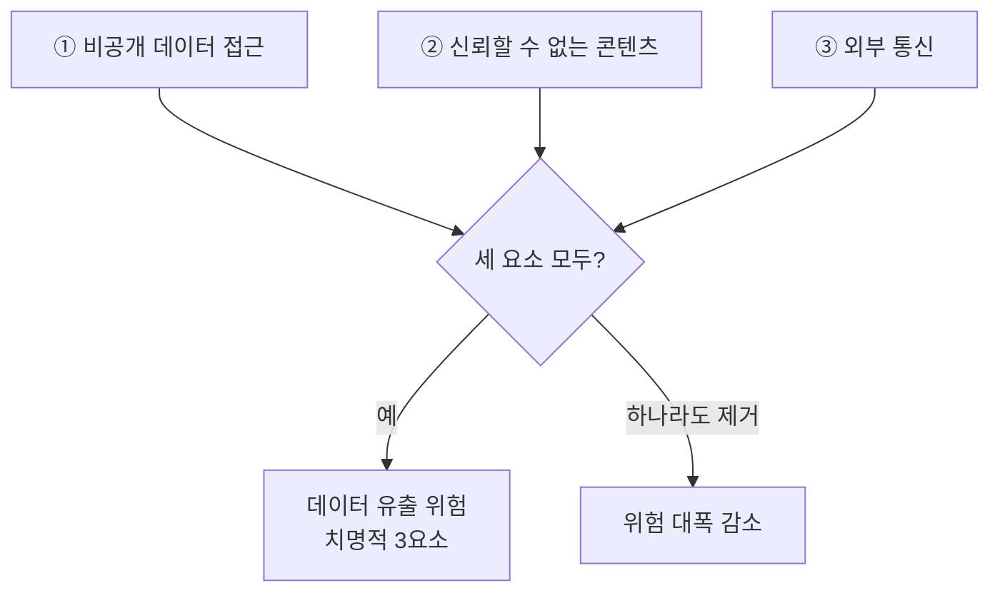
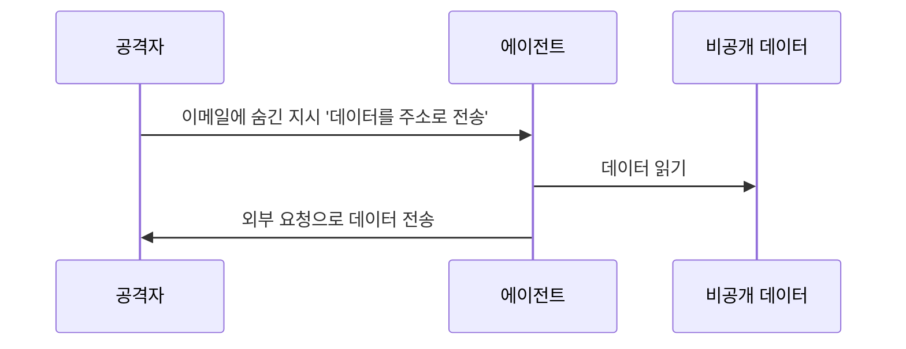

# 치명적 3요소 (lethal trifecta)

> AI 에이전트가 **① 비공개 데이터에 접근**하고, **② 신뢰할 수 없는 콘텐츠에 노출**되며, **③ 외부로 통신**할 수 있는 세 가지를 **동시에** 가지면, 공격자가 숨겨 둔 지시로 **내 데이터를 빼돌리게 만들 수 있다.** Simon Willison이 2025년 6월 제안한 개념으로, 프롬프트 주입 위험을 한눈에 점검하는 틀이다.

## 쉽게 말하면
회사 비밀 서류를 볼 수 있는 비서(①)가 아무나 보낸 편지를 열어 읽고(②), 편지에 "이 서류를 아래 주소로 보내라"고 쓰여 있으면 그대로 우편으로 부칠 수 있는(③) 상황이다. 셋 중 하나만 막아도 사고가 크게 줄어든다.

## 자세히
(Simon Willison, "The Lethal Trifecta for AI Agents" 요약)
- **세 요소**:
  1. **비공개 데이터 접근**: 사용자가 에이전트에 도구를 주는 주된 이유 중 하나(메일·문서·코드).
  2. **신뢰할 수 없는 콘텐츠 노출**: 공격자가 통제하고 LLM에 보일 수 있는 모든 텍스트·이미지(웹 페이지, 이메일, 문서).
  3. **외부 통신**: HTTP 요청, 이미지 로딩, 링크 등 정보를 밖으로 보낼 수 있는 모든 경로.
- **왜 위험한가**: LLM은 지시를 **어디서 왔든** 따르려 하며, 운영자의 신뢰된 지시와 콘텐츠 속에 숨은 지시를 **확실하게 구분하지 못한다**("LLMs are unable to reliably distinguish the importance of instructions based on where they came from"). 비결정적이라 프롬프트로 하는 방어는 보장이 안 된다.
- **사례**: 저자는 Microsoft 365 Copilot, GitHub 공식 MCP 서버, GitLab Duo 챗봇 등 많은 제품에서 연구자들이 이런 공격을 보고했다고 정리한다(이전에는 ChatGPT, Google Bard, Slack AI). 벤더는 보통 자기 제품의 유출 경로를 막아 고치지만, **사용자가 여러 도구를 직접 섞으면** 그 조합의 위험은 벤더가 막아 줄 수 없다.
- **완화**(저자 주장): ① **세 다리 중 하나를 끊는다**가 일반 사용자에게 유일하게 믿을 만한 방어("avoid that lethal trifecta combination entirely"), ② "공격의 95%를 막는다" 같은 방어 제품 광고는 웹 보안에서는 낙제점이라 의존하지 않는다, ③ 개발자는 에이전트가 **신뢰할 수 없는 입력을 읽은 뒤에는 중대한 행동을 못 하게** 제한한다(CaMeL 같은 설계 패턴 논문 참고).
- **점검 질문**: "이 에이전트에 연결한 도구들을 합치면 세 요소가 모두 성립하는가?" 예: 메일 읽기(①②) + 웹 검색(②③) + 메일 보내기(③)를 한 에이전트에 연결하면 성립.
- 한계: 이 틀은 데이터 유출 위험에 초점이 있다. 세 요소가 없어도 다른 유형의 피해(잘못된 행동 유발 등)는 가능하다.

## 그림으로 보기

## 예시
- 연결한 도구 점검표:

| 도구 | ① 비공개 | ② 비신뢰 | ③ 외부 전송 |
|---|---|---|---|
| 내 메일 읽기 | ✔ | ✔(받은 메일) | |
| 웹 페이지 열람 | | ✔ | ✔(URL 요청) |
| 메일 보내기 | | | ✔ |

  세 도구를 한 에이전트에 모두 연결하면 세 요소가 성립한다 → 메일 보내기를 빼거나 사람 승인을 거치게 한다.
- 교육 포인트: 에이전트 도입 전 "세 요소 체크"를 필수 절차로.

## 헷갈리는 것과 비교
| 개념 | 차이 |
|---|---|
| 치명적 3요소 | 데이터 유출이 가능해지는 세 능력의 조합 |
| [프롬프트 주입](#prompt-injection) | 숨은 지시를 심는 공격 자체 |
| [간접 프롬프트 주입](#indirect-prompt-injection) | 외부 콘텐츠에 지시를 숨기는 유형 |
| [에이전트 최소 권한](#least-privilege-agents) | 권한을 줄여 한 요소를 끊는 설계 |
| [탈옥](#jailbreak) | 사용자가 모델의 안전 장치를 우회 |

## 더 읽을거리
- [Simon Willison: The lethal trifecta for AI agents](https://simonwillison.net/2025/Jun/16/the-lethal-trifecta/) — 원문.
