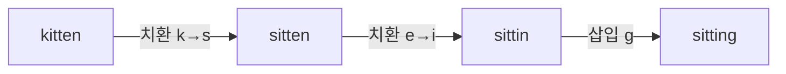

# 레벤슈타인 거리

> 한 문자열을 다른 문자열로 바꾸는 데 필요한 **삽입·삭제·치환의 최소 횟수**. 맞춤법 교정, 중복 탐지, AI 제안을 사람이 얼마나 고쳤는지(편집 거리) 재는 데 쓰인다. 고전적 정의에서는 편집 1회의 비용이 1이다.

## 쉽게 말하면
"kitten"을 "sitting"으로 바꾸려면 글자 하나를 바꾸고(k→s), 하나를 바꾸고(e→i), 하나를 끼워 넣는다(g). 총 3번이라 거리는 3이다. 가장 적게 손대는 길을 찾는 것이다.

## 자세히
출처: Wikipedia "Levenshtein distance"(본문 확인, 2026-11-18). 아래 한국어 예시 숫자는 직접 계산했다.
- **재귀 정의**: D(i,0)=i, D(0,j)=j. 그 외 D(i,j)는 세 값의 최솟값: 삭제 D(i−1,j)+1, 삽입 D(i,j−1)+1, 치환 D(i−1,j−1)+δ(마지막 글자가 같으면 0, 다르면 1).
- **계산법(Wagner–Fischer, 1974)**: (m+1)×(n+1) 표를 채운다. 시간 Θ(mn), 표를 다 저장하면 공간도 Θ(mn). 거리만 필요하면 이전 행만 쓰므로 공간 O(min(m,n)). 편집 순서를 복원하려면 표를 거슬러 올라간다.
- **범위**: |m−n| 이상, max(m,n) 이하. 같은 길이에서는 해밍 거리 이하("flaw"와 "lawn": 해밍 4, 레벤슈타인 2). 인접 글자 교환까지 1회로 치는 변형이 Damerau–Levenshtein.
- **단위 선택**: 바이트·코드포인트·자소 묶음 중 무엇을 한 글자로 볼지, 유니코드 정규화(NFC·NFD) 여부에 따라 값이 달라진다. 한국어는 음절 단위냐 자모 단위냐가 결과를 크게 바꿀 수 있으므로 기록해 둔다(문서의 단위 선택 설명에서 이어지는 적용).
- **직접 계산한 사례**:

| 원문 | 수정본 | 거리 | 길이 정규화 |
|---|---|---|---|
| kitten | sitting | 3 | 0.429 |
| 환불 요청 | 환불 요청함 | 1 | 0.167 |
| 확인했습니다 | 확인 했습니다 | 1 | 0.143 |
| 300만 원 입금 | 30만 원 입금 | 1 | 0.111 |

- **핵심 교훈**: 마지막 행처럼 거리 1(정규화 0.111)인 수정이 금액을 10배 바꿀 수 있다. 편집 거리는 **얼마나 많이** 고쳤는지를 말하지 **얼마나 중요하게** 고쳤는지는 말하지 않는다([의미 유사도](#semantic-similarity-edit)).
- **쓰임**: AI 제안 수락 후 수정량 측정([무수정 수락률](#accept-without-edit-rate)), 요약·번역 후편집 노력 추정.

## 그림으로 보기


## 예시
```python
def levenshtein(a, b):
    prev = list(range(len(b) + 1))
    for i, ca in enumerate(a, 1):
        cur = [i]
        for j, cb in enumerate(b, 1):
            cur.append(min(prev[j] + 1, cur[j-1] + 1, prev[j-1] + (ca != cb)))
        prev = cur
    return prev[-1]

levenshtein("300만 원 입금", "30만 원 입금")   # 1
```
교육 활용: "AI 초안을 거의 안 고쳤다"는 보고를 받으면 거리 값과 함께 어떤 글자가 바뀌었는지도 보게 하는 실습.

## 헷갈리는 것과 비교
| 개념 | 차이 |
|---|---|
| 레벤슈타인 거리 | 삽입·삭제·치환 최소 횟수 |
| 해밍 거리 | 같은 길이에서 다른 위치 수만 셈 |
| [정규화 편집 거리](#normalized-edit-distance) | 길이로 나눠 비교 가능하게 |
| [의미 유사도](#semantic-similarity-edit) | 표면이 아니라 뜻의 차이를 봄 |

## 더 읽을거리
- [Wikipedia: Levenshtein distance](https://en.wikipedia.org/wiki/Levenshtein_distance) — 정의·알고리즘·변형
