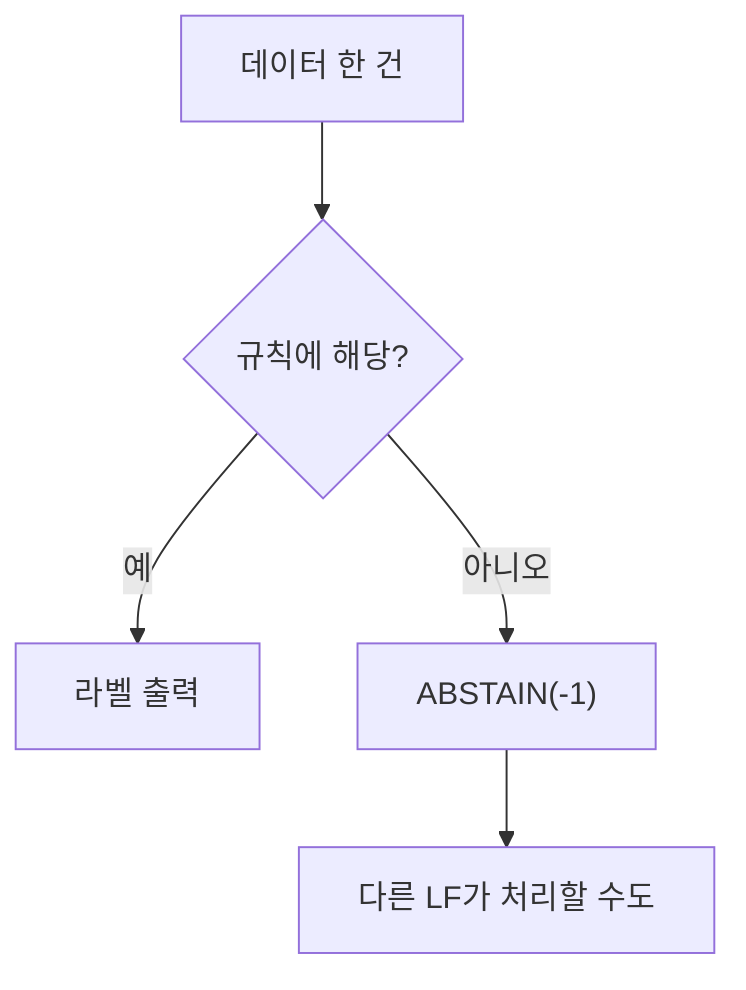
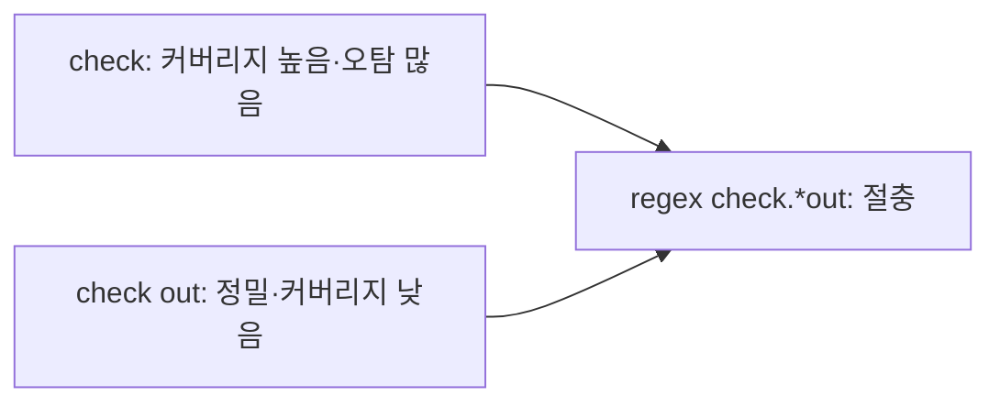

# 기권(ABSTAIN)

> 라벨링 함수(LF)가 확신이 없을 때 라벨을 붙이지 않고 "모르겠다"를 반환하는 설계다. Snorkel에서는 ABSTAIN = -1로 표기한다.

## 쉽게 말하면
시험에서 모르는 문제를 찍지 않고 비워 두는 것과 같다. 틀린 답을 내는 것보다 비워 두는 편이 낫고, 다른 채점 규칙들이 그 칸을 채울 수 있다.

## 자세히
(Snorkel 공식 튜토리얼 코드와 설명을 직접 읽고 확인.)
- LF는 데이터 한 건을 받아 **라벨을 주거나 기권**한다. 완벽할 필요도 모든 데이터에 라벨을 붙일 필요도 없다(noisy 허용).
- 튜토리얼 상수: `ABSTAIN = -1`, `HAM = 0`, `SPAM = 1`. 예: `return SPAM if "check out" in x.text.lower() else ABSTAIN`.
- **정확도·커버리지 절충**: `"check"`는 커버리지가 높지만 오탐이 많고, `"check out"`은 정밀하지만 "check me out" 같은 변형을 놓친다. 정규식 `check.*out`으로 둘의 중간을 택한다.
- **통계 계산에서의 처리**: Correct·Incorrect·Empirical Accuracy는 LF가 라벨을 낸 건에서만 계산한다(기권한 건에는 벌점이 없다).
- **설계 원칙(제안)**: 근거가 약한 조건에서는 기권, 한쪽 클래스만 판정하는 LF(스팸만, 정상만)를 여러 개 두기. 기권이 많으면 [커버리지](#lf-coverage-conflict)가 낮아져 라벨이 안 붙은 데이터가 늘어난다.

## 그림으로 보기

## 예시
- 고객 문의 분류: "환불"이 있으면 환불 의도 LF, 없으면 ABSTAIN.
- 교육 활용: "AI가 모를 때 모른다고 하는 것도 설계"라는 메시지의 비유로 활용.

## 헷갈리는 것과 비교
| 개념 | 차이 |
|---|---|
| ABSTAIN | 라벨 없음(미정). 정상 클래스(HAM)와 다름 |
| 정상 클래스 라벨 | 그 클래스라고 적극 판정 |
| [LF 커버리지·충돌](#lf-coverage-conflict) | 기권이 많을수록 커버리지 하락 |

## 더 읽을거리
- [Snorkel 튜토리얼 소스(spam)](https://github.com/snorkel-team/snorkel-tutorials/blob/master/spam/01_spam_tutorial.py) — ABSTAIN·check/regex LF 예제.
