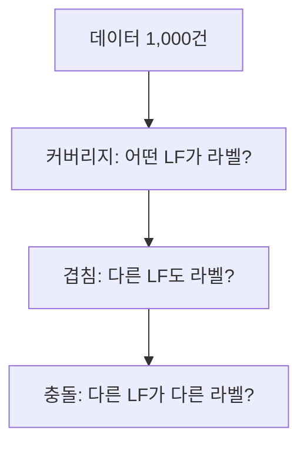
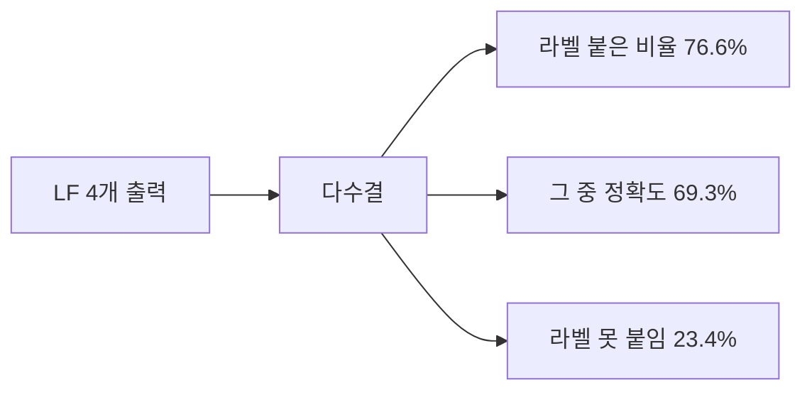

# LF 커버리지와 충돌

> 라벨링 함수(LF)를 평가하는 세 가지 기본 지표다. 커버리지는 LF가 라벨을 붙인 데이터의 비율, 겹침은 다른 LF도 같이 라벨을 붙인 비율, 충돌은 다른 LF가 서로 다른 라벨을 붙인 비율이다.

## 쉽게 말하면
심사위원 여러 명이 있을 때, 어떤 심사위원이 전체 작품 중 몇 개를 채점했는지(커버리지), 다른 심사위원도 같은 작품을 채점했는지(겹침), 같은 작품에 서로 다른 점수를 줬는지(충돌)를 보는 것과 같다. 충돌이 많다고 반드시 나쁜 건 아니지만 어디를 점검해야 할지 알려 준다.

## 자세히
(Snorkel LFAnalysis 문서를 직접 열어 확인하고, 정의대로 numpy로 직접 계산.)
- **정의(문서)**
  - **커버리지**: LF가 라벨을 붙인(기권이 아닌) 데이터 비율. `lf_coverages()`.
  - **겹침(overlap)**: 다른 LF가 하나라도 기권하지 않고 라벨을 붙인 예제. `lf_overlaps()`; 최댓값은 그 LF의 커버리지.
  - **충돌(conflict)**: 다른 LF가 **다른** 라벨을 붙인 예제로 더 엄격. `lf_conflicts()`; 최댓값은 그 LF의 겹침 비율.
  - **경험적 정확도**: 정답이 있을 때 LF 정확도 `lf_empirical_accuracies(Y)`. `lf_summary(Y)`는 이런 통계를 표로 모은다.
- **직접 계산(1,000건, LF 4개 시뮬레이션)**
  | LF | 커버리지 | 겹침 | 충돌 | 실제 정확도 |
  |---|---|---|---|---|
  | lf_url | 0.226 | 0.226 | 0.156 | 0.894 |
  | lf_keyword | 0.505 | 0.490 | 0.325 | 0.683 |
  | lf_short | 0.804 | 0.762 | 0.476 | 0.608 |
  | lf_noisy | 0.887 | 0.826 | 0.512 | 0.547 |
  커버리지가 큰 LF일수록 충돌도 크다. 충돌 크기는 LF의 정확도가 낮을수록 커진다(여기선 같은 현상).
- **합친 결과(직접 계산, 단순 다수결)**: 하나 이상의 LF가 라벨을 붙인 데이터는 **76.6%**, 그 중 다수결 정확도 **69.3%**(동률은 기권 처리). 정확도 가중 투표(정답 기반 가중치)는 99%를 커버하되 정확도 68.5% — 커버리지가 달라 단순 비교는 안 된다. 더 나은 합치기는 [라벨 모델](#label-model-denoising).
- **해석 요령(제안)**: ① 커버리지가 낮은 LF는 보강하거나 규칙 확장 ② 충돌이 높은 두 LF는 정의가 상충하는지 확인 ③ 아무 LF도 라벨을 못 붙인 데이터(여기선 23.4%)에는 다른 모델이 필요 ④ 정확도가 0.5 근처인 LF는 제거 후보.
- **통계적 주의**: 충돌이 많아도 라벨 모델이 정확도 차이를 이용해 풀 수 있고, 반대로 충돌이 없어도 LF들이 같은 방식으로 틀린다면(상관) 위험하다(제안).

## 그림으로 보기



## 예시
```python
import numpy as np
ABS = -1
cov = (L != ABS).mean(0)                      # L: (n, 규칙 수)
others = np.delete(L, j, axis=1)
conflict = ((L[:, j] != ABS) &
            ((others != ABS) & (others != L[:, [j]])).any(1)).mean()
```
- 사내 스팸/문의 분류에서 LF 10개를 만들고 충돌 상위 2쌍을 회의에서 검토해 정의를 정리한다.

## 헷갈리는 것과 비교
| 지표 | 질문 |
|---|---|
| 커버리지 | 얼마나 많은 데이터에 라벨을 붙이나 |
| 겹침 | 다른 LF와 함께 라벨을 붙이나 |
| 충돌 | 다른 LF와 의견이 다른가 |
| 정확도 | 정답과 얼마나 맞나(정답 필요) |

## 더 읽을거리
- [Snorkel LFAnalysis](https://snorkel.readthedocs.io/en/master/packages/_autosummary/labeling/snorkel.labeling.LFAnalysis.html) — 정의와 함수(열어 확인).
