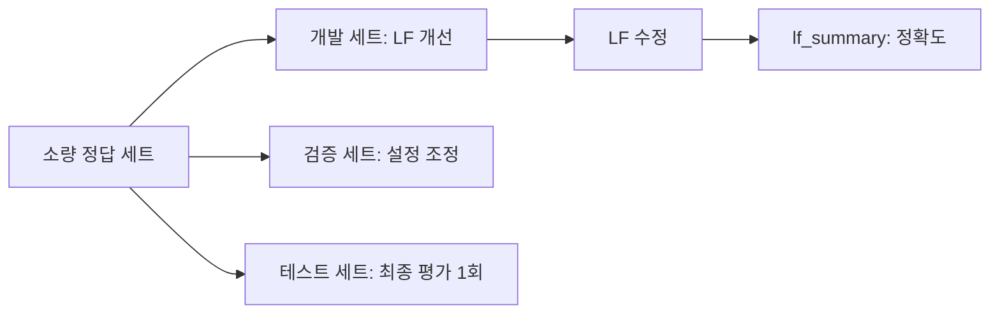
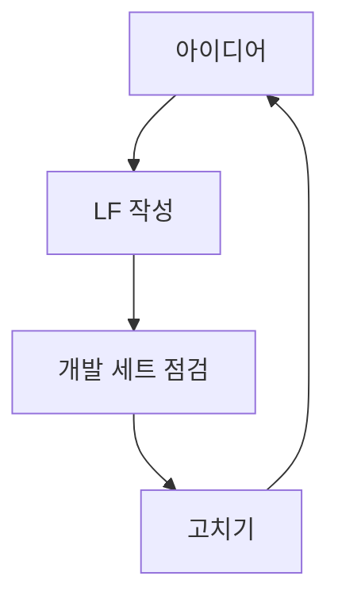

# LF 정확도 점검(개발 세트)

> 소량의 정답(골드) 라벨을 가진 개발 세트로 라벨링 함수(LF)의 실제 정확도를 재서, LF를 고치고 거르는 점검 절차다.

## 쉽게 말하면
시험지를 대량으로 자동 채점하기 전에, 소수의 정답지로 채점 규칙이 맞게 동작하는지 시험해 보는 것이다. 정답지는 규칙을 고치는 데 쓰고, 최종 시험(테스트 세트)은 아껴 둔다.

## 자세히
(Snorkel 튜토리얼 소스를 직접 읽고 확인.)
- **데이터 분할**: 학습 세트(정답 없음, 약한 지도로 라벨) + **테스트 세트**(소량 수작업 라벨, 최종 평가 전용·오류 분석에 쓰지 않음). 더 실전적인 설정에서는 손 라벨 데이터를 **개발 세트**(LF 아이디어·디버깅용)와 **검증 세트**(하이퍼파라미터 조정, 테스트 점수를 안 보고 성능 확인)로 더 나눈다.
- **LF 개발 주기**: ① 예시를 보고 아이디어 ② 초기 LF 작성 ③ 학습/개발 세트에서 출력을 눈으로 확인 ④ 커버리지·정확도 개선.
- **측정**: 개발 세트에 정답이 있으면 `lf_summary()`가 Correct / Incorrect / Empirical Accuracy를 계산한다(LF가 라벨을 낸 건에서만).
- **정답이 없을 때**: LabelModel이 정확도를 추정. 튜토리얼은 학습 세트에는 정답이 없고 테스트 세트는 볼 수 없으므로 이 통계를 직접 못 구한다고 명시.
- **주의(제안)**: 개발 세트에 맞춰 규칙을 과하게 고치면 개발 세트에 과적합한다. 개발 세트는 수백 건 정도라도 대표성이 중요하다. 개발·검증·테스트를 섞지 않는다.

## 그림으로 보기

## 예시
- 상담 문의 200건에 사람이 라벨을 달아 개발 세트로 만들고 LF별 정확도를 표로 확인.
- 교육 활용: 학습·검증·테스트 세트를 입시 모의고사·수능에 비유.

## 헷갈리는 것과 비교
| 개념 | 차이 |
|---|---|
| 개발 세트 | LF 수정용 정답 |
| 테스트 세트 | 최종 평가용, 수정에 쓰지 않음 |
| [LF 요약표](#lf-summary-table) | 정확도를 포함한 진단표 |

## 더 읽을거리
- [Snorkel 튜토리얼 소스(spam)](https://github.com/snorkel-team/snorkel-tutorials/blob/master/spam/01_spam_tutorial.py) — 데이터 분할·LF 개발 주기 설명.
