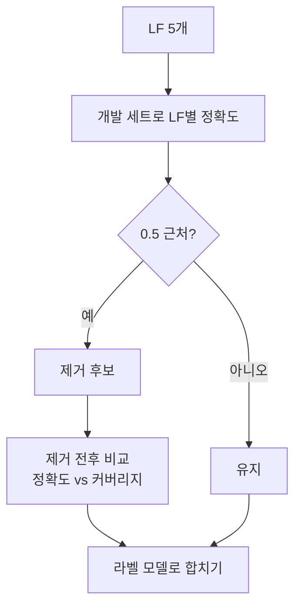
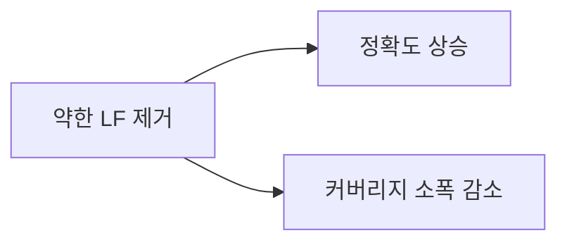

# 약한 LF 제거

> 정확도가 0.5(찍기 수준) 근처인 라벨링 함수(LF)를 빼는 작업이다. 이런 LF는 커버리지만 넓히고 라벨 품질을 깎는다.

## 쉽게 말하면
심사위원 5명 중 2명이 사실상 동전 던지기로 점수를 준다면, 그 둘을 빼도 결과가 나빠지지 않고 오히려 좋아진다. 다만 심사위원이 몇 건이나 채점했는지(커버리지)는 줄어드니 얼마나 줄고 얼마나 나아지는지 따져 본다.

## 자세히
(Data Programming 논문 arXiv 1605.07723 본문과 Snorkel LFAnalysis 문서를 직접 열어 확인하고, 시뮬레이션은 직접 실행.)
- **논문의 가정**: 이론 분석에서 LF 정확도 α를 **0.8~0.9**, 커버리지 β를 0.3~0.5로 가정하고, 이는 "사용자가 정확도·커버리지가 높은 LF를 쓰는 경험"과 대체로 맞는다고 적는다(식 (1) 부근). 즉 0.5 근처 LF는 가정 바깥이다.
- **Snorkel 문서**: `lf_empirical_accuracies(Y)`로 개발 세트 정확도를, `lf_coverages()`로 커버리지를 본다. 문서는 "무엇이 랜덤보다 낫다"는 기준값을 주지 않는다 — 기준은 사용자가 정한다.
- **직접 시뮬레이션(5,000건, 이진 라벨, LF 5개, 단순 다수결, 동률은 기권)**
  | 구성 | 라벨 붙은 비율 | 정확도 |
  |---|---|---|
  | 5개 전부(정확도 0.90·0.80·0.70·0.52·0.50) | 83.2% | 77.3% |
  | 약한 둘(0.52·0.50) 제거 | 81.2% | **86.6%** |
  | 0.70 LF도 제거(LF 2개) | 72.0% | 89.6% |
  약한 LF 제거로 커버리지는 2%p 줄고 정확도는 9%p 올랐다. 더 빼면 정확도는 더 오르지만 라벨 붙는 데이터가 눈에 띄게 줄어 trade-off가 생긴다(시뮬레이션이며 실제 데이터에선 LF 간 상관이 있어 다를 수 있다).
- **절차(제안)**: ① 사람 라벨 개발 세트로 LF별 정확도 측정([합친 라벨 검증](#label-model-validation)) ② 0.5+ε 이하(이진 기준)는 제거 후보 — 클래스가 많으면 기준은 1/클래스 수 ③ 제거 전후 합친 라벨 정확도·커버리지를 같이 비교 ④ 정확도가 낮아도 **다른 LF가 못 보는 데이터**를 덮는다면 남길지 판단.
- **주의**: 라벨 모델([라벨 모델](#label-model-denoising))은 LF별 정확도를 가중치로 추정하므로 약한 LF의 가중치를 낮출 수 있다. 하지만 개발 세트 없이 추정한 정확도는 틀릴 수 있어, 제거 판단은 가능하면 사람 라벨로 확인한다.

## 그림으로 보기

## 예시
- 고객 문의 분류에서 "문장이 짧으면 불만" LF의 정확도가 0.51로 나오면 제거하고, 합친 라벨 정확도가 올랐는지 개발 세트로 확인.
- 교육 소재: "찍기 수준 규칙은 많아도 도움이 안 된다"를 위 표로 보여 주기.

## 헷갈리는 것과 비교
| 개념 | 차이 |
|---|---|
| 약한 LF 제거 | 쓸모없는 LF를 입력에서 뺌 |
| [LF 커버리지와 충돌](#lf-coverage-conflict) | LF 진단 지표(제거 판단의 근거 일부) |
| [라벨 모델](#label-model-denoising) | LF를 정확도 가중으로 합침(약한 LF 가중치를 낮춤) |
| [합친 라벨 검증](#label-model-validation) | 결과를 사람 라벨로 확인 |

## 더 읽을거리
- [Data Programming (arXiv 1605.07723)](https://arxiv.org/abs/1605.07723) — LF 정확도·커버리지 가정과 생성 모델.
- [Snorkel LFAnalysis 문서](https://snorkel.readthedocs.io/en/master/packages/_autosummary/labeling/snorkel.labeling.LFAnalysis.html) — `lf_empirical_accuracies`, `lf_coverages` 등 진단 함수.
