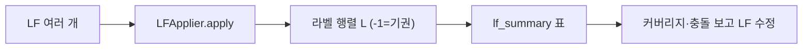
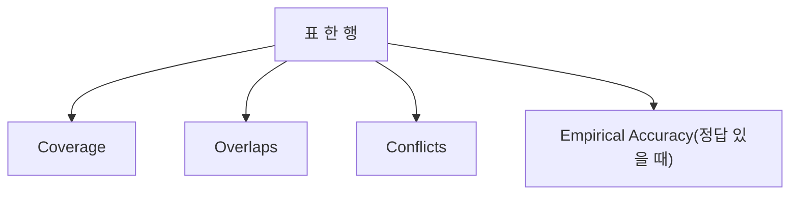

# lf_summary 표 읽기

> Snorkel의 `LFAnalysis(L, lfs).lf_summary()`는 라벨링 함수(LF)마다 극성·커버리지·중복·충돌·정확도를 한 표로 보여 준다. LF를 고르고 고치는 계기판이다.

## 쉽게 말하면
선수별 기록표다. 몇 경기에 나왔는지(커버리지), 다른 선수와 같은 장면에 겹쳤는지(중복), 의견이 달랐는지(충돌), 득점률(정확도)이 적혀 있다.

## 자세히
(Snorkel 튜토리얼 소스를 직접 읽고 확인.)
- **라벨 행렬 L**: 행 = 데이터, 열 = LF, `L[i, j]` = j번째 LF가 i번째 데이터에 낸 라벨(기권은 -1). `PandasLFApplier(lfs).apply(df)`로 만든다.
- **표의 열**
  - **Polarity**: LF가 내는 고유 라벨 집합(기권 제외)
  - **Coverage**: LF가 라벨을 붙인 데이터 비율
  - **Overlaps**: 이 LF와 다른 LF가 함께 라벨을 붙인 비율
  - **Conflicts**: 함께 라벨을 붙였는데 **의견이 다른** 비율
  - **Correct / Incorrect / Empirical Accuracy**: 정답 라벨이 있을 때만. LF가 라벨을 낸 건만 대상(기권엔 벌점 없음)
- **튜토리얼의 쓰임**: `check`와 `check out`의 커버리지를 비교하고, 정규식 LF를 추가해 "커버리지는 `check`와 `check out` 사이, 오탐은 줄이는" 지점을 찾았다. 정답이 없는 학습 세트에서는 Correct 등을 구할 수 없고, LabelModel이 정확도를 추정한다고 안내한다.
- **읽는 요령(제안)**: 커버리지가 높고 충돌이 많으면 오탐 의심, 커버리지가 낮고 충돌이 없으면 보수적 LF, 충돌 0이어도 같은 방식으로 틀리는 LF들의 가능성([상관된 LF](#correlated-lf-risk)).

## 그림으로 보기

## 예시
- 새 LF 추가 후 Conflicts가 20%로 뛰면 충돌 샘플 10건을 직접 읽고 규칙 수정.
- 교육 활용: 스프레드시트 한 줄로 "규칙의 건강 상태"를 점검하는 감각 익히기.

## 헷갈리는 것과 비교
| 개념 | 차이 |
|---|---|
| lf_summary | LF별 진단표 |
| [LF 정확도 점검](#lf-dev-set-accuracy) | 소량 정답으로 정확도 확인 |
| 라벨 행렬 | 원자료 행렬(표는 요약) |

## 더 읽을거리
- [Snorkel 튜토리얼 소스(spam)](https://github.com/snorkel-team/snorkel-tutorials/blob/master/spam/01_spam_tutorial.py) — LFAnalysis 항목 설명.
