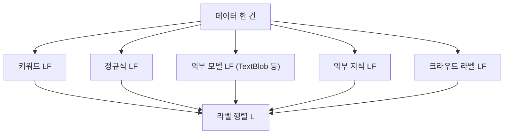
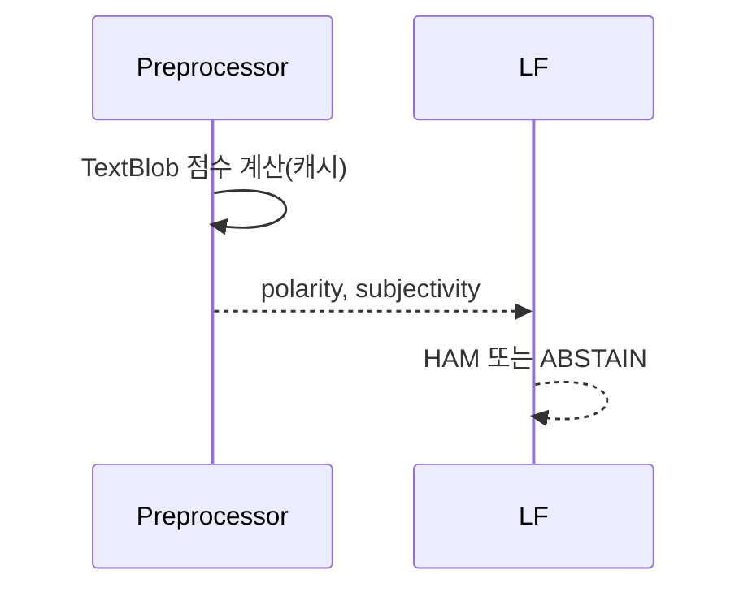

# LF 종류(패턴·메타·외부지식)

> 라벨링 함수(LF)는 데이터 한 건을 받아 라벨이나 기권을 돌려주기만 하면 되므로, 키워드·패턴·외부 모델·외부 지식·크라우드 라벨 등 다양한 약한 지도 신호를 같은 틀로 감쌀 수 있다.

## 쉽게 말하면
채점 보조 도구 상자다. 돋보기(키워드), 도장(패턴), 다른 과목 선생님(외부 모델), 사전(외부 지식), 아르바이트생(크라우드)이 각자 아는 만큼만 점수를 매긴다.

## 자세히
(Snorkel 공식 튜토리얼의 설명과 코드를 직접 읽고 확인.)
Snorkel 튜토리얼이 드는 형태:
- **키워드 검색**: `"check" in x.text.lower()`
- **패턴 매칭**: 정규식 `re.search(r"check.*out", ...)`
- **제3자 모델**: 다른 과제로 학습된 모델. 예시는 TextBlob 감성 분석을 스팸/정상 분류에 활용 — 폴라리티 > 0.9면 HAM, 주관성 ≥ 0.5면 HAM. 정확하지 않아도 LabelModel이 정확도를 추정해 가중한다.
- **원거리 지도(distant supervision)**: 외부 지식베이스 사용.
- **크라우드워커 라벨**: 각 작업자를 데이터 일부에 라벨을 내는 블랙박스 함수로 취급.
- **전처리기(Preprocessor)**: `@preprocessor(memoize=True)`로 데이터를 가공(예: TextBlob 점수 계산)한 결과를 여러 LF가 공유, 캐시로 재계산 방지. `@labeling_function(pre=[...])`로 연결.
- 메타 규칙·외부 지식이라는 이름의 분류는 튜토리얼 용어가 아니라 이 지도에서의 묶음이다(제안).
- 선택 기준(제안): 설명 가능성, 구축 비용, 오류 패턴이 서로 다른지.

## 그림으로 보기

## 예시
- 리뷰 감성 분류에서 키워드 LF 3개, 이모지 규칙 1개, 기존 감성 모델 LF 1개를 조합.
- 교육 활용: "정답이 없을 때 여러 불완전한 단서를 합치는 법"의 첫 수업.

## 헷갈리는 것과 비교
| 개념 | 차이 |
|---|---|
| 규칙 LF | 사람이 쓴 패턴 |
| 모델 LF | 학습된 다른 모델의 출력을 이용 |
| [LF 기권](#lf-abstain) | 어떤 종류든 모르면 기권 |

## 더 읽을거리
- [Snorkel 튜토리얼 소스(spam)](https://github.com/snorkel-team/snorkel-tutorials/blob/master/spam/01_spam_tutorial.py) — LF 유형·Preprocessor 예.
