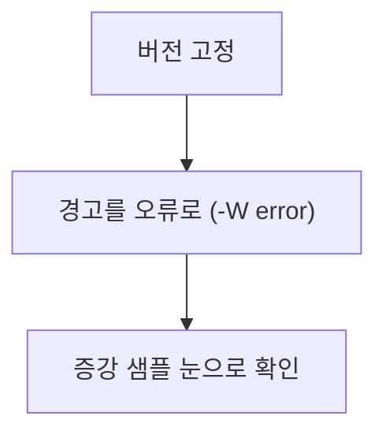

# 라이브러리 버전별 API 차이

> 인터넷의 예제·문서와 **내가 설치한 버전의 인자 이름이 다른** 문제다. 어떤 라이브러리는 옛 인자를 에러 없이 무시하고 경고만 내므로, 의도한 설정이 적용되지 않은 채 학습이 돌 수 있다.

## 쉽게 말하면
옛날 요리책에 "소금 1스푼"이라고 적혀 있는데 새 주방 기계는 그 단어를 못 알아듣고 "모르는 말이네요" 하고 소금 없이 요리한다. 요리는 끝나지만 맛은 틀린다.

## 자세히
(Albumentations 2.0.8을 설치해 인자를 하나씩 시험한 결과. 이 버전의 값이며 다른 버전은 다를 수 있다)
| 호출 | 결과 |
|---|---|
| `Rotate(limit=10, value=0)` | 오류 없음, 경고 `Argument(s) 'value' are not valid for transform Rotate` → **무시됨**(새 이름 `fill`) |
| `Rotate(limit=10, fill=0)` | 정상 |
| `CoarseDropout(max_holes=4)` | 오류 없음, 경고로 **무시** → 새 인자는 `num_holes_range` |
| `GaussNoise(var_limit=(10,50))` | 오류 없음, 경고로 **무시** → 새 인자는 `std_range` |
| `ShiftScaleRotate()` | 경고 "Affine의 특수한 경우이니 Affine을 쓰라"(사용 중단 예고) |
| `RandomCrop(size=(10,10))` | **오류**(height·width 필수 입력 요구) |
- 핵심 위험: 위 두 번째 줄처럼 **옛 인자는 예외 없이 무시된다.** `max_holes=4`로 4개 구멍을 기대했는데 기본값이 쓰일 수 있다. 경고를 로그에서 못 보면 모른다.
- 같은 이유로 LLM이 쓴 코드나 오래된 블로그 예제가 최신 버전에서 다르게 동작한다.
- 점검 습관(제안):
  1. `pip show 패키지`로 버전을 기록하고 `requirements.txt`에 고정한다.
  2. `python -W error`로 경고를 오류로 바꿔 인자 무시를 즉시 드러낸다(이 환경에서 직접 시험하지는 않았다. 표준 파이썬 옵션).
  3. 새 인자를 쓴 뒤 `help(클래스)` 또는 문서에서 인자 이름을 대조한다.
  4. 증강 결과 이미지를 몇 장 저장해 눈으로 확인한다([증강 샘플 점검](#augmentation-sample-review)).
- 관련 위험: [박스 좌표 형식](#bbox-coordinate-formats)처럼 오류 없이 결과만 틀어지는 "조용한 버그"의 한 종류다.

## 그림으로 보기



## 예시
```bash
pip show albumentations        # 버전 확인
python -W error train.py       # 경고를 예외로
```
- 같은 `CoarseDropout` 예제가 1.x에서는 `max_holes`, 2.x에서는 `num_holes_range`.
- 교육: "복사한 코드가 돈다고 맞는 건 아니다."

## 헷갈리는 것과 비교
| 개념 | 차이 |
|---|---|
| 오류(예외) | 즉시 실패, 발견 쉬움 |
| 경고 + 무시 | 계속 실행, 설정 미적용 |
| 사용 중단(deprecation) | 아직 작동하지만 제거 예정 |

## 더 읽을거리
- [Albumentations 문서](https://albumentations.ai/docs/) — 변환별 현재 인자(설치 후 `help()`로 대조).
