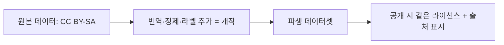
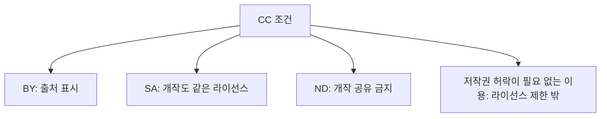

# 파생 데이터 라이선스 상속

> 원본 데이터의 라이선스 조건이 그것을 가공·번역·재구성한 파생 데이터에도 따라붙는지의 문제다. 특히 Creative Commons의 ShareAlike(동일조건)와 NoDerivatives(변경금지)가 파생물(adaptation)을 어떻게 다루는지가 핵심이다.

## 쉽게 말하면
남의 레시피를 보고 내 가게에서 조금 고쳐 만든 레시피를 팔 때, 원 레시피 주인이 "고쳐서 쓰려면 너도 똑같은 조건으로 공개하라"고 했는지, "아예 고치지 마라"고 했는지를 확인해야 한다. 데이터의 파생본도 마찬가지다.

## 자세히
(Creative Commons FAQ를 직접 열어 확인. 일반 정보이며 법률 자문이 아니다. 각 나라의 저작권법이 달라 실제 적용은 법무 검토가 필요하다.)
- **ShareAlike(SA)**: 자료의 **개작(adaptation)**을 **같은 라이선스로** 공개하도록 요구한다.
- **NoDerivatives(ND)**: 개작의 **공유**를 금지한다. 다만 어떤 매체·형식으로도 쓸 수 있다는 허락은 ND에서도 유지된다(FAQ).
- **모든 CC 라이선스는 출처 표시(BY)** 를 요구한다. 표시 방법은 매체·맥락에 따라 유연하다.
- **개작이란?(FAQ)**: "하나 이상의 기존 저작물에 기반한 저작물"이며 무엇이 개작인지는 적용 법률에 달렸다. 일반적으로 다른 언어로 번역하는 것이나 소설을 영화화하는 것이 개작으로 여겨진다. 수정물이 이전 저작물에 **기반**할 때 저작권법상 개작 수준에 이른다고 본다. CC 라이선스 안에서는 음악을 영상과 맞춰 싱크하는 것이 법과 무관하게 항상 개작이다.
- **AI 학습과의 관계(FAQ)**: CC 라이선스는 **저작권상 허락이 필요한 모든 상황**에 대해 재사용 허락을 준다. 저작권 허락이 필요하지 않은 이용에는 라이선스가 제한을 두지 않으며, FAQ는 "미국에서 텍스트·데이터 마이닝은 공정 이용으로 허락이 필요 없다"고 예를 든다. 데이터베이스 마이닝도 데이터베이스 제작자의 권리를 행사하는 것이 아니라면 라이선스에 기댈 필요가 없다고 한다. 다른 나라는 다를 수 있다.
- **데이터셋에 적용할 때의 질문(제안)**: ① 번역·요약·라벨 추가·합성 재작성이 "개작"인가? ② 모델 가중치는 학습 데이터의 개작인가? — 이 질문의 답은 이번 조사에서 확인하지 못했고 법적 쟁점이다. ③ 파생 데이터셋을 공개할 때 원본 조건(SA·BY·비영리)을 표기했는가.
- **실무에서 흔한 실수(제안)**: 라이선스 호스팅 표기만 믿고(오표기율이 높다는 감사 결과, [데이터 라이선스와 출처](#data-licensing-provenance)) 파생 데이터에 더 자유로운 라이선스를 붙이는 것.

## 그림으로 보기

## 예시
- 영어 CC BY-SA 문서를 한국어로 번역해 학습 데이터로 공개 → 번역은 개작이므로 CC BY-SA로 공개하고 원 출처를 표시(FAQ 취지).
- 사내에서만 쓰는 모델 학습에 쓰는 경우의 의무는 국가·사안마다 달라 법무에 확인(제안).

## 헷갈리는 것과 비교
| 개념 | 차이 |
|---|---|
| ShareAlike | 개작도 같은 조건으로 |
| NoDerivatives | 개작 공유 금지 |
| 출처 표시(BY) | 모든 CC 라이선스의 기본 조건 |
| [목적 제한](#purpose-limitation) | 개인정보를 수집 목적 안에서 쓰는 원칙(라이선스와 별개) |

## 더 읽을거리
- [Creative Commons FAQ](https://creativecommons.org/faq/) — SA·ND·개작 정의·AI 학습 관련 답변(직접 열어 확인).
- [The Data Provenance Initiative (arXiv:2310.16787)](https://arxiv.org/abs/2310.16787) — 라이선스 오표기 감사(초록 직접 확인).
