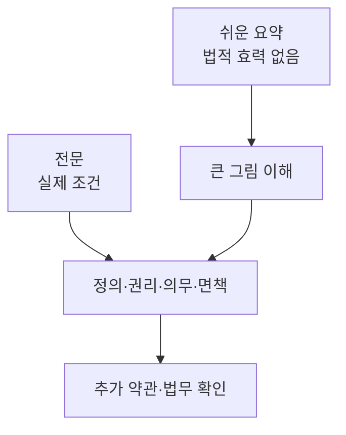
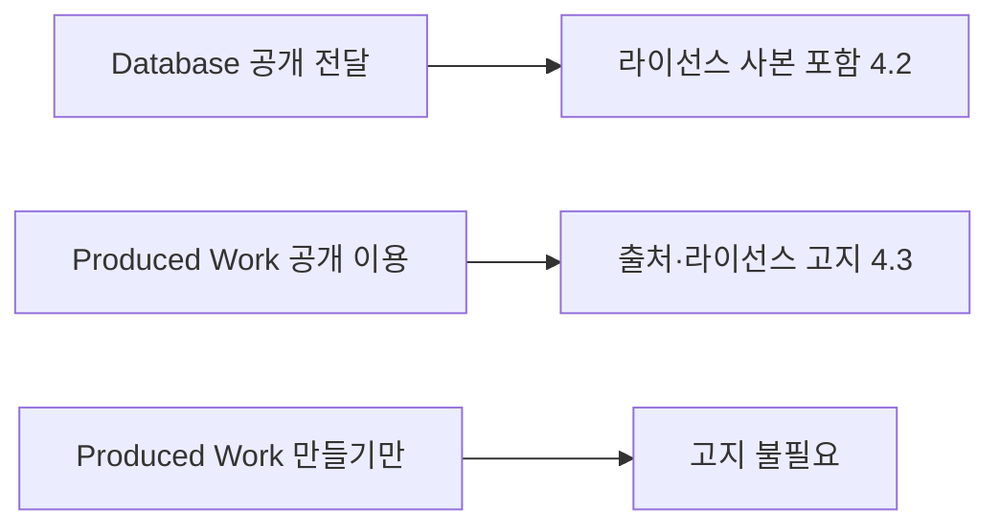

# 라이선스 요약과 전문

> 라이선스 사이트의 "쉬운 요약(summary)"은 이해를 돕는 안내일 뿐 **법적 효력이 없고, 실제 조건은 전문(legal text)이 정한다.** 요약만 읽고 판단하면 놓치는 조건이 생긴다. (법률 자문이 아니다.)

## 쉽게 말하면
가전제품의 "간단 사용 설명" 카드는 편하지만, 보증 범위와 책임은 약관 전문에 적혀 있다. 분쟁이 나면 전문이 기준이다.

## 자세히
- **요약의 지위**: ODbL 요약 페이지는 이 요약이 참고용이고 법적 가치가 없으며 라이선스 자체에는 들어 있지 않다고 밝힌다. CC BY-SA 4.0 설명 페이지도 요약에 법적 효력이 없으니 법적 코드를 검토하라고 안내한다(둘 다 직접 읽음).
- **ODC-By 1.0 전문에서 요약이 생략하기 쉬운 것들**(전문 페이지 직접 읽음):
  - **정의(1.0)**: Database는 체계적으로 배열된 자료의 모음, Contents는 그 안의 정보·저작물, Produced Work는 Contents의 전부 또는 **상당 부분**을 검색·질의로 이용해 만든 작업물, **Publicly**는 본인과 본인이 통제하는 사람(과반 지분이나 활동 지시 권한) 외의 사람을 가리킨다.
  - **권리(3.1)**: 전 세계·무상·비독점이며 "상업적 이용을 명시적으로 포함"한다. 해지는 9조에서만 가능.
  - **고지 의무(4.2·4.3)**: 데이터베이스나 파생 데이터베이스를 공개 전달하면 라이선스 사본(또는 URI)을 포함하고 기존 저작권·라이선스 고지를 유지. Produced Work를 만드는 것 자체는 고지 불필요하지만, 그것을 공개 이용하면 출처와 라이선스를 알리는 고지를 붙여야 한다(예시 문구는 "Contains information from DATABASE NAME which is made available…").
  - **보증 부인(7.1)**: "있는 그대로" 제공이며 무보증. 일부 법역에서는 이 배제가 적용되지 않을 수 있다.
- **요약과 전문이 어긋날 때**: 전문이 기준이다. 요약의 짧은 문구("출처 표시")는 4.2와 4.3처럼 상황별로 다른 의무를 한 줄로 줄인 것이다.
- Open Data Commons 스스로 자신들은 로펌이 아니며 중요한 판단은 관할 지역의 법률 전문가와 상의하라고 안내한다(전문 페이지 하단 고지).
- 읽는 요령(제안): 요약으로 큰 그림 → 전문에서 정의 → 부여 권리 → 의무(고지·공유) → 면책 순으로 확인하고, 해당 데이터셋의 추가 약관(예: Common Crawl 약관)도 함께 본다([FineWeb 이용 조건](#fineweb-license-terms)).

## 그림으로 보기

## 예시
| 행위 | ODC-By 전문 기준 |
|---|---|
| 데이터베이스 사본 재배포 | 라이선스 사본·고지 유지 |
| 질의로 만든 결과물 공개 이용 | 출처 고지 필요 |
| 결과물을 내부에서만 사용 | 공개 이용이 아니면 고지 불필요(전문 확인) |
- 업무 장면: 교육 자료에 데이터셋에서 뽑은 통계 차트를 실을 때 "Contains information from …" 형태의 출처 문구를 달아도 되는지 법무에 확인한다.

## 헷갈리는 것과 비교
| 개념 | 차이 |
|---|---|
| 요약 | 이해용 안내, 법적 효력 없음 |
| 전문 | 구속력 있는 조건 |
| [Share-alike](#share-alike) | 전문·요약 모두 확인해야 하는 대표 조건 |
| [FineWeb 이용 조건](#fineweb-license-terms) | 라이선스 + 추가 약관 읽기 사례 |

## 더 읽을거리
- [ODC-By 1.0 전문](https://opendatacommons.org/licenses/by/1-0/) — 정의·권리·고지·보증 부인(직접 읽음).
- [ODbL 요약](https://opendatacommons.org/licenses/odbl/summary/) — 요약이 법적 효력 없음을 명시(직접 읽음).
- [CC BY-SA 4.0 설명](https://creativecommons.org/licenses/by-sa/4.0/) — 설명서와 법적 코드의 구분(직접 읽음).
