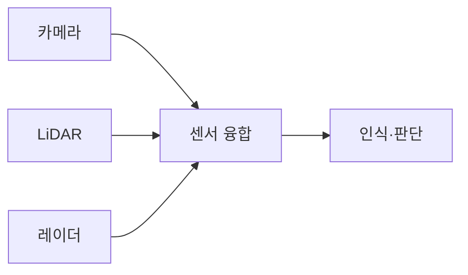
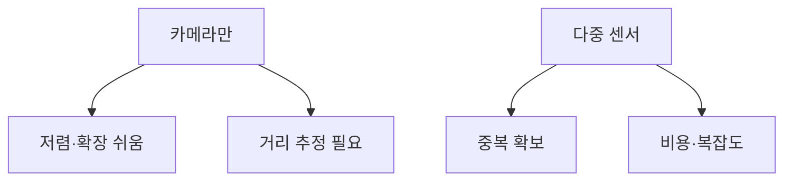

# LiDAR vs 카메라 방식

> 자율주행 센서 구성의 두 철학. **다중 센서(카메라+LiDAR+레이더)**로 중복을 확보하는 Waymo식과 **카메라만** 쓰는 Tesla식의 차이.

## 쉽게 말하면
어둠 속에서 눈만 믿고 걷는 사람과, 눈에 손전등과 지팡이까지 챙긴 사람의 차이다. 눈만으로 가능하다는 쪽은 싸고 확장이 쉽다고 하고, 다 챙기는 쪽은 한 센서가 틀려도 다른 센서가 잡아 준다고 한다.

## 자세히
- Waymo 페이지(열람 2026-11-28): Jaguar I-PACE에 **카메라 29개**(360° 시야, 낮·저조도), 차 둘레의 **LiDAR**(레이저 반사로 3D 지도), **밀리미터파 레이더**(거리·속도, 비·안개·눈에서도 동작 주장). 서버급 CPU·GPU로 실시간 처리. 6세대 하드웨어는 2026-02 블로그를 참조(내용은 확인 못 함).
- Tesla 문서(검색 결과 기준): FSD (Supervised)는 전·후·좌·우에 설치된 카메라 입력으로 주변을 인식. 운전자는 상시 주의하고 넘겨받을 준비를 해야 하며, 카메라 오염·비·희미한 차선이 성능에 영향을 줄 수 있다고 경고. 레이더를 뺀 순수 비전 노선은 중복성 부족 비판이 있다(IEEE Spectrum 등 오래된 기사).
- 트레이드오프: LiDAR는 거리 정확도가 높지만 비싸고 장치가 큰 편이다. 카메라는 싸고 정보가 풍부하지만 거리를 추정해야 하고 조명·날씨에 민감.
- 구성이 다르면 운영 방식도 다르다: Waymo는 무인 로보택시(레벨 4), Tesla 문서는 운전자 감독 전제([SAE 레벨](#sae-levels)). 어느 쪽이 "낫다"는 단정은 근거가 부족하다.

## 그림으로 보기

## 예시
- 한밤 역광 상황: 카메라는 눈부심, LiDAR는 거리 윤곽을 비교적 안정적으로 제공.
- 교육: "한 데이터원에 의존 vs 교차 검증"을 업무 AI의 출처 검증에 빗대어 설명.

## 헷갈리는 것과 비교
| 개념 | 차이 |
|---|---|
| LiDAR | 레이저로 3D 거리 측정 |
| 레이더 | 전파로 거리·속도 측정 |
| [종단간 주행](#end-to-end-driving) | 센서 이후 처리를 한 신경망으로 하는 방식, 센서 선택과는 별개 |

## 더 읽을거리
- [Waymo Driver](https://waymo.com/waymo-driver/) — 센서 구성(읽음, 회사 설명).
- [Tesla FSD 지원](https://www.tesla.com/support/fsd) — 검색 결과로 감독 요구 확인.
