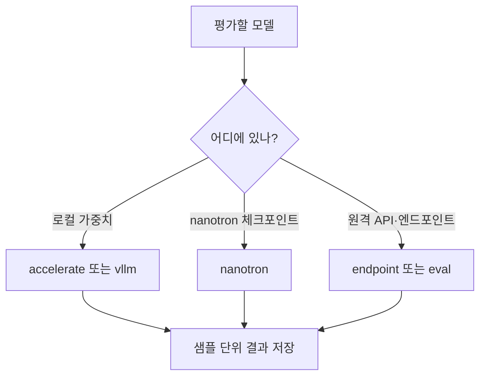

# lighteval 백엔드 선택

> lighteval은 평가를 **여러 "백엔드"(모델을 돌리는 방식)**로 실행할 수 있게 해 준다. 어떤 백엔드를 고르느냐에 따라 속도·필요 장비·원격/로컬 여부가 달라진다.

## 쉽게 말하면
같은 시험지를 교실(로컬 GPU), 대형 시험장(분산 클러스터), 온라인 시험(원격 API)에서 볼 수 있다. 시험지(벤치마크)는 같고 시험 방식만 다르다. 장소에 따라 속도와 비용이 달라진다.

## 자세히
(Hugging Face `lighteval` GitHub README를 직접 읽음. 아래 명령은 README에 있는 것만 적었고 직접 실행하지는 않았다.)
- **무엇인가**: "여러 백엔드에서 LLM을 평가하는 올인원 도구". 원격 서빙 모델이나 메모리에 올린 모델 모두 지원하고, 샘플 단위 결과를 저장해 디버깅할 수 있다. 지식·수학·코드·채팅 평가·다국어·핵심 NLU 영역의 **1,000개 넘는 과제**가 있다.
- **진입점(백엔드)**:
  | 명령 | 백엔드 | 쓸 때 |
  |---|---|---|
  | `lighteval eval` | inspect-ai | README가 권장하는 기본 진입점 |
  | `lighteval accelerate` | 🤗 Accelerate | CPU 또는 GPU 1개 이상에서 Transformers 모델 실행 |
  | `lighteval nanotron` | Nanotron | nanotron으로 학습한 체크포인트 분산 평가 |
  | `lighteval vllm` | vLLM | GPU에서 빠른 서빙 엔진으로 평가 |
  | `lighteval sglang` | SGLang | SGLang 서빙 엔진 사용 |
  | `lighteval endpoint` | Inference Endpoints·TGI·LiteLLM·Inference Providers | 원격 서버/API 모델 평가 |
  | `lighteval custom` | 사용자 정의 | 직접 만든 모델 래퍼 |
- **README 예시**: `lighteval eval "hf-inference-providers/openai/gpt-oss-20b" gpqa:diamond`. 파이썬 API로는 Transformers 모델을 `TransformersModel.from_model`로 감싸 `Pipeline`으로 `gsm8k`를 평가한다.
- **설치**: `pip install lighteval`(extras는 문서 참조), 허브에 결과를 올리려면 `hf auth login`. Windows는 미검증·미지원, Mac·Linux 기대.
- **고르는 기준(제안)**: ① 내 모델이 로컬 가중치인가 원격 API인가 ② GPU 수와 속도 요구(대량 평가는 vLLM 계열) ③ 학습 프레임워크(nanotron 체크포인트면 `nanotron`) ④ 결과 재현을 위해 **같은 백엔드·같은 설정을 비교 전체에 고정**(백엔드가 다르면 생성 방식·배치·정밀도 차이로 점수가 달라질 수 있음, 일반 설명).
- **한계**: README에 `accelerate` 사용 예시 명령, 과제 파일 형식, 다중 GPU 설정은 없다. 공식 문서(huggingface.co/docs/lighteval)를 확인한다.

## 그림으로 보기



## 예시
| 상황 | 후보 진입점 |
|---|---|
| 노트북에서 소형 모델 확인 | `accelerate` |
| 학습한 nanotron 체크포인트 | `nanotron` |
| 호스팅된 모델 비교 | `endpoint`/`eval` |
```bash
lighteval eval "hf-inference-providers/openai/gpt-oss-20b" gpqa:diamond   # README 예시
```
- 업무 장면: 데이터 ablation 모델 10개를 같은 `vllm` 설정으로 평가해 점수 차이가 백엔드 차이가 아니라 데이터 차이에서 오게 한다.

## 헷갈리는 것과 비교
| 개념 | 차이 |
|---|---|
| 백엔드 | 모델을 돌리는 방식 |
| 과제(task) | 평가 내용(gsm8k 등) |
| [nanotron·lighteval](#nanotron-lighteval) | 두 도구의 상위 개요 |
| [ablation 실험 설계](#ablation-experiment-design) | 평가 설정을 고정하는 원칙 |

## 더 읽을거리
- [huggingface/lighteval (GitHub)](https://github.com/huggingface/lighteval) — 백엔드와 CLI(README 직접 읽음).
