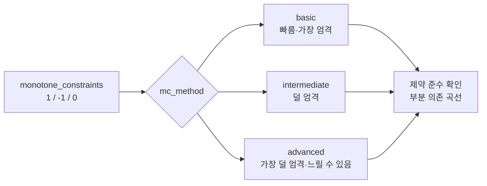

# LightGBM 단조 제약 방식

> LightGBM의 `monotone_constraints_method`는 단조 제약을 트리 학습에 적용하는 세 가지 방식(`basic`, `intermediate`, `advanced`)이다. 문서는 `basic`이 가장 빠르지만 가장 엄격하고, `advanced`가 가장 덜 엄격하지만 느릴 수 있다고 설명한다.

## 쉽게 말하면
"이 변수는 오르면 점수도 올라야 한다"는 규칙을 지키는 방법이 세 가지 있다. 가장 단순한 방법은 규칙을 지나치게 조심스럽게 적용해 모델 자유도를 많이 깎는다. 더 정교한 방법은 규칙은 지키면서 덜 깎지만 계산이 더 든다.

## 자세히
출처: LightGBM 공식 Parameters 문서(본문 확인)와 **직접 실행한 합성 데이터 실험**(lightgbm 4.7.0, 2026-11-18). 실험은 장난감 수준이며 실제 데이터의 결론이 아니다.
- **파라미터(문서)**: `monotone_constraints`(별칭 `mc`)는 변수마다 1(증가)·−1(감소)·0(제약 없음)을 모든 변수에 대해 순서대로 적는다. `monotone_constraints_method`(별칭 `mc_method`, 기본 `basic`)는 제약을 걸었을 때만 쓰인다.
- **세 방식(문서)**: `basic`은 학습 속도 저하가 없지만 예측을 과도하게 제약한다. `intermediate`는 속도를 아주 조금 늦출 수 있으나 제약이 훨씬 덜하고 결과가 눈에 띄게 좋아질 것으로 기대된다. `advanced`는 가장 덜 엄격하지만 더 느릴 수 있다.
- **`monotone_penalty`(문서)**: 기본 0.0. 트리 앞쪽 X 수준(내림)에서 단조 분할을 금지하고 깊이에 따라 패널티를 연속적으로 높인다. 0이면 패널티 없음.
- **제약**: 문서는 "범주형 변수에 대해서는 출력을 단조 제약할 수 없다"고 명시한다.
- **직접 실험**: 데이터 4,000개(학습 3,000/검증 1,000), 변수 3개, `y = 3·x0 − 2·x1 + A·sin(12·x0) + 0.3·x2 + 잡음(σ=0.3)`. x0 증가·x1 감소 제약, 5개 시드 평균. 결과:

| 설정 | RMSE (A=0.5) | RMSE (A=1.5) | 학습 시간(초) |
|---|---|---|---|
| 제약 없음 | 0.3193 | 0.3244 | 0.17 |
| basic | 0.3288 | 0.8345 | 0.17~0.18 |
| intermediate | 0.3283 | 0.8352 | 0.18~0.19 |
| advanced | 0.3288 | 0.8355 | 0.26~0.29 |

- **관찰**: ①이 장난감 데이터에서는 세 방식의 RMSE 차이가 거의 없었다. 문서가 말한 "intermediate가 basic보다 크게 낫다"는 효과는 재현되지 않았다. ②`advanced`가 약 1.6배 느렸다. ③진짜 관계가 비단조일수록(A=1.5) 제약 때문에 RMSE가 0.32 → 0.83으로 크게 올랐다. ④첫 실험(시드 0)에서 제약 없는 모델은 x0 격자 상 감소 구간이 평균 약 59곳 나타났고 세 제약 모델은 0이었다. 제약은 설정대로 지켜졌다.
- **해석(제안)**: 방식 선택의 차이는 데이터 구조에 따라 달라지므로 자사 데이터로 세 방식을 비교한다. 성능이 크게 떨어지면 가정이 틀렸는지 점검한다([제약과 성능 트레이드오프](#constraint-performance-tradeoff)).

## 그림으로 보기


## 예시
```python
import lightgbm as lgb
model = lgb.LGBMRegressor(
    monotone_constraints=[1, -1, 0],         # x0 증가, x1 감소, x2 자유
    monotone_constraints_method="intermediate",
    monotone_penalty=0.0,
    n_estimators=300, learning_rate=0.05)
model.fit(X_train, y_train)
```
점검: x0만 격자로 바꿔 예측해 감소 구간이 없는지 센다([부분 의존 곡선 점검](#partial-dependence-check)).

## 헷갈리는 것과 비교
| 개념 | 차이 |
|---|---|
| `mc_method` | 제약을 적용하는 알고리즘 방식 |
| `monotone_penalty` | 트리 앞쪽 분할에서 단조 분할을 억제 |
| [단조 제약 설정법](#monotone-constraints) | 두 라이브러리의 파라미터 개요 |
| XGBoost 단조 제약 | 별도 구현, `monotone_constraints`만 있음 |

## 더 읽을거리
- [LightGBM Parameters](https://lightgbm.readthedocs.io/en/latest/Parameters.html) — `monotone_constraints`, `monotone_constraints_method`, `monotone_penalty`
- [단조 제약 설정법](#monotone-constraints) — 이 지도의 개요 노드
