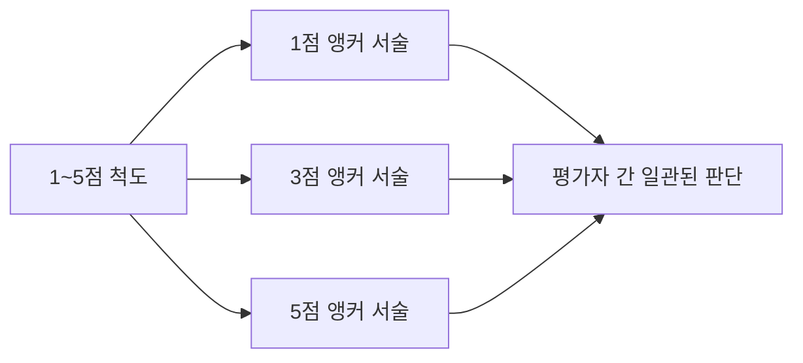
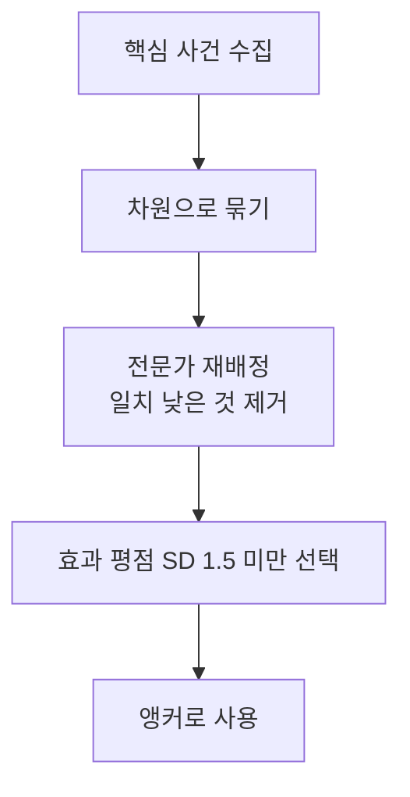

# 척도 기준 문장 (anchors)

> 1~5점 같은 척도의 각 점수(특히 양끝)가 무엇을 뜻하는지 구체적 서술이나 행동 예시로 고정해 두는 것. 평가자(사람·LLM)마다 "3점"의 의미가 달라지는 것을 줄인다.

## 쉽게 말하면
"3점 = 보통"이라고만 쓰면 사람마다 다르게 읽는다. "3점 = 요청한 세 가지 중 두 가지를 정확히 수행하고 한 가지는 빠짐"처럼 쓰면 채점자가 달라도 같은 기준으로 판단하기 쉽다.

## 자세히
출처는 위키백과 "Behaviorally anchored rating scales"(BARS, 열람, 2차 출처)와 CheckEval 초록(열람)이다.
- **BARS의 정의**: 보통 5~9점의 수직 척도로, 숫자 척도를 좋음·보통·나쁨 수행의 "구체적 서술 예시"에 묶는다. 각 척도 점에 그 수준을 보여 주는 구체적 직무 행동 예가 붙는다.
- **앵커 만드는 순서(문서)**: 효과적·비효과적 행동 사례를 핵심사건 기법이나 과업 분석으로 모은다 → 사례를 묶어 수행 차원으로 정의 → 전문가가 사례를 차원에 다시 배정하고 일치가 낮은 것(흔히 50~75% 기준)을 버림 → 전문가가 남은 행동의 효과를 5~9점으로 평가 → 표준편차 1.50 미만인 행동만 앵커로 사용.
- **장점과 한계(문서)**: 그래픽 평정 척도의 주관성 비판에 대응해 행동·수행을 더 정확히 평가하도록 설계됐고 우수한 평가법으로 여겨진다는 설명이 있다. 다만 한 검토는 강점이 행동 대 숫자 앵커가 아니라 수행 차원을 모으는 방식에 있을 수 있다고 본다. 한계로는 여전히 신뢰도가 낮을 수 있고, 관대 편향이 나타날 수 있으며, 차원 간 변별 타당도가 부족할 수 있다.
- **LLM 심판과의 연결(해석)**: CheckEval 논문은 기존 LLM 심판의 평가 불일치를 "주관적 평가 기준과 리커트 점수의 결합" 탓으로 본다(초록). 따라서 척도를 유지하더라도 각 점수의 기준을 문장으로 고정하는 것이 한 가지 대응이 될 수 있다. 이 효과를 직접 시험한 논문은 이번에 확인하지 못했다.
- **실무 팁(일반 관행)**: 양끝(1점·5점)을 서술문으로 먼저 정하고, 중간 점수는 "양끝 사이"가 아니라 관찰 가능한 행동으로 쓴다. 예시 답변을 점수별로 붙여 보정 세션을 한다.

## 그림으로 보기

## 예시
- 답변 근거성 척도 앵커 예: 5점 = 모든 주장에 근거 구절이 붙음, 3점 = 주장의 절반만 근거 있음, 1점 = 근거 없음(예시용).
- 교육 실습: 같은 답변 5개를 앵커 없는 척도와 앵커 있는 척도로 각각 채점해 평가자 간 점수 차이를 비교.

## 헷갈리는 것과 비교
| 개념 | 차이 |
|---|---|
| 척도 기준 문장 | 점수별 의미를 서술로 고정 |
| 앵커 없는 리커트 | 숫자만 제시 |
| [이진 체크리스트 평가](#binary-checklist-eval) | 점수제 대신 예/아니오 항목 |
| BARS | 행동 예시를 앵커로 쓰는 전통적 방법 |

## 더 읽을거리
- [Wikipedia: Behaviorally anchored rating scales](https://en.wikipedia.org/wiki/Behaviorally_anchored_rating_scales) — 정의·개발 순서(열람, 2차 출처)
- [CheckEval (arXiv 2403.18771)](https://arxiv.org/abs/2403.18771) — 리커트와 모호한 기준 문제(초록 열람)
