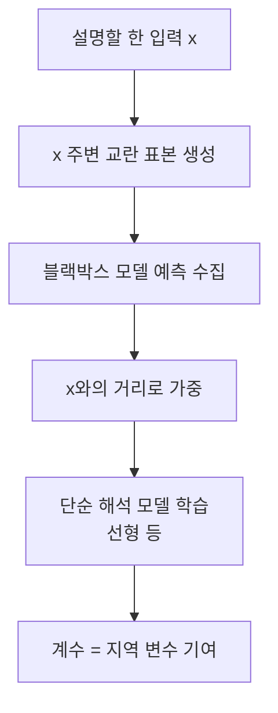

# LIME

> Local Interpretable Model-agnostic Explanations. 어떤 분류기든 **한 예측 주변**에서 단순한 해석 가능 모델(예: 선형 모델)을 맞춰, 그 예측을 설명하는 방법. 모델 종류를 가리지 않는 지역 설명이다.

## 쉽게 말하면
복잡한 곡선의 한 점 근처만 확대하면 거의 직선처럼 보인다. LIME은 그 점 근처에서 직선(단순 모델)을 그려 "이 근처에서는 이 변수가 이만큼 영향을 준다"고 말한다. 곡선 전체를 설명하는 것은 아니다.

## 자세히
출처: Ribeiro·Singh·Guestrin, "Why Should I Trust You?: Explaining the Predictions of Any Classifier"(arXiv 1602.04938, 2016-02 제출, 2016-08 개정, 초록 열어서 읽음). 이 세션에서 `pip install lime`은 빌드에 실패해 직접 실행해 보지 못했다.
- **핵심 아이디어(초록)**: 어떤 분류기든 각 예측 주변에서 **해석 가능한 모델을 지역적으로 학습**해 설명한다. 설명이 "해석 가능하면서 모델에 충실(interpretable and faithful)"하다고 주장한다.
- **모델 요약**: 설명이 붙은 **대표 예측을 소수 선택**해 모델의 전체 그림을 주는 방법도 제안한다. 이 선택은 부분 모듈러(submodular) 최적화 문제로 정식화했다.
- **적용(초록)**: 텍스트 분류기(랜덤 포레스트 등)와 이미지 분류기(신경망)에 시연했다.
- **평가(초록)**: 시뮬레이션과 사람 대상 실험에서 신뢰 관련 과제, 즉 예측을 믿을지 결정, 모델 선택, 믿을 수 없는 분류기 개선, 분류기를 믿으면 안 되는 이유 파악을 수행했다.
- **동작 방식(일반 설명, 초록 서술이 아님)**: 설명할 입력 주변에서 입력을 교란한 표본을 만들고, 교란 표본에 대한 원 모델의 예측을 받은 뒤, 원 입력과의 거리에 가중해 단순 모델을 맞춘다. 단순 모델의 계수가 변수별 기여다.
- **한계(일반 설명 + 다른 출처)**: 교란 표본이 실제 데이터 분포와 다르면 설명이 왜곡될 수 있고, 이를 악용해 설명을 속일 수 있다는 연구가 있다([LIME·SHAP 속이기](#fooling-lime-shap)). 같은 입력도 표집이 달라 설명이 흔들릴 수 있다(직접 확인하지 못함).
- **SHAP과의 관계**: Lundberg·Lee는 LIME을 포함한 기존 6개 방법을 하나의 가법적 특성 중요도 부류로 통합했다고 주장한다([전역 vs 지역 설명](#global-vs-local-explanation)).

## 그림으로 보기

## 예시
- 텍스트 분류: 스팸으로 분류된 메일에서 어떤 단어가 스팸 쪽으로 미는지 단어별 가중치 표시.
- 점검: 지역 단순 모델이 해당 근방에서 원 모델 예측을 얼마나 잘 따라 하는지(지역 적합도)를 같이 본다.

## 헷갈리는 것과 비교
| 개념 | 차이 |
|---|---|
| LIME | 예측 주변에 단순 모델을 맞추는 지역 설명 |
| SHAP | Shapley 값에 기반한 기여 배분, 이론적 성질을 강조 |
| [사후 설명의 정확도 검증](#post-hoc-explanation-validity) | LIME 같은 설명의 충실도 문제 |
| [LIME·SHAP 속이기](#fooling-lime-shap) | 설명 조작 연구 |

## 더 읽을거리
- ["Why Should I Trust You?" (arXiv 1602.04938)](https://arxiv.org/abs/1602.04938) — LIME 원논문 초록(열어서 확인)
