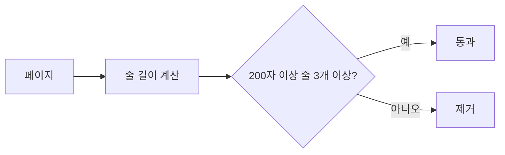
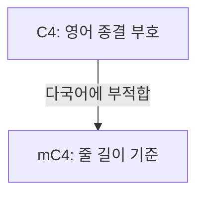

# 줄 길이 필터

> 영어 구두점 규칙(문장 끝 마침표) 대신 "200자 이상인 줄이 3줄 이상 있는가"로 본문 페이지를 가려내는 다국어용 필터다. mC4가 사용했다.

## 쉽게 말하면
메뉴·목록·버튼 문구는 짧은 줄이 많고, 진짜 글은 긴 줄이 몇 개 있다. 문장부호 대신 "긴 문단이 있나"를 본다.

## 자세히
(mT5 논문 arXiv 2010.11934 3.1절을 직접 읽고 확인.)
- **배경**: C4의 핵심 규칙 중 하나는 영어 종결 부호(마침표 등)로 끝나지 않는 줄 제거. 많은 언어가 영어식 종결 부호를 쓰지 않아 mC4에는 부적합.
- **mC4의 대체**: 페이지에 **200자 이상인 줄이 3개 이상** 있어야 통과(이름: line length filter).
- 나머지 C4 규칙(문서 간 줄 중복 제거, 나쁜 단어 포함 페이지 제거)은 유지했다.
- **ablation**: XNLI zero-shot 정확도 표에서 mT5-Large 기준선 81.1, "줄 길이 필터 없음" 79.1(−2.0). 단, 이 표는 ablation 여러 항목 중 하나로 시드 변동 등은 논문에서 별도 확인 필요.
- 한계(제안): 200자는 문자 체계에 따라 정보량이 다르다(한·중·일 한 글자 vs 알파벳). 글자 수 기준 임계값을 언어별로 조정할 필요가 있을 수 있다.

## 그림으로 보기

## 예시
- 한국어 뉴스 페이지(긴 줄 다수)는 통과, 메뉴만 있는 쇼핑 목록 페이지는 탈락.
- 교육 활용: 영어 중심 규칙이 다른 언어에서 어떻게 깨지는지 보여 주는 사례.

## 헷갈리는 것과 비교
| 개념 | 차이 |
|---|---|
| 줄 길이 필터 | 긴 줄 개수로 본문 판별 |
| 종결 부호 필터(C4) | 줄이 마침표로 끝나는지 |
| [Gopher 휴리스틱](#gopher-quality-heuristics) | 단어 수·기호 비율 등 다른 규칙 |

## 더 읽을거리
- [mT5 (arXiv 2010.11934)](https://arxiv.org/abs/2010.11934) — 3.1절과 ablation 표.
