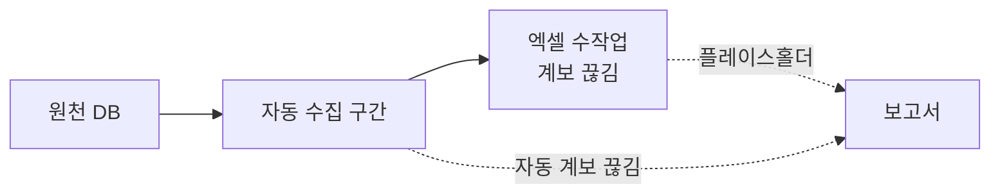
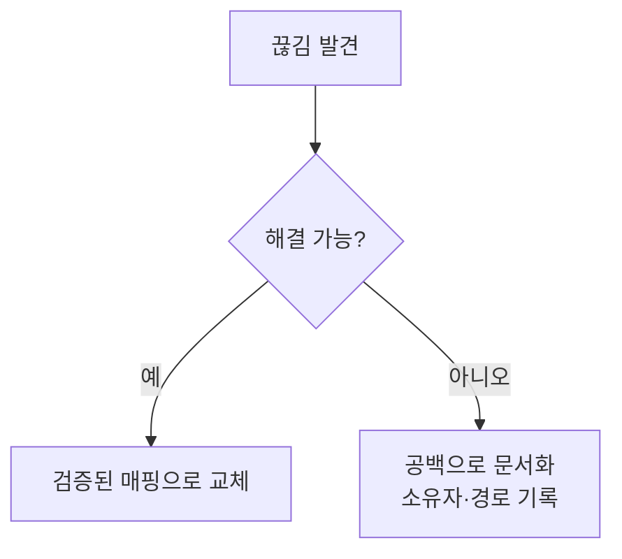

# 계보의 끊김

> 자동 수집이 닿지 않는 **수작업 단계·스프레드시트·연결기가 없는 옛 시스템** 때문에 계보 그래프가 중간에서 끊기는 문제다. 끊긴 구간은 "원인을 모른다"가 아니라 "모른다는 사실을 기록해야 할 곳"이다.

## 쉽게 말하면
택배 추적이 "분류센터 도착"에서 멈췄다. 물건은 사람이 손으로 옮겼기 때문에 스캐너 기록이 없다. 그 뒤 구간은 추적 불가다. 추적이 끊긴 지점을 표시해 두면 적어도 어디부터 사람에게 물어봐야 하는지 알 수 있다.

## 자세히
(Alation 발표 블로그 2026-08과 oneuptime 글을 직접 읽었다. Dagster 비교 가이드는 열었으나 해당 내용이 없었다. 아래 나머지는 검색 요약이라 표시했다.)
- **끊김의 원인(일반 원칙)**: ① 사람이 엑셀·CSV로 내보내 가공하는 구간 ② 연결기(커넥터)가 없는 옛 앱·틈새 앱 ③ 코드 내부를 알 수 없는 블랙박스 변환 ④ 수집기 권한 부족으로 빠진 간선. oneuptime 글도 "오래된 간선, 수집기 권한으로 빠진 간선, 개발/운영 이름 충돌이 오도할 수 있다"고 경고한다.
- **수작업 문서의 문제(검색 요약, 직접 확인 못 함)**: 수작업 계보는 쓴 날의 파이프라인을 반영해 금방 낡는다는 Dagster 비교, 수작업 추적이 거짓 안심을 줘 문서가 없는 것보다 위험할 수 있다는 Collibra의 주장이 소개된다. 모두 벤더 관점이다.
- **Alation "Critical Lineage"의 대응(직접 읽음, 벤더 발표)**:
  - **스프레드시트를 카탈로그 객체로 등록**: 담당자가 플랫폼을 지정하고 핵심 데이터를 매핑하면 계보 그래프 안의 관리 대상이 된다.
  - **Application Register**: 커넥터가 없는 시스템(옛 앱 포함)을 연결된 소스와 함께 기록해 시스템 수준의 지도를 만든다.
  - **플레이스홀더 계보**: 도메인 전문가가 없을 때 임시 노드를 두고 추적을 이어 간다. 나중에 검증된 매핑으로 바꾸거나(변경은 버전 이력에 기록), 문서화된 공백으로 남긴다.
  - **하나의 그래프**: 수작업·플레이스홀더·자동 계보를 한 버전 관리 그래프에 두고, 각 노드의 출처를 추적한다.
- **한계(글에서 인정)**: 자동 계보를 대체가 아니라 보완한다. 플레이스홀더는 완전한 매핑이 아니며 "무엇이 빠졌고 누가 해결을 맡고 해결 경로가 무엇인지"를 남긴 책임 있는 기록일 뿐 공백은 해결 전까지 열려 있다. 글은 작업량·해결 기간을 수치로 보이지 않는다. GA 2026-08-13, Alation Cloud Service 고객 대상, 소비 단위 필요(홍보성 정보).
- **OpenLineage로 이음새 만들기(검색 요약)**: IBM 쪽 설명에 OpenLineage 호환 소스에서 데이터 흐름을 정의·연결하는 사용자 정의 계보가 있다고 한다(직접 확인 못 함).
- **실무 원칙(일반)**: 끊김은 지우지 말고 `알 수 없음` 간선으로 표시, 소유자와 해결 기한을 붙인다. 수작업 단계는 가능하면 스크립트화하거나 수집 가능한 위치(공유 테이블)에 쓰게 바꾼다.

## 그림으로 보기

## 예시
- 재무팀이 ERP 추출 CSV를 엑셀에서 가공해 BI에 올리는 구간: 엑셀을 카탈로그에 등록하고 입력·출력 열을 매핑, 담당자 지정.
- 교육 소재: "AI 답변의 근거를 따라갔더니 누군가의 엑셀에서 끊긴다면?"

## 헷갈리는 것과 비교
| 개념 | 차이 |
|---|---|
| 계보의 끊김 | 추적이 중간에서 끊긴 상태 |
| [계보 그래프로 원인 찾기](#lineage-graph-debugging) | 끊김이 있으면 확신도를 낮춰야 하는 대상 |
| [OpenLineage](#openlineage) | 자동 수집 규격, 이음새에 쓸 수 있음 |
| 플레이스홀더 노드 | 공백을 책임 있는 기록으로 남기는 방법 |

## 더 읽을거리
- [Alation Critical Lineage 발표 (2026-08)](https://www.alation.com/blog/critical-lineage-end-to-end-governance/) — 스프레드시트·플레이스홀더로 공백을 다루는 벤더 방식.
- [How to Use Data Lineage to Find the Root Cause of a Broken Dashboard](https://oneuptime.com/blog/post/2026-09-08-lineage-root-cause-broken-dashboard/view) — 끊김·낡은 간선이 오도하는 사례와 "명시적 공백" 권고.
