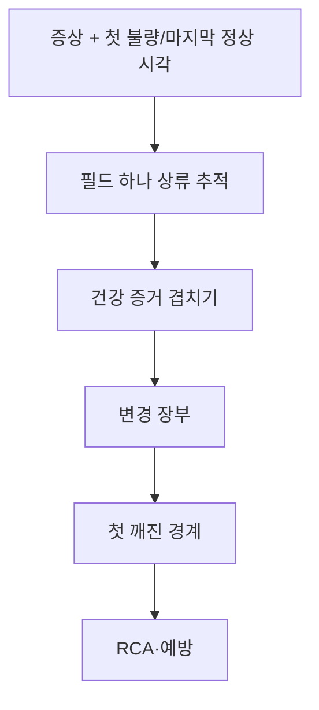

# 계보 그래프로 원인 찾기

> 대시보드나 모델 입력의 이상한 숫자에서 출발해 **계보(lineage) 그래프를 상류로 거슬러 올라가며**, 올바르던 지점과 처음 틀어진 지점 사이의 경계에서 원인 후보를 좁히는 디버깅 방법이다.

## 쉽게 말하면
수돗물이 탁하면 집 수도꼭지에서 출발해 배관을 거슬러 올라가며 "여기는 맑고 여기부터 탁하다"를 찾는다. 배관 도면이 계보 그래프다. 도면이 원인을 말해 주지는 않지만, 어디부터 봐야 하는지를 한 구간으로 줄여 준다.

## 자세히
(oneuptime 블로그와 Atlan 안내서를 직접 읽었다. 둘 다 벤더·서비스 블로그라 제품 홍보가 섞여 있다. 그림은 일반 원칙에 가깝다.)
- **트리아지 vs RCA(Atlan)**: 트리아지는 가장 유력한 실패 지점을 찾고, 근본 원인 분석(RCA)은 왜 생겼고 재발을 막으려면 무엇을 바꿀지 설명한다. 같은 계보 경로를 쓰되 RCA는 증거와 예방에 집중한다.
- **작업 순서(oneuptime, 2026-09-08 글)**
  1. **증상을 구체화**: 실패 유형(갱신 실패, 빈 시각화, 잘못된 값, 누락 필드, 낡은 데이터, 부분 범위, 권한 오류), 대시보드·필드·필터 상태, **처음 나쁜 시각과 마지막 정상 시각**을 기록한다.
  2. **안정적 ID로 시작**: 표시 이름이 아닌 플랫폼 ID, BI 메타데이터부터 물리 연결까지 경로 확인. 권한이 부족하면 빈 결과가 나올 수 있다.
  3. **대시보드 전체가 아니라 필드 하나를 추적**: 영향받은 지표만 열 단위로 상류 전개하되 조인·필터·윈도우 로직 같은 간접 영향도 포함. 테이블 수준 계보만 있으면 확신을 낮추고 후보를 넓힌다.
  4. **노드·간선에 건강 증거를 겹침**: 실행 상태·시간, 코드 버전, 스키마 버전, 신선도, 행 수, null 비율, 파티션 상태. 사고 시점 기준(as-of) 뷰로 본다.
  5. **변경 장부**: 마지막 정상과 첫 불량 사이의 스키마 게시·배포·작업 실행·갱신을 시간순으로 나열하고 거꾸로 걷는다. 이상 신호는 필드 경로 위에 있고 창 안에서 바뀌고 정확한 범위를 설명하고 증상을 재현하고 수정 후 회복돼야 후보에서 원인이 된다.
  6. **첫 깨진 경계 찾기**: 상류는 맞고 하류가 처음 틀린 지점에서 멈춘다. 값·조인 키·영향 세그먼트까지 확인.
  7. **품질 검사로 국소화**: 파티션 도착, 행·키 수, 조인 null 비율, 원천 합계 대조. 통과가 정확성의 증명은 아니다(null 검사는 잘못된 환율 변환을 못 잡는다).
- **글의 예**: `net_revenue` 지표가 01:00 갱신 후 EMEA에서 0. 변경 장부: 00:42 스키마 게시, 00:51 코드 배포, 01:00 변환 작업이 01:07에 끝났고 행 수가 93% 감소. 원천 물량은 정상이라 첫 깨진 경계는 변환 `build_daily_orders`.
- **주의(글)**: 초록색 실행이 데이터 정확성을 보장하지 않는다. 오래된 간선·수집기 권한으로 빠진 간선·개발/운영 이름 충돌이 오도할 수 있다. 간선마다 수집 시각·생성 주체·신뢰도를 표시하고, 완전해 보이는 추측보다 **명시적 미해결 공백**이 안전하다.
- **Atlan 한계 정리**: 열 단위 계보가 항상 필요하진 않다. 계보는 최신으로 유지돼야 하고, 소유자·정의가 없으면 "누가 움직일지"는 안 보인다.

## 그림으로 보기

## 예시
- 매출 대시보드의 지역 값이 0이 됐을 때 증상 시각을 적고, 해당 지표 열을 상류로 따라가 직전 배포·스키마 변경과 행 수 감소가 겹치는 변환 단계를 찾는다.
- 교육 소재: 정답을 모르는 상태에서 "어디서부터 틀렸나"를 이진 탐색하듯 좁혀 가는 연습.

## 헷갈리는 것과 비교
| 개념 | 차이 |
|---|---|
| 계보 그래프 디버깅 | 상류로 거슬러 경계를 찾는 방법 |
| 영향 분석(impact analysis) | 하류로 무엇이 깨지는지 보는 방향 |
| [OpenLineage](#openlineage) | 계보 데이터를 모으는 규격 |
| [계보의 끊김](#lineage-gaps-manual-steps) | 이 방법이 막히는 대표 원인 |

## 더 읽을거리
- [How to Use Data Lineage to Find the Root Cause of a Broken Dashboard (oneuptime)](https://oneuptime.com/blog/post/2026-09-08-lineage-root-cause-broken-dashboard/view) — 7단계 절차와 예(직접 읽음).
- [How To Use Data Lineage To Triage Data Quality Issues (Atlan)](https://atlan.com/know/how-to-use-data-lineage-to-triage-data-quality-issues/) — 트리아지 vs RCA(직접 읽음, 벤더).
