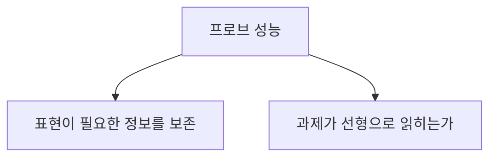

# 선형 프로브

> 선형 프로브(linear probe)는 **이미 학습된 모델의 표현(임베딩)을 얼러 두고(동결), 그 위에 선형 층 하나만 새로 학습**하는 방식이다. 표현이 얼마나 쓸모 있는지 재거나, 적은 비용으로 분류·회귀기를 만들 때 쓴다.

## 쉽게 말하면
이미 똑똑한 번역가가 문장을 숫자 요약으로 바꿔 주고, 우리는 그 요약표를 보고 "교육적인가?"를 점수로 매기는 계산식(선형식)만 새로 만든다. 번역가는 건드리지 않는다.

## 자세히
- 실제 사례(HuggingFace FineWeb-Edu 분류기 모델 카드, 열람): 임베딩 모델 **Snowflake-arctic-embed**에 **회귀 출력 하나짜리 분류 헤드**를 붙이고 **임베딩·인코더 층을 동결한 채** 헤드만 학습했다(Llama-3 주석 약 45만 개, 20 에폭, 학습률 3e-4). 사용 시에는 단일 로짓을 점수로 쓰고 `int(round(max(0, min(score, 5))))`로 0~5 정수 점수로 만든다([루브릭을 프롬프트로](#rubric-to-prompt)). 큰 모델을 통째로 미세조정하는 것보다 학습·배포가 가볍다.
- **직접 해 본 토이 실험(교훈이 있는 음의 결과)**: scikit-learn `load_digits`(8×8 숫자)에서 **숫자 0~4만으로 학습한 MLP의 은닉층(64개)을 동결 인코더**로 삼고, **처음 보는 숫자 5~9**를 구분하는 로지스틱 회귀 프로브를 학습했다(시험 40%, 10개 시드 평균). 비교: 원본 픽셀에 같은 로지스틱 회귀, 무작위 가중치로 만든 동결 특징.
  | 클래스당 학습 예 | 원본 픽셀 | 동결 인코더 특징 | 무작위 동결 특징 |
  |---|---|---|---|
  | 3개 | **0.844** | 0.716 | 0.804 |
  | 10개 | **0.930** | 0.872 | 0.904 |
  | 30개 | **0.962** | 0.942 | 0.943 |
- 읽는 법: **동결 표현이 원본 픽셀보다 나빴다.** 이유(추정): ① 숫자 8×8 픽셀은 이미 선형으로 잘 분리되어 표현이 더 해 줄 일이 없다 ② 인코더가 0~4 구분에 맞춰 학습돼 5~9에 필요한 정보를 **버렸다**(전이가 안 된다). 무작위 특징이 학습된 특징보다 나은 것이 이를 뒷받침한다. 즉 **프로브 성능 = 표현이 새 과제에 필요한 정보를 얼마나 보존하느냐**이며, 사전학습 표현이 항상 이기는 것은 아니다.
- 선형 프로브의 용도: ① **표현 평가**(프로브 정확도가 높을수록 선형으로 읽히는 정보가 풍부) ② **저비용 분류기**(헤드만 학습) ③ 소량 라벨 상황. 한계: 선형 층은 표현이 비선형으로 담은 정보를 못 읽고, 동결 표현이 과제와 어긋나면 성능이 제한된다. 이 경우 일부 층을 풀어 미세조정한다(제안).
- 점검 습관(제안): 프로브를 쓰기 전에 **원본 특징 기반 기준선**과 비교하고, 임베딩 모델 선택을 표본으로 평가한다([임베딩 모델 선택](#embedding-model-choice)).
- 한계: 토이 실험은 소형 MLP·8×8 숫자라 대형 사전학습 모델의 결과를 대표하지 않는다.

## 그림으로 보기



## 예시
```python
Z = encoder.encode(texts)            # 동결 임베딩
probe = LogisticRegression().fit(Z, labels)   # 선형 프로브
```
- 교육: "사전학습 표현을 믿기 전에 기준선과 비교한다" — 위 음의 결과를 학습 사례로 사용.

## 헷갈리는 것과 비교
| 개념 | 차이 |
|---|---|
| 선형 프로브 | 인코더 동결, 선형 헤드만 학습 |
| 전체 미세조정 | 모든 가중치 학습 |
| 부분 미세조정 | 위쪽 일부 층만 풀어 학습 |
| 특징 추출 | 임베딩을 뽑아 다른 모델에 입력(프로브의 일반형) |

## 더 읽을거리
- [fineweb-edu-classifier 모델 카드](https://huggingface.co/HuggingFaceFW/fineweb-edu-classifier) — 동결 임베딩+회귀 헤드(읽음).
- 직접 실행: scikit-learn 숫자 데이터 프로브 3조건 비교.
